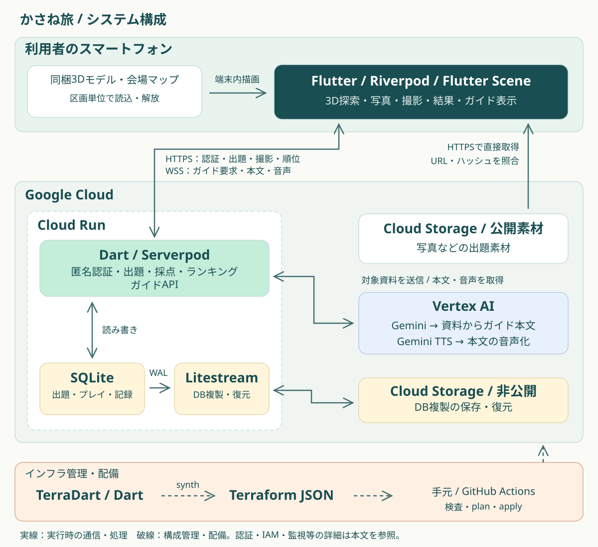

# かさね旅


**一枚の写真から、誰かが見た景色をたどる。**

**Flutter Sceneで歩く3D観光体験を、UI・バックエンド・インフラまでDartでつくる。**

かさね旅（旧称 PhotoHunt／万博フォトハント）は、訪問者の写真を手がかりに3D空間を歩き、同じ撮影視点を探すAndroid／iOS向け観光アプリです。最初の対象は大阪・関西万博。現地に行けなかった人には場所を知る入口を、訪れた人には記憶をたどりながら建築の特徴を見つめ直す体験を目指します。

DevFest GDGoC Japan Hackathon 2026の観光カテゴリ向けに開発しています。仕様・設計判断の正本は [`docs/specs.md`](docs/specs.md) です。

[特長](#特長注力したこと) · [画面](#画面プレビュー) · [アーキテクチャ](#アーキテクチャ) · [起動手順](#ローカルで起動する) · [APK作成](#android-apkを作成配布する) · [品質確認](#テスト品質)

## 解決したい課題

現地を訪れられなかった人や、閉幕後に関心を持った人にも、その場所の魅力を発見する入口をつくりたい。訪れた人には、思い出の景色を別の角度から見つめ直してほしい。かさね旅は、写真と説明を読む体験に「同じ視点を探す」という観察の目的を加えます。

舞台は、実在する**大阪・関西万博の会場と英国パビリオン**。写真と3Dモデルで柱・屋根・建物の重なりを比較し、撮影者のエピソードや建築の背景に触れる体験です。「視点を自分で変えることが、場所への理解や関心につながる」という仮説を検証します。

かさね旅が目指す「追体験」は、写真に残された他者の視点を、自分で探してたどることです。写真には、撮影者がその場所で選んだ立ち位置と構図が残っています。その視点に3D空間で近づくために、柱の並びや屋根、建物の重なりを見比べる。「同じ景色を探す」という目的が、建築を観察するきっかけになります。撮影後には、写真に添えられたエピソードを通じて、撮影者が何に惹かれたのかにも触れます。

最初の舞台に選んだのは、閉幕した大阪・関西万博です。開催当時の会場を、そのまま訪れることはできません。写真と3Dモデルを重ねることで、訪れた人には記憶をたどる機会を、行けなかった人には誰かの視点から場所を知る入口をつくります。

| 想定する利用者 | 体験の入口 |
| --- | --- |
| 万博を訪れていない人・建築に初めて触れる人 | 「ゴール周辺探索」で、撮影地点の近くから構図の比較を始める |
| 万博を訪れた人・会場に詳しい人 | 「自由探索」で、入口から記憶を手がかりに歩く |

名前の「かさね」には、**写真と3D、撮影者と自分、過去と今の体験を重ねる**意味を込めています。

## 特長・注力したこと

### Flutter Sceneで、Flutterの画面から3D空間へ

このアプリの中心は、Flutter Sceneによる**端末内の3D探索**です。写真パネル・地図・操作UIと3D空間を一つのFlutterアプリで扱い、写真の構図を自分の移動とカメラ操作で再現します。区画ごとの読込・詳細度の切替・不要モデルの解放まで実装し、実在する会場のモデルをスマートフォンで扱うことに取り組んでいます。

### UI・API・インフラまで、フルスタックDart

FlutterでUI、ServerpodでAPI、TerraDartでインフラを記述しています。共通のDTOと幾何ロジックをsharedに置き、Dartの型をアプリとサーバーの境界でも使います。

| 採用技術 | このプロジェクトで選んだ理由 |
| --- | --- |
| Flutter / Flutter Scene | Android・iOSのUIと3D表示をFlutterの構成内で扱い、写真・地図・ガイドを探索画面に統合するため |
| Serverpod | Dartで認証・採点・保存を実装し、生成クライアントと型付きRPC／streamでアプリへつなぐため |
| TerraDart | Cloud RunやIAMなどの構成もDartで定義し、Terraformのplan／applyで変更を管理するため |
| Riverpod / Freezed | 機能ごとの依存・状態の寿命を管理し、画面状態を不変データとして扱うため |
| mise monorepo | 5つのconfig rootのツール版・依存取得・検査コマンドを一つの入口から管理するため |

### 設計と開発環境も、体験を支える実装として

アプリは画面・ViewModel・機能別Provider・プレイ制御の責務を分け、APIはpresentation／application／domain／infrastructureのレイヤーに分離しています。外部サービスの詳細を採点規則に持ち込まず、生成DTO・DBの行・画面状態を別の型として扱います。設計上の境界と参照実装を[仕様書](docs/specs.md#リポジトリ内の責務)に記録しています。

Dart 3.13を前提とし、Primary Constructor、パターンマッチ、switch式などを実装で採用しています。例えば[採点用の不変値と採点処理](api/lib/src/domain/services/shot_scorer.dart)ではPrimary Constructorを使い、保持する値と依存をクラス宣言で示しています。記法の方針も[プロジェクト規約](.agents/skills/flutter-rule/modern-dart-syntax/SKILL.md)で共有しています。

Docker Compose、fake-gcs-server、seed投入、ガイドのfake実装を揃え、API・素材取得を含めて手元で再現できる開発環境を用意しています。セットアップ・起動・検査は下記のmiseタスクから実行できます。

## 体験の流れ

1. **探索を始める** — 入口から歩く「自由探索」と、撮影地点の近くから始める「ゴール周辺探索」を選びます。
2. **写真の視点を探す** — 写真と会場マップを見ながら移動し、柱・屋根・建物の重なりを比較します。
3. **シャッターを切る** — サーバーが撮影位置・向きの近さを採点します。
4. **写真と体験を重ねる** — お手本の視点・実際の写真・撮影者のエピソード・固定解説を見て、自己ベストをランキングで比較します。

探索中には「この辺りを解説」から、周辺の構造物の資料に基づく説明文・音声を生成するガイド機能もあります。匿名ログインで利用し、GPSによる現在地の取得は行いません。点数は撮影視点の近さを表し、文化理解や学習成果を評価するものではありません。

提出対象は1区画・1写真・2モードです。他の観光地やVRへの展開は将来の検討で、現在の対応端末はAndroid／iOSです。

## 公開用ブランチの設定

`public` はコードフリーズした `main` を基に、公開用の設定とデータを整理したブランチです。
課金アカウントID（`000000-000000-000000`）とApple署名チームID（`XXXXXXXXXX`）はサンプルです。
クラウドへ配備する前に `infrastructure/terradart/bootstrap/lib/env.dart` の課金アカウントを設定し、
iOS実機向けに署名するときはXcodeで自分のTeamを選んでください。
APIテスト用のサンプルは `api/test/fixtures/seeds/` に置き、本番用の `content/` には含めません。

## プライバシーへの配慮

匿名ログインで利用し、GPSによる実際の現在地は取得しません。撮影やガイドに使う座標は、**アプリ内の3D空間の位置**です。ゲーム内の撮影は端末のカメラで周囲を撮影する操作ではなく、3Dのカメラ姿勢を確定する操作です。

匿名アカウントでもプレイ記録・自己ベストなどはサーバーに保存されます。AIガイドでは、選択した構造物の登録資料をサーバーからVertex AIへ送ります。実際に扱うデータと保存範囲は[仕様書](docs/specs.md)に記載しています。現在のガイドは日本語対応です。

## アーキテクチャ



発表資料と同じ構成を、リポジトリで更新できるSVGで掲載しています。実線は実行時の通信・処理、破線は構成管理・配備です。3Dモデルと探索用の会場マップは端末に同梱し、写真などの出題素材は公開Cloud Storageから直接取得します。端末がVertex AIやDBへ直接接続することはありません。

| 領域 | 技術・役割 |
| --- | --- |
| アプリ | Flutter・Riverpod・Flutter SceneによるUI、3D描画、移動・撮影操作 |
| API | Dart／Serverpod。匿名認証、出題、撮影・採点、ランキング、ガイドの配信 |
| 保存 | SQLiteとLitestream。Cloud Storageへの複製と起動時の復元、単一writer制御 |
| 素材・ガイド | 同梱会場マップとCloud Storage上の出題素材。Vertex AI Geminiで説明文、Gemini TTSで音声を生成 |
| 実行基盤 | Cloud Run、Secret Manager、Cloud Logging。TerraDartで構成を管理 |

### 端末内の3D描画と状態管理

Flutter Sceneで3D空間を端末内に描画します。[SceneTileStreamer](app/lib/usecase/scene/scene_tile_streamer.dart)はプレイヤーに近い区画からモデルを読み込み、距離に応じて詳細モデルと簡略モデルを切り替えます。遠ざかった区画は描画から外し、共有キャッシュの参照を解放します。同時読込数にも上限を設け、会場全体の高精細モデルを常時保持する負担を抑えています。

Riverpodで機能ごとの状態と依存関係を管理し、ViewModelが画面の状態・操作を扱います。[PlayController](app/lib/usecase/play/play_controller.dart)がプレイ中の位置・向き・進行状態を管理し、描画・ガイド・撮影が同じ姿勢を参照します。Serverpodの生成クライアントとsharedの公開DTOを使い、FlutterとAPIの間で型を共有します。

### アプリ（Flutter）のレイヤー構成

Flutterアプリは、機能別のレイヤードアーキテクチャで実装しています。画面・画面状態・機能別の状態と通信・プレイ／3Dのロジック・データモデルの責務を分け、3D描画や撮影、API通信のような複雑な処理を整理しています。配置の決まりは[仕様書の「リポジトリ内の責務」](docs/specs.md#リポジトリ内の責務)を正としています。

```text
app/lib/
├── main.dart / app.dart   # エントリポイント
├── router/                # go_routerによる画面遷移
├── ui/                    # 画面ごとの screen.dart・view_model.dart・components/
├── provider/              # Riverpodによる機能別の状態・通信・保存
├── usecase/               # プレイ（移動・カメラ・衝突）、3Dシーン、地図投影
├── model/                 # アプリ専用の不変データ型（Freezed）
└── utils/                 # 共通の小さな部品
```

| レイヤー | 責務 | 代表ファイル |
| --- | --- | --- |
| Screen／components | 画面の組み立てと表示。ViewModelの値を表示し、操作を通知する | [ui/exploration/screen.dart](app/lib/ui/exploration/screen.dart) |
| ViewModel | 画面固有の状態（読み込み・パネル・エラー表示の文言）を持ち、ProviderやUseCaseを呼ぶ | [ui/exploration/view_model.dart](app/lib/ui/exploration/view_model.dart) |
| Provider | 機能ごとの状態と副作用（生成クライアントによるAPI呼び出し、端末への保存）。SDKの例外を画面で扱える失敗に変換する | [provider/play/provider.dart](app/lib/provider/play/provider.dart) |
| UseCase | 移動・カメラ回転・衝突判定・地図投影などのロジックと、3Dシーンの資源の寿命 | [usecase/play/play_controller.dart](app/lib/usecase/play/play_controller.dart) |
| Model | アプリ専用の不変データ型。RPC・Widget・日本語の表示文言を持たない | [model/play/model.dart](app/lib/model/play/model.dart) |

依存の向きは `Screen → ViewModel → Provider／UseCase → Model` です。ViewModelは機能別ProviderのNotifierと、PlayController・SceneAdapterを呼びます。Screenが座標の補正・採点・RPCを直接実行することはありません。APIとの間の公開DTOは独自に定義し直さず、sharedの生成型を使います。

**状態管理**：Riverpod（`hooks_riverpod`）とコード生成（`riverpod_generator`）で、機能別のProviderとNotifierを型安全に作ります。`provider/<機能>/provider.dart` に、認証・出題・プレイ・素材・手がかり写真・ガイド・ランキング・プロフィールなどの状態をまとめています。

| 画面 | 役割 |
| --- | --- |
| mode_select | 自由探索／ゴール周辺探索の選択、自由探索の入口の選択、モード別の自己ベストと順位 |
| exploration | 3D空間を歩き、写真の視点を探して撮影するメイン画面。地図・手がかり写真・AIガイド |
| result | 採点結果、自分の撮影とお手本の3D・実写写真の比較、撮影後の解説 |
| ranking | 出題版・モード別のランキング |
| settings | ニックネーム、出典・クレジット |

- **端末では採点しない**：撮影時は位置と向きを送るだけで、点数・自己ベスト・順位はサーバーが確定します。画面には結果DTOの値を表示します。
- **素材の検証とキャッシュ**：3Dモデルと探索用の会場マップはアプリに同梱します。出題の写真・地図は[素材の取得処理](app/lib/provider/assets/provider.dart)がSHA-256・サイズ・形式を検証してから端末に保存し、再利用します。
- **匿名認証**：Serverpodの匿名ログインだけを使い、登録フォームはありません。GPSなどの位置情報は取得しません。
- **最新のDart記法**：Dart 3.13のPrimary Constructorなどを使い、定型のコードを減らしています。

### 撮影・採点と素材の整合性

撮影時には3D空間内の位置と向きをHTTPS RPCで送信します。採点は画像認識ではなく、[ShotScorer](api/lib/src/domain/services/shot_scorer.dart)による正解姿勢との比較です。水平位置の距離、左右の向き（yaw）、上下の向き（pitch）の差から0〜1000点を算出し、正解姿勢は撮影成立後に返します。正式な採点・自己ベスト・順位の確定はサーバーが担当します。

出題は不変の版（revision）に紐づけ、写真・座標・固定解説・採点条件を揃えます。APIから受け取る素材参照にはURL・SHA-256・サイズ・MIMEが含まれ、[素材検証処理](app/lib/provider/assets/validation.dart)で取得先とファイルの整合性を検証します。移動を毎フレーム送信する構成ではなく、撮影やガイド要求時に姿勢を送る構成です。取得済み素材での探索は継続できますが、撮影確定・順位・新規ガイドには通信が必要です。

### 資料に基づくAI音声ガイド

「この辺りを解説」を押すと、次の順序で本文と音声を届けます。

1. プレイID・位置・向きを送り、サーバーがセッションの所有者・有効期限・歩行範囲を確認します。
2. 登録された構造物から位置・向きに応じた対象を選び、その対象の資料をGeminiへ渡して日本語の短い説明文を生成します。資料にない事実や撮影の正解位置を加えないよう、システム指示を分離しています。
3. ServerpodのWSS streamで本文を先に返し、確定した本文をGemini TTSで音声化します。音声はWAVを分割して同じstreamで配信するため、音声の準備を待たずに本文を読めます。
4. 本文の生成に失敗した場合は登録済みの固定文へ切り替え、音声生成に失敗した場合は本文を残します。ガイドの障害で撮影の進行を止めない構成です。

画面を閉じる・アプリが背景へ移る・別プレイへ移行する際は、購読と音声再生を終了します。本文・音声をDBやGCSに永続キャッシュせず、生成の起点は利用者の操作に限定しています。対象選択は登録データの距離・方向に基づくため、画面内の物体を画像認識しているわけではありません。実装は[対象選択](api/lib/src/application/usecase/prepare_nearby_guide.dart)、[本文生成](api/lib/src/infrastructure/gemini/gemini_guide_text_generator.dart)、[音声生成](api/lib/src/infrastructure/gemini/gemini_guide_speech_generator.dart)を参照してください。

### SQLiteをCloud Runで運用する仕組み

SQLiteはCloud Runコンテナ内に置き、Litestreamで非公開Cloud Storageへ複製します。コンテナの起動時にはwriterの所有権を取得してDBを復元し、終了時には所有権を解放します。書き込みの成功応答はSQLiteのcommitだけで返さず、[永続化ゲート](api/lib/src/infrastructure/database/replication/serial_persistence_gate.dart)を通じてLitestreamの複製完了を確認してから返します。

この構成は**単一writerが前提**です。APIを複数writerへ水平拡張する設計ではなく、所有権管理と復元・複製によってCloud Runの一時的なファイルシステムを補います。公開素材・非公開DB複製・seed入力のバケットを分離し、実行用サービスアカウントやSecret Managerの権限はインフラ側で管理します。

### Dartによるインフラ管理

[TerraDart](infrastructure/terradart/README.md)でbootstrap／stackの構成をDartとして定義し、Terraform JSONへ変換してplan／applyします。Cloud Run、管理用Jobs、Cloud Storage、IAM、Secret Managerなどをコードで管理し、GitHub Actionsの検査・配備経路につなげています。ローカルではDocker Composeとfake-gcs-server、ガイドのfake実装を使い、本番のVertex AIを呼ばずに開発できます。

詳細な制約・設計判断は[仕様書](docs/specs.md)、リソース・IAM・配備手順は[インフラ設計](docs/infrastructure.md)を参照してください。冒頭のキービジュアルは作品のコンセプトを表すイラストで、実際のゲーム画面ではありません。

## リポジトリ構成

| パス | 内容 |
| --- | --- |
| `app/` | Flutterアプリと同梱3D素材 |
| `api/` | Serverpod API、DB、migration、seed CLI |
| `api/client/` | Serverpodが生成するクライアント。手動編集しない |
| `shared/` | 公開DTOと純Dartの共通ロジック |
| `content/` | 出題・施設のseed、素材と来歴 |
| `infrastructure/local/` | Docker ComposeとGCS emulatorによる開発環境 |
| `infrastructure/terradart/` | Google Cloudの構成管理 |
| `docs/` | 仕様、設計、接続手順、検証記録 |

`api` / `app` / `shared` / `infrastructure/local` / `infrastructure/terradart` を [mise](https://mise.jdx.dev/) のmonorepoとして管理します。

## 前提

- mise `2026.11.0` 以上（`mise.toml` の `min_version`）
- Docker（ローカル環境・API イメージのビルドで使う）
- iOSで動かす場合：macOS、Xcode、iOS Simulator
- Androidで動かす場合：Android SDK、JDK、エミュレーターまたは実機

Flutter／Dartなどの版はmiseで固定しています。OSごとの開発環境は別途用意し、`cd app` のうえで `mise exec -- flutter doctor -v` で不足を確認してください。

## セットアップ

```sh
mise trust --all   # ルートと各 config root の mise.toml を信頼する
mise install --monorepo   # mise.lock で固定したツールを全 config root 分入れる
mise setup         # 全プロジェクトの依存を取得する
```

- Dart の版は project ごとに指定できる。`app` は Flutter 同梱の Dart、`api` / `shared` は各 `mise.toml` の `[tools] dart` で固定する。

## ローカルで起動する

初回はリポジトリのルートで次を実行します。Dockerを起動しておいてください。

```sh
cp infrastructure/local/.env.example infrastructure/local/.env.local
mise //infrastructure/local:up
mise //infrastructure/local:seed
mise //app:run:local ios
```

`.env.local` がすでにある場合はコピーし直さず、既存の設定を使います。`up` はAPI・GCS emulator・DBの準備、`seed` は英国パビリオン出題（`uk-pavilion/r5`）の登録・公開を行います。既存データの更新や出題の切替は、[ローカル環境の手順](infrastructure/local/README.md#4-seed-の投入)を参照してください。別の出題が公開中の場合、新しい出題の公開は拒否されます。データを消すresetで回避せず、公開版の切替手順を使います。

```sh
mise //app:run:local ios --device-id <端末ID>  # 複数端末がある場合
mise //app:run:local android                   # Androidエミュレーター
mise //app:run:local device 192.168.0.10        # 同じLAN上の実機（開発PCのIPを指定）
```

Androidエミュレーター・実機では、起動前に `.env.local` の `GCS_PUBLIC_HOST` と `ASSET_BASE_URL` を端末から届くアドレスに合わせて `up` し直します。対応表は[アプリからの接続](infrastructure/local/README.md#5-アプリからの接続)を参照してください。

ローカルのガイドはfake実装で、Vertex AIを呼びません。`run:local` はdebug向けのHTTP素材取得設定を渡します。本番用releaseビルドはHTTPS接続です。

## 本番APIにつないで起動する

デプロイ済み環境と、そのTerraform stateを読み取る権限・Google CloudのADC認証が必要です。準備は[インフラの手順](infrastructure/terradart/README.md)を参照してください。

```sh
mise //infrastructure/terradart:outputs
mise //app:run:prod --device-id <端末ID>
```

`outputs` が生成する `infrastructure/terradart/stack/.terradart/dart_defines.prod.json` を使います。本番接続ではローカルAPIの起動は不要ですが、インターネット接続が必要です。保存するプレイ記録なども本番環境へ反映されます。

## Android APKを作成・配布する

Android開発環境を準備し、上の `outputs` を実行したあと、次で本番API接続のAPKを作成できます。

```sh
cd app
mise exec -- flutter build apk --release \
  --dart-define-from-file=../infrastructure/terradart/stack/.terradart/dart_defines.prod.json
```

出力先は `app/build/app/outputs/flutter-apk/app-release.apk` です。Google Driveなどのチーム用フォルダへアップロードし、閲覧権限のあるメンバーがAndroid端末にダウンロードしてインストールします。ビルドだけでは自動共有されません。iPhoneにはAPKをインストールできません。

現在のAndroid設定は**開発用キーで署名するreleaseビルド**です。テスト配布用として扱い、ストア公開用の署名・配布は [Issue #17](https://github.com/penguins-osaka/gdg_hack/issues/17) で管理します。

## 確認中の事項

- 「この辺りを解説」で説明が出ない場合があります。対象の方位判定と開始地点からの距離の問題を [Issue #213](https://github.com/penguins-osaka/gdg_hack/issues/213) で追跡しています。
- 歩行・カメラ・座標ロジックのapp／shared／API間の統合は [Issue #121](https://github.com/penguins-osaka/gdg_hack/issues/121) で進めます。
- 素材の出典・利用条件と配布範囲は [Issue #3](https://github.com/penguins-osaka/gdg_hack/issues/3) とアプリの「出典・クレジット」で確認します。

最新の対応状況は [Issues](https://github.com/penguins-osaka/gdg_hack/issues) を参照してください。

## 今後の展望

まずは1区画・1写真の体験で、初めての利用者が撮影まで進めるか、写真と3Dの比較からどのような発見が生まれるかを試遊で確かめます。そのうえで、素材の利用条件と位置・向きの対応を確認できる別の観光地・文化施設への展開を検討します。複数コンテンツ、多言語ガイド、VRは将来の検討対象で、現在の提供機能には含めません。

## チーム・AI活用

チームは**ぼちぼちエンジニア**です。コードへの貢献は[GitHub Contributors](https://github.com/penguins-osaka/gdg_hack/graphs/contributors)で確認できます。

プロダクト内でのGemini／Gemini TTSの役割と、開発支援AIの利用・確認範囲を[AI活用の記録](docs/ai-usage.md)に分けて記載しています。

## テスト・品質

採点・歩行範囲・ガイド対象選択などのロジック、画面状態と操作、ガイドの本文・音声・取消処理、インフラ構成をそれぞれ検査します。APIには[レイヤー間の依存を検査するテスト](api/test/unit/architecture_test.dart)も置き、設計上の境界をコードで確認しています。

| 検査 | コマンド | 確認範囲 |
| --- | --- | --- |
| 全体の静的解析・テスト | `mise check` | app／api／shared／TerraDartのlint・test |
| APIの結合確認 | `mise //api:test:integration` | テスト用SQLiteと生成クライアントを使ったAPI連携 |
| 生成物・DB変更の整合性 | `mise //api:check:generated` / `mise //api:check:migration` | 生成クライアント・公開DTO・migrationの更新漏れ |

自動テストと、端末での3D表示・操作・音声の確認は分けて扱います。変更時には差分全体のセルフレビューを行い、実行した検査と未検証事項をPRに記録する運用です。

### よく使うコマンド

```sh
mise //infrastructure/local:up   # ローカル環境を起動（手順は infrastructure/local/README.md）
mise //app:run:local             # アプリをローカル API につないで起動
mise check                       # 全プロジェクトの lint と test
mise tasks ls --all              # 全プロジェクトのタスク一覧
```

`mise check` にAPIのintegrationテストは含まれません。APIの結合確認は `mise //api:test:integration`、生成物・migrationの検査は `mise //api:check:generated` / `mise //api:check:migration` で実行します。

設計の詳細は[仕様書](docs/specs.md)、[インフラ設計](docs/infrastructure.md)、[ガイド接続](docs/guide-app-integration.md)、[プレイ接続](docs/play-app-integration.md)を参照してください。

### タスクの参照記法

| 記法 | 意味 |
| --- | --- |
| `//path:task` | monorepo root からの絶対指定（例 `mise //app:test`） |
| `:task` | 今いる project のタスク（例 `cd app && mise :test`） |
| `//...:test` | 全 project の `test` |

## ツールの版を更新する

`[monorepo] lockfile = true` により、ルートの `mise.lock` で全 project のツールを固定している。

1. 各 `mise.toml` の版（`flutter` / `dart`）を変える、または `mise up` を実行する
2. `mise lock` で `mise.lock` を更新する
3. `mise.lock` の差分（版・checksum・URL）をレビューしてコミットする

## コントリビュート

作業の前提・コマンド・規約は [`AGENTS.md`](AGENTS.md) にまとめている（人間も AI エージェントも同じものを読む）。
Issue は [`.github/ISSUE_TEMPLATE/`](.github/ISSUE_TEMPLATE/) の `task` / `bug`、PR は [`.github/pull_request_template.md`](.github/pull_request_template.md) に沿って書く。
