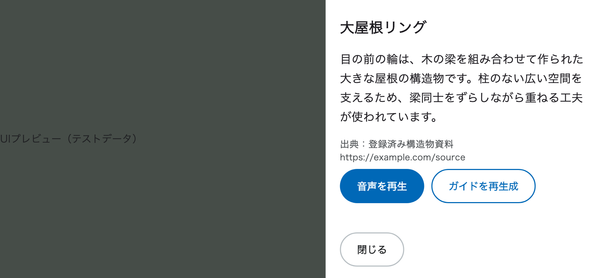

# Flutter 解説パネルの接続（#16 / #13）

## 実装済みの境界

- `provider/api_client/provider.dart`：接続先と生成 `Client` の注入・破棄。機能固有のDTO・接続口を持たない。
- `provider/guide/provider.dart`：同じ `apiClientProvider` の生成Clientから型付きstreamを購読し、順序・サイズ・WAVを検証。一時ファイルとプレイヤーは呼出し単位で所有する。
- `model/guide/model.dart`：Freezedの状態・失敗分類。公開イベントにはsharedの生成DTOを使用する。
- `ui/exploration/view_model.dart`：利用者操作とライフサイクル、失敗分類から日本語への変換。
- `ui/exploration/components/exploration_guide_panel.dart`：右側パネルの表示。本文が長くても閉じる操作はスクロール外に置く。

参照は [handson_pub_dev完成版](https://github.com/pochipochi-tsudoi/handson_pub_dev/tree/6e78ff796f0646eae43609095b7c8a71888e1e88/lib/complete) の `provider/dio/provider.dart` → `provider/package/provider.dart` → `ui/details/view_model.dart` → `screen.dart` / `components/package_header.dart`。
今回も接続 → 機能別生成Notifier → ViewModel → componentsという依存方向を守る。

## #13 から接続するもの

ガイドの通信は `apiClientProvider` の `client.guide.explainNearby` に接続済み。
認証・実プレイの接続は #13（PR #103）の担当範囲とし、mainだけで実プレイが完了するとは扱わない。
ダミー本文・ダミーセッションID・成功扱いの音声は本番経路へ入れない。

1. #13 は同じ `apiClientProvider` のClientに認証を接続する。ガイド用Clientを別に生成しない。
2. `GuideApiClient.release` の標準実装は何もしない。当該購読をcancelすると、固定版Serverpod 4.1.1の `ClientMethodStreamManager` が全購読の有無を確認し、最後の購読なら接続を閉じる。正常終了も同じ管理に従う。ガイドから `closeStreamingMethodConnections()` や共有Clientの `close()` を呼ぶと他の購読を壊すため、呼ばない。アプリ独自の購読数管理も重ねない。
3. `usecase/play/play_controller.dart` の `guideRequestSnapshotProvider` は、PlayControllerの正本から、その瞬間の `ExplainNearbyRequest`（playSessionId / positionX / positionZ / yawDegrees / locale=`ja-JP`）を返す。位置や向きの独自補正はガイドUIに追加しない。
4. 別プレイへの移行・終了と認証主体の変更時は `guideProvider.notifier.close()` を呼び、旧購読だけでなく取得済み音声も破棄する。Client差し替えはProviderの依存更新でも破棄されるが、同じClientの認証変更だけではProviderは再生成されないため、認証側・進行側で明示的に閉じる。
5. #103 のguide接続変更と競合した場合は、本ブランチのSDKによる接続解放を採用する。`release` で全streamを閉じる実装には戻さない。

ガイドを開く／再生成するときだけsnapshotを取得し、Provider入口でDTOをコピーする。背景復帰でRPCや音声を自動再開しない。再生成は本文と音声の組全体を置き換えるため、生成料金が再度発生し得る。

## ローカルでの接続検証

```sh
cd app
mise exec -- flutter test test/provider/guide test/ui/exploration/guide_panel_test.dart test/ui/exploration/guide_view_model_test.dart
```

`client_connection_test.dart` はループバックのWebSocket peerに実際の生成Clientで接続し、認証ヘッダー、2購読の共有、片方だけの取消、最後の終了によるsocket解放、次の接続を検証する。サーバーの業務処理や実Vertex・署名実機の音声を検証するものではない。

再生成の60秒期限には古い購読の解放待ちも含める。期限が過ぎた後から新しい生成RPCを開始しない。

SDK 4.1.1の開始確認前のcancelには通知を取り逃す競合がある（#122）。この場合も画面・音声は即座に無効化し、サーバー終了時のsocket回収をテストしているが、上流の即時停止は保証しない。全streamの強制切断で回避せず、SDK修正は同Issueで追跡する。

## 残る結合確認

- 実APIの本文・対象・出典と、その本文に対応した音声を署名実機で確認する。
- 実プレイの位置・向き・セッションが要求へ渡ることを確認する。
- 他のstreamを併用し、ガイドの取消が他の購読を壊さないことを確認する。
- 閉じる・背景移行・別プレイで実機の音声が止まり、一時ファイルが消えることを確認する。

これらが終わるまで #16 全体の完了とはしない。UIのAI生成ラベル・定型見出し・×の削除は今回のユーザー指定による仕様変更。

## UIプレビュー

以下はWidgetをテストデータで描画したプレビュー。実API・3D描画・実機再生の証跡ではない。


