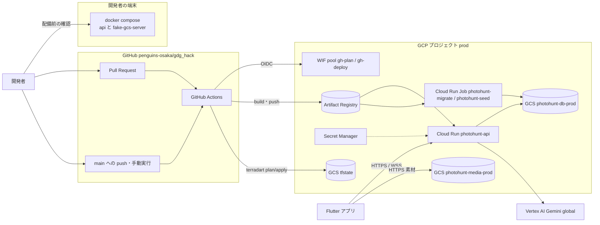
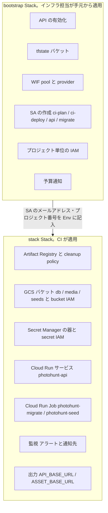
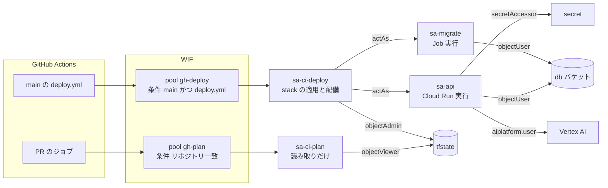
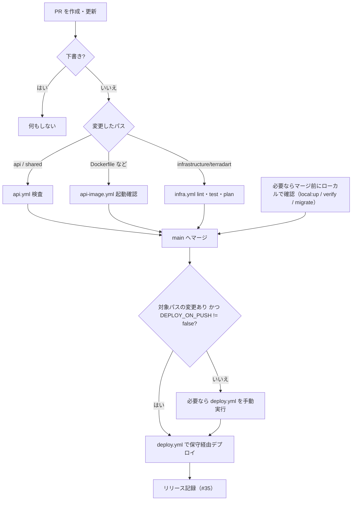
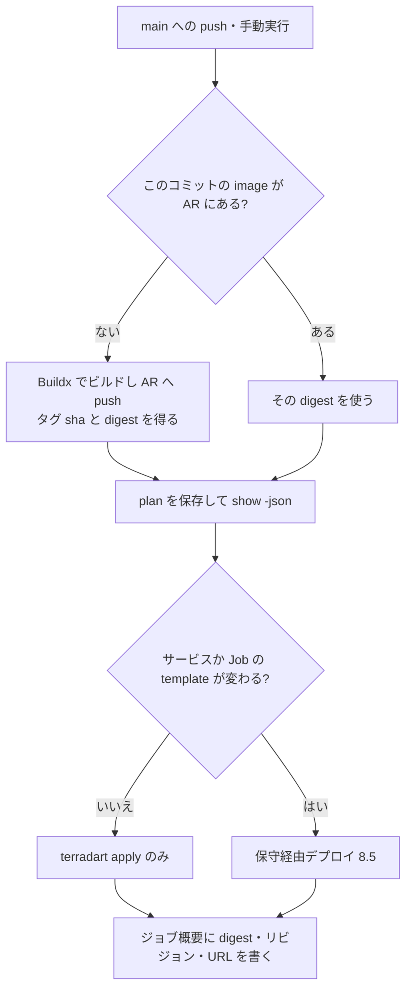
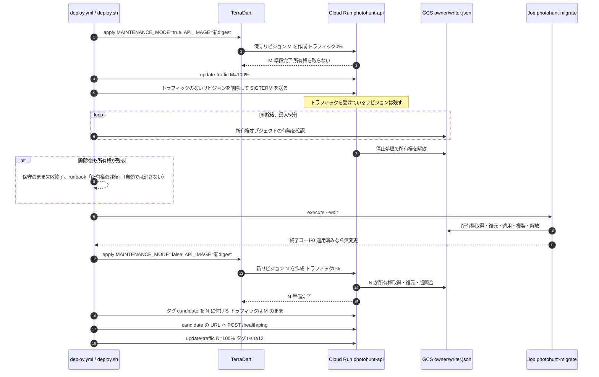
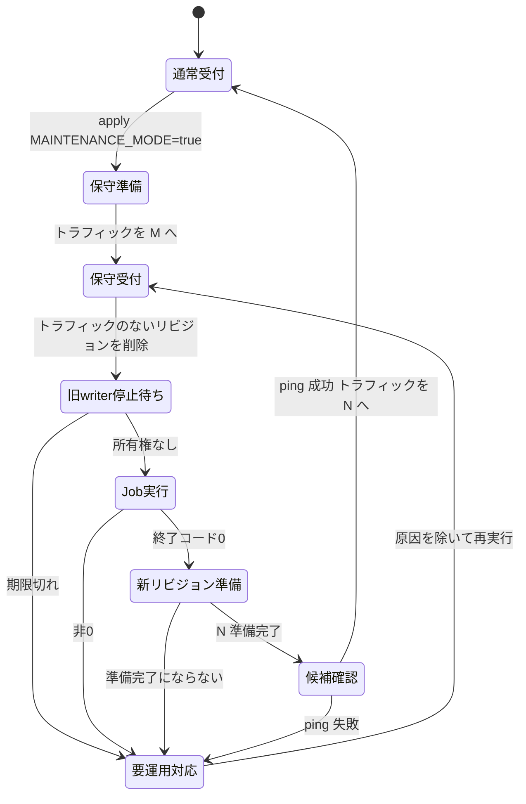

# 万博フォトハント インフラ・CI/CD 設計書

対象 Serverpod API を Google Cloud へ配備するためのインフラ構成（TerraDart）と CI/CD（GitHub Actions）

設計更新日 2026年11月9日

関連 Issue #33（TerraDart）、#34（migration Job・デプロイ手順）、#78（Vertex AI）、#35（結合確認・リリース記録）

## この文書の位置付け

仕様の正本は [`docs/specs.md`](specs.md) とする。
本書は、正本の「クラウド・永続化・運用」「公開・設定・セキュリティ」で決めた内容を、配備の手段（TerraDart の Stack 構成、IAM、GitHub Actions のワークフロー、デプロイ手順）へ落とし込む詳細設計である。
正本の内容は書き写さず、節名で参照する。
正本「TerraDartによる構成管理」は、パッケージ構成・IAM・CI/CD・デプロイ手順の詳細を本書に委ねている。
それ以外で本書の判断が正本と食い違う場合は正本を優先し、食い違いを解消する変更を同じ PR で正本へ入れる。

「採用」は設計判断であり、実装・実証の完了を意味しない。
実証が必要な項目は末尾の「未決事項」（INF-xx）で管理する。

## 1. 範囲

| 対象 | 内容 |
| --- | --- |
| 含む | GCP プロジェクトの初期化（bootstrap）、API 用の Cloud Run サービスと Job、GCS、IAM、Secret Manager、Artifact Registry、監視・予算通知、GitHub Actions による検査・plan・デプロイ、運用手順の骨子 |
| 含まない | アプリ（Flutter）のビルド・署名・配布（#17）、migration CLI の中身（#34）、コンテナの起動順序と所有権の部品（#24、実装済み）、ガイドの実装（#31・#32・#78） |

## 2. 設計方針

| 判断 | 方針 | 理由 |
| --- | --- | --- |
| 環境 | クラウドは `prod` の1環境だけを作る。配備前の検証はローカル環境（`infrastructure/local`）で行う | 期限と費用を優先する。ローカルは本番と同じ api image で、起動順序・復元・同期を確認できる（正本「ローカル開発環境」） |
| IaC | TerraDart（OpenTofu を engine に使う）で全リソースを Dart で定義する | 正本「TerraDartによる構成管理」で採用済み。API・共有コードと同じ Dart で書け、出力を型付きでアプリへ渡せる |
| Stack の分割 | `bootstrap`（人が適用）と `stack`（CI が適用）の2層 | 権限の強い操作（API 有効化・SA 作成・プロジェクト IAM・予算）を CI の資格情報から外す |
| image の指定 | TerraDart の変数で digest を渡し、Cloud Run の template を IaC で管理する | 正本「imageは不変digest」。環境変数・SA・probe と image を同じ plan で確認できる |
| トラフィック | TerraDart では管理しない（`ignoreChanges`）。デプロイ手順で `gcloud` から切り替える | 正本「Job実行とトラフィック切替は構成applyから分離する」 |
| デプロイ方式 | 毎回「保守リビジョン経由」で切り替える。ローリング更新・無停止更新はしない | 単一 writer のため、新旧リビジョンが同時に所有権を持てない（「8.5 デプロイ手順」） |
| 配備の契機 | main への push（API の image に入るもの・`stack`・配備手順が変わったとき）で自動配備する。seed と途中からの再開は手動実行（`workflow_dispatch`）。Variables の `DEPLOY_ON_PUSH=false` で自動配備を止められる | マージ後の配備忘れと手作業をなくす。保守時間はマージの時刻に出るので、審査期間など止めたいときは Variables で切る |
| 切替前の確認 | 新リビジョンをタグ URL で疎通確認してからトラフィックを移す | dev 環境がない分、本番で受付を始める前に新リビジョンを確かめる |
| migration | 保守中に毎回 Job を実行する（適用済みなら無変更で終わる） | 「スキーマ変更の有無」の判定ロジックを CI に持たせない。Job の実行費用は小さい |
| CI の認証 | Workload Identity Federation（WIF）。SA キーは発行しない | 長期の秘密を GitHub に置かない |
| GitHub Actions | 無料枠（private・Free プランで月 2,000 分）に収まるよう、実行条件・ジョブ数・キャッシュを絞る | 「8.1 コスト最適化の方針」 |
| 手順の再現性 | デプロイの各段階を mise タスク（シェル）にし、CI は同じタスクを呼ぶ | 既存の `api.yml` と同じく、手元と CI で同じコマンドを使う。CI が止まっても手元から続きを実行できる |

## 3. 全体構成



アプリから見た実行時の構成（SQLite・Litestream・writer 所有権）は正本「システム構成」の図を正とする。
本書の図は、それを配備・管理する側の構成を示す。

## 4. 環境

| 項目 | 値 |
| --- | --- |
| GCP プロジェクト | `gdg-hack-514011`（番号 88648067616。INF-01） |
| 用途 | 提出・審査・結合確認（#35） |
| リージョン | `asia-northeast1`（Vertex AI は `global`。#78） |
| DB レプリカ | `gs://photohunt-db-prod/litestream/v1` |
| writer 所有権 | `gs://photohunt-db-prod/owner/writer.json` |
| 公開素材 | `gs://photohunt-media-prod` |
| `GUIDE_BACKEND` | `gemini`（`GUIDES_ENABLED=true`。モデル・思考の量・音声 ID は D07（#134）で確定し、`stack/lib/env.dart` に置く） |
| 配備の契機 | main への push（対象パスの変更時）と手動実行（`workflow_dispatch`、main ブランチ） |

バケット名はグローバルで一意である必要があるため、取得できなければ `photohunt-<用途>-prod-<短い接尾辞>` にする（INF-01）。
DB レプリカの prefix（`litestream/v1`）を変えることは、空の DB への切り替えと同じ意味になる。
正本「TerraDartによる構成管理」のとおり、prefix の変更はデータ移行として別に扱い、通常の apply で変えない。

### 検証環境を持たないことの扱い

正本「公開と切り戻し」は「検証用のDB・バケットを本番と分ける。新リビジョンの開発・検証に本番DBを使わない」としている。
クラウドの検証環境は作らず、次の分担で満たす。

| 確認したいこと | 確認する場所 |
| --- | --- |
| API の機能・生成物・migration | `api.yml`（PR）と手元の `mise check` |
| image のビルドと起動 | `api-image.yml`（PR）と `mise //infrastructure/local:up` |
| 所有権・復元・同期・二重起動の拒否 | `mise //infrastructure/local:verify`（fake-gcs-server） |
| スキーマ変更の適用 | `mise //infrastructure/local:migrate`（ローカルのレプリカ） |
| GCS の認証・権限、Vertex AI、保守経由デプロイ | prod の初回構築時（利用者がいない段階）に一通り実施する（12. 実装順序） |
| 新リビジョンの起動 | 配備のたびに、トラフィックを移す前のタグ URL で確認する（8.5） |

ローカルの fake-gcs-server では確認できない項目（GCS の IAM、Litestream の GCS からの復元）は、prod の初回構築で確認する。
提出後の配備でこれらに関わる変更を入れる場合は、保守時間を長めに見込み、利用の少ない時間帯に行う。
正本「公開と切り戻し」も同じ内容に更新済みである。

## 5. TerraDart の構成

### 5.1 2層の Stack



| 層 | 適用者 | state | 理由 |
| --- | --- | --- | --- |
| `bootstrap` | インフラ担当（Owner 相当の利用者認証、`gcloud auth application-default login`） | 初回は `LocalBackend`、tfstate バケット作成後に `terradart state migrate` で `gs://<tfstate>/bootstrap/prod` へ移す | state の置き場所自体と、CI の資格情報を作る層なので CI からは適用できない。SA 作成・プロジェクト IAM・課金の権限を CI に渡さない |
| `stack` | GitHub Actions（`ci-deploy` SA）。緊急時はインフラ担当が手元から同じタスクで適用 | `gs://<tfstate>/stack/prod` | ワークロードの変更は頻繁なので CI に任せる。リソース単位の IAM だけを扱い、プロジェクト IAM を持たない |

`bootstrap` を変える頻度は低い（初回と SA・権限の追加時だけ）。
`stack` が使う SA は `bootstrap` で作り、`stack` では `Env` に書いたメールアドレスで参照する。
これにより `ci-deploy` SA は `iam.serviceAccountAdmin` も `resourcemanager.projectIamAdmin` も持たずに済む。

### 5.2 ディレクトリ

公式の構成に合わせる。根拠は 5.8 にまとめる。

- **1 Stack を 1 つの Dart パッケージにする。** 雛形は `terradart init` で作り、手で組み立てない。
- **state バケットの Stack は、アプリの Stack と別パッケージにする。** cookbook `remote-backend` の構成で、アプリ側を destroy しても state の置き場所に触れないようにするため。

```text
infrastructure/terradart/
  mise.toml                # config root。dart・gcloud の版と、setup/lint/test/plan/apply/outputs/deploy タスク
  README.md                # 運用手順（runbook）。#34 の成果物
  scripts/
    deploy.sh              # 保守経由デプロイの各段階（8.5）。CI と手元で共通
  bootstrap/               # terradart init --provider google --env prod --backend local で作る
    pubspec.yaml           # terradart_core・terradart_google（^ なし）、dev_dependencies に terradart_cli、
                           #   terradart: { engine: tofu, opentofu_version: <版> }
    pubspec.lock           # コミットする
    bin/infra.dart         # runEnvironments(args, Env.values, (env) => BootstrapStack(env: env))
    lib/env.dart           # Env.prod（projectId、stateBucket は初回 null）
    lib/stack.dart         # BootstrapStack。add(...) を呼ぶのはこのファイルだけ
    lib/apis.dart          # google_project_service の組み立て
    lib/state_bucket.dart  # tfstate バケット
    lib/identity.dart      # SA、WIF の pool・provider、プロジェクト単位の IAM
    lib/budget.dart        # 予算通知
    test/                  # synth 結果の検査
    .gitignore             # tf-out/ と .terradart/（init が生成）
    README.md              # init が生成。手順を追記する
    AGENTS.md              # init が生成。リポジトリの AGENTS.md と矛盾しないよう確認する
  stack/                   # terradart init --provider google --env prod --state-bucket <tfstate> で作る
    pubspec.yaml / pubspec.lock / .gitignore / README.md / AGENTS.md
    bin/infra.dart         # 環境変数 API_IMAGE・RELEASE_ID・MAINTENANCE_MODE を読み、Stack のコンストラクタへ渡す
    lib/env.dart           # 環境の値（プロジェクト、SA、secret の版など）
    lib/release.dart       # 上の環境変数の検査（digest 指定でなければ synth で止める）
    lib/runtime_env.dart   # サービスと Job に共通の環境変数
    lib/stack.dart         # PhotohuntStack。add(...) を呼ぶのはこのファイルだけ
    lib/registry.dart      # Artifact Registry
    lib/storage.dart       # db・media バケットと bucket IAM
    lib/secrets.dart       # Secret Manager の器と secret IAM
    lib/api_service.dart   # Cloud Run サービスと invoker
    lib/jobs.dart          # migrate・seed の Job
    lib/monitoring.dart    # 通知先とアラート
    test/                  # synth 結果の検査（秘密の literal がない、PAP が enforced、image が digest 指定など）
```

- 部品のファイル（`registry.dart` など）は、組み立てた resource を返す純粋な関数だけを持つ。
  `Stack.add(...)` は `stack.dart` だけが呼ぶ。全体の構成を `stack.dart` の 1 か所で読めるようにするためで、cookbook `single-project-app` と同じ書き方である。
- `tf-out/` と `.terradart/` は `init` が生成する `.gitignore` のとおり Git 管理外にする。`pubspec.lock` はコミットする。
- `appExports`（アプリ向けの型付き reader の生成）は今は使わない。
  アプリはすでに `String.fromEnvironment('ASSET_BASE_URL')` で値を読んでおり、define file の変数名を合わせれば足りるため。reader への移行はアプリ側の変更として別に扱う。
- `mise.toml` の `config_roots` には既に `infrastructure/terradart` が入っている。
  `mise check` で動くよう、`lint`（2 つのパッケージの `dart analyze`・`dart format`）と `test`（`dart test`。synth した構成の検査）を定義する。どちらも資格情報・ネットワークなしで動く。
  `terradart validate` は provider のダウンロードが重いので `mise check` に含めず、別タスク `validate` にして CI（`infra.yml`）で実行する。

### 5.3 環境の宣言と実行時の値

環境は `prod` だけだが、TerraDart の `runEnvironments` と 1 要素の `Env` enum で宣言する（公式の推奨。環境を `pubspec.yaml` には書かない）。
要素が 1 つなら `--env` を省略でき、作業ディレクトリ（`tf-out/prod`）と define file（`.terradart/dart_defines.prod.json`）の名前に環境名が入る。
環境を後から足す場合も、Stack 本体を変えずに `Env` へ要素を足すだけで済む。

```dart
// stack/lib/env.dart（概略。値は INF-01 で確定する）
enum Env {
  prod(
    projectId: '<prod のプロジェクトID>',
    stateBucket: '<prod のプロジェクトID>-tfstate',
    apiServiceAccount: 'sa-api@<prod>.iam.gserviceaccount.com',
    migrateServiceAccount: 'sa-migrate@<prod>.iam.gserviceaccount.com',
    secretVersion: 1,
    guidesEnabled: false,
  );
  // ...
}
```

`bootstrap` の `Env` は `stateBucket` を nullable にする。
初回は `null`（`LocalBackend`）で適用し、tfstate バケットができたら値を入れて `terradart state migrate` で state を移す（cookbook `remote-backend` の手順）。
ADC の quota project がプロジェクトと違うと、GCS backend の初期化が 404 になる。`gcloud auth application-default set-quota-project` を先に実行する。

実行のたびに変わる値（image の digest、保守モード）は **Terraform 変数にしない**。
公式 skill は「Terraform 変数を宣言せず、Dart の値（コンストラクタ引数や、`bin/infra.dart` で読む環境変数）を使う」としている。
そのため `bin/infra.dart` で次の環境変数を読み、Stack のコンストラクタへ渡す。

| 環境変数 | 必須 | 内容 |
| --- | --- | --- |
| `API_IMAGE` | 必須 | `asia-northeast1-docker.pkg.dev/<project>/photohunt/api@sha256:...`。digest 以外（タグ）は synth の時点で拒否する |
| `RELEASE_ID` | 必須 | コミット SHA。`RELEASE_ID` として API と Job に渡す |
| `MAINTENANCE_MODE` | 任意（既定 `false`） | 保守リビジョンを作るときだけ `true` |

- 値の検査は Dart の synth で行う。不正なら synth が失敗し、`terradart` は終了コード 10 で止まる。plan・apply には進まない。
- infra だけを変える apply でも `API_IMAGE` は必須である。CI は稼働中のサービスから現在の digest を読んで渡す（8.4）。
- 秘密はこの経路で渡さない。秘密が必要になった場合は、`variable(..., sensitive: true)` で Terraform の sensitive 変数にする（公式の例外規則）。
- `outputEnvironment()` は使わない。生成される reader（`appExports`）を前提にした仕組みで、API はその reader を使わないため。`ASSET_BASE_URL` などは `Env` の値から literal で渡す（実装で確認）。
- `PHOTOHUNT_SYNTH_PLACEHOLDER=1` のときだけ、存在しない image を指す仮の値で synth する。資格情報なしの `validate` 用で、plan・apply のタスクは必ず空にする。

### 5.4 版の固定

| 対象 | 固定先 | 値 |
| --- | --- | --- |
| Dart | `infrastructure/terradart/mise.toml` | `3.13.7`（api と同じ。TerraDart は 3.10 以上が必要） |
| TerraDart CLI | 各パッケージの `dev_dependencies`（`terradart_cli`、`^` なし）。mise のタスクは `dart run terradart_cli:terradart` を呼ぶ | 0.36 系の同じ patch（INF-02） |
| terradart_core・terradart_google | 各パッケージの `pubspec.yaml`（`^` なし）と `pubspec.lock` | CLI と同じ版。CLI と core・provider の版は揃える必要がある |
| OpenTofu | 各パッケージの `pubspec.yaml` の `terradart.engine: tofu` と `terradart.opentofu_version` | `terradart` が SHA-256 を確かめてダウンロードし、ユーザーのキャッシュに置く。mise では入れない 。PATH の `tofu` が優先されるので、mise の `engine-check` が版の違いを止める |
| gcloud | `mise.toml` の tools | `deploy.sh` が使う（INF-02） |
| google provider | `tf-out/prod/.terraform.lock.hcl`（コミットする） | 生成される `required_providers` は `~> 8.0` までしか固定しないため（INF-03） |
| Agent Skill | リポジトリの `.agents/skills/terradart`・`.claude/skills/terradart` と `skills-lock.json` | `npx skills add nozomi-koborinai/terradart#v<CLI と同じ版> --skill terradart`。CLI を上げるときに一緒に更新する |

- CLI を `dart pub global activate` で入れる方法も公式にあるが、マシンごとの導入になり版がずれる。そのため、プロジェクトごとに版を固定できる `dev_dependencies` を使う（公式「The terradart command」の Install）。
- OpenTofu を mise で PATH に置くことはしない。`terradart` は PATH の `tofu` を優先して使うので、`pubspec.yaml` の固定と mise の版が二重になり、どちらが使われたかが分かりにくくなるため。
  正本「TerraDartによる構成管理」も同じ固定方法に更新済みである。#33 の本文の更新は INF-11 で扱う。
- Agent Skill は `terradart init --agent-skill` でパッケージ内に置く方法もある。
  しかしこのリポジトリはすでに `npx skills` と `skills-lock.json` でルートの skill を管理しているため、同じ方法に揃える。
- TerraDart は alpha で、minor の更新で破壊的変更が入る。
  Renovate 等による自動更新はせず、更新は plan の差分をレビューしてから行う（正本の方針と同じ）。
- CI と agent では `--no-input --json` を付けて実行し、標準出力の JSON（`ok`・`error.code`）で成否を判定する（公式 skill の指示）。

### 5.5 リソース一覧（stack）

設定値は正本「リソースと実行構成」「設定値」を正とし、ここでは TerraDart で表す内容と境界だけを示す。

| リソース（TerraDart の型） | 主な設定 | 備考 |
| --- | --- | --- |
| `GoogleArtifactRegistryRepository` `photohunt` | Docker、`asia-northeast1`、cleanup policy（直近 10 個を残し、それ以外の 14 日超を削除） | 保管料を抑える。直近 10 個は切り戻し先として残す |
| `GoogleStorageBucket` `photohunt-db-prod` | `asia-northeast1`、Standard、uniform bucket-level access、Public Access Prevention `enforced`、soft delete は既定（7日）、`forceDestroy: false` | Litestream のレプリカと writer 所有権。所有権オブジェクトは作らない |
| `GoogleStorageBucket` `photohunt-media-prod` | 同上の地域・クラス、PAP は `inherited`、`allUsers` に `objectViewer` | 内容ハッシュ付きの不変パスなので、オブジェクトに長い `Cache-Control` を付ける（アップロード時） |
| `GoogleStorageBucketIamMember` | db バケット：`sa-api`・`sa-migrate` に `roles/storage.objectUser`。media バケット：`allUsers` に `objectViewer`、seed Job の `sa-migrate` に `objectCreator`、素材担当グループに `objectAdmin`。seeds バケット：`sa-migrate` に `objectViewer`、素材担当グループに `objectAdmin` | API の実行 SA（`sa-api`）に素材の書き込み権限を与えない。seed Job の `sa-migrate` は素材の作成だけ（上書き・削除なし）と、seed の入力の読み取りだけ |
| `GoogleStorageBucket` `photohunt-seeds-prod` | db と同じ（非公開、PAP `enforced`） | seed の入力（`content/seeds` の写し）。seed Job が `/content/seeds` に読み取り専用でマウントする（Cloud Run Job の GCS ボリューム）。出題の更新に API の再ビルド・再配備を要さない（正本「リポジトリ内の責務」）。実行時の正本は DB なので、ここを上書きしても公開済みの版は変わらない |
| `GoogleSecretManagerSecret` ×2 | `serverpod-jwt-hmac-key`、`serverpod-jwt-refresh-pepper`、自動レプリケーション | 器だけを作る。値（版）は人が `gcloud secrets versions add` で入れ、state に値を残さない |
| `GoogleSecretManagerSecretIamMember` | 各 secret に `sa-api` と `sa-migrate` の `secretAccessor` | Job が起動する Serverpod も production mode で秘密を読むため、安全側で付ける（INF-07） |
| `GoogleCloudRunV2Service` `photohunt-api` | 正本の既定値（gen2、1 vCPU、1 GiB、同時要求10、最小0・最大1、要求上限120秒、インスタンスベース課金）、`API_IMAGE` の digest、環境変数、secret の版を固定して参照、startup probe（`/health/ping` 相当、最大 240 秒） | `lifecycle.ignoreChanges: ['traffic', 'client', 'client_version']`。`deletionProtection` を有効にする |
| `GoogleCloudRunV2ServiceIamMember` | `allUsers` に `run.invoker` | アプリから匿名で呼ぶ公開 API |
| `GoogleCloudRunV2Job` `photohunt-migrate` | 同じ `API_IMAGE`、タスク1・並列1・再試行0・期限15分、`sa-migrate`、API と同じ DB 系の環境変数 | コマンドは #34 の migrate CLI |
| `GoogleCloudRunV2Job` `photohunt-seed` | 同上。引数は実行時に `--args` で渡す | seed の入力は seeds バケットを GCS ボリュームとして `/content/seeds` に読み取り専用でマウントする（INF-08） |
| `GoogleMonitoringNotificationChannel`・`GoogleMonitoringAlertPolicy` | 「10. 監視と費用」 | |

Cloud Run の環境変数は、#33 の一覧（`RELEASE_ID`、`DB_REPLICA_BUCKET`、`DB_REPLICA_PREFIX`、`DB_WRITER_OWNER_OBJECT`、`LITESTREAM_SOCKET_PATH`、`MAINTENANCE_MODE`、`ASSET_BUCKET`、`ASSET_BASE_URL`、`GUIDE_BACKEND`、`GUIDES_ENABLED`、`VERTEX_PROJECT_ID`、`VERTEX_LOCATION`、`GEMINI_TEXT_MODEL`、`GEMINI_TEXT_THINKING_LEVEL`、`GEMINI_TTS_MODEL`、`GUIDE_PROMPT_VERSION`、`GUIDE_VOICE_ID`）と `ANON_SIGNUP_LIMIT_PER_HOUR`（#25）を Stack の1か所で組み立て、サービスと Job で共有する。
`STORAGE_EMULATOR_HOST` は設定しない（正本「設定値」）。
secret は `SERVERPOD_PASSWORD_jwtHmacSha512PrivateKey`・`SERVERPOD_PASSWORD_jwtRefreshTokenHashPepper` として注入する（`api/config/passwords.yaml.example`）。

### 5.6 IaC が持たないもの

| 対象 | 持ち主 | 理由 |
| --- | --- | --- |
| サービスのトラフィック配分・タグ | デプロイ手順（`gcloud run services update-traffic`） | 保守リビジョンを挟む切り替えを apply から分ける。apply は新しいリビジョンを作るだけで、トラフィックを動かさない |
| writer 所有権オブジェクト | 実行中のコンテナと運用者 | 実行時の排他状態。apply で作成・削除・初期化しない（正本） |
| secret の値 | インフラ担当 | state・plan の出力に値を残さない |
| Job の実行 | デプロイ手順 | 構成の変更と実行を分ける |
| 素材のアップロード | 素材担当（`content/` の手順） | 許諾確認と一体の作業であり、CI から自動で公開しない |

### 5.7 出力

```dart
addOutput('api_base_url', api.uri);
addOutput('asset_base_url', /* https://storage.googleapis.com/photohunt-media-prod */);
addDartDefineOutput(only: ['api_base_url', 'asset_base_url']);
```

- `terradart apply` か `terradart outputs` が `.terradart/dart_defines.prod.json` に `API_BASE_URL`・`ASSET_BASE_URL` を書く。
  アプリはこれを `--dart-define-from-file` で読む。変数名は正本「設定値」と一致する。
- 出力は公開値だけにする。secret の値・SA のメールアドレス・バケットの非公開名は出さない。
- アプリをビルドする人は `terradart outputs` のために state の読み取り権限だけを持てばよく、apply 権限は要らない。

### 5.8 公式の推奨との対応

TerraDart 0.36.0 の公式ドキュメント、CLI に同梱の Agent Skill（`skills/terradart/SKILL.md`）、cookbook と照合した結果を示す。

| 項目 | 公式の推奨 | 本書の判断 | 出典 |
| --- | --- | --- | --- |
| パッケージの単位 | インフラはアプリと別の Dart パッケージにする。中身は `pubspec.yaml`・`lib/env.dart`・`lib/stack.dart`・`bin/infra.dart`・`.gitignore`・`README.md`・`AGENTS.md` | 同じ。置き場所は仕様の配置契約（`infrastructure/terradart/`）に従う | Start from an existing Flutter app、The terradart command「Creating a project」 |
| 雛形の作り方 | `terradart init` | 同じ。手で組み立てない | 同上 |
| state バケット | state を入れるバケットは、最小限の別の Stack で作る。最初はローカルの state で適用し、`state migrate` で移す | `bootstrap` パッケージに入れる。SA・WIF・予算もここに置く点は本書独自の判断（CI へ渡す権限を小さくするため） | cookbook `remote-backend` |
| Stack の分割 | 部品ごとのファイルに純粋な builder 関数を置き、`add(...)` は Stack の 1 か所だけで呼ぶ | 同じ | cookbook `single-project-app` |
| 環境 | Dart の enum で宣言し、`runEnvironments` に渡す。`pubspec.yaml` には書かない。環境ごとに作業ディレクトリと backend を分ける | 同じ（要素は `prod` だけ） | Environments、Agent Skill |
| 実行時の値 | Terraform 変数を宣言せず、`bin/infra.dart` で読んだ環境変数やコンストラクタ引数を使う。秘密だけは sensitive 変数にする | 同じ（`API_IMAGE` など） | Agent Skill「Write the stack」 |
| サーバーへの値渡し | 出力を `outputEnvironment()` で Cloud Run の env に渡し、名前の二重記述を避ける | 使わない。`appExports` の reader が前提で、API はそれを使わないため | Agent Skill、Outputs in client apps |
| CLI の固定 | プロジェクトごとに固定するなら `dev_dependencies` の `terradart_cli` | 同じ | The terradart command「Install」 |
| engine | PATH に `tofu` がなければ、固定された OpenTofu を SHA-256 で検証してダウンロードする。`opentofu_version` で版を指定できる | `pubspec.yaml` で固定し、mise では入れない | The terradart command「The engine」 |
| Git 管理 | `tf-out/` と `.terradart/` は無視する | 同じ。ただし `tf-out/prod/.terraform.lock.hcl` だけは例外としてコミットする（INF-03） | Start from an empty directory |
| CI・agent | `--no-input --json` で実行する。`apply` の `--auto-approve` は明示したときだけ付ける。`validate` は資格情報なしで動く | 同じ。CI の apply だけ `--auto-approve` を付ける | Agent Skill「Deploy」 |
| Agent Skill | `terradart skill install` か、版を固定した `npx skills add ...#v<版>` | `npx skills` でリポジトリのルートに置き、`skills-lock.json` で管理する（既存の skill と同じ方法） | The terradart command「The agent skill」 |
| アプリへの出力 | `appExports` で型付き reader を生成し、`fromDartDefine()` で読む | 今は使わない。define file の変数名だけを合わせる（アプリ側の変更を避ける） | Outputs in client apps |

公式に推奨がなく、本書の判断で決めた点は次のとおり。

- 1 リポジトリに Stack を 2 つ置くときのディレクトリ名。cookbook はレシピごとの別ディレクトリなので、それに倣って `bootstrap/` と `stack/` の 2 パッケージにした。
- 複数パッケージの共通コード（`Env` の値の一部など）の共有方法。今は `bootstrap` が作った SA のメールアドレスを、`stack` の `Env` に手で書く。
  件数が少なく変更も稀なため。共有パッケージは作らない。
- 保守経由のデプロイ手順。TerraDart の範囲外で、本書 8.5 の設計による。

## 6. IAM



| SA（bootstrap で作成） | 付与する権限 | 使う場面 |
| --- | --- | --- |
| `sa-ci-plan` | `roles/viewer`、`roles/iam.securityReviewer`（IAM の読み取り）、tfstate バケットの `objectViewer` | PR の plan。`-lock=false` で実行し、state を書かない |
| `sa-ci-deploy` | `roles/run.admin`、`roles/artifactregistry.admin`、`roles/storage.admin`、`roles/secretmanager.admin`、`roles/monitoring.editor`、`roles/logging.configWriter`（ログベースのアラートが作る notification rule。`monitoring.editor` には含まれない）、`sa-api`・`sa-migrate` への `iam.serviceAccountUser`、tfstate バケットの `objectAdmin` | stack の plan・apply、image の push、トラフィック切替、Job 実行、所有権の確認 |
| `sa-api` | `roles/aiplatform.user`（プロジェクト）、db バケットの `objectUser`、secret の `secretAccessor` | Cloud Run サービスの実行 |
| `sa-migrate` | db バケットの `objectUser`、secret の `secretAccessor`（INF-07）、seeds バケットの `objectViewer`、media バケットの `objectCreator`（seed が素材を置く。INF-08） | migrate・seed の Job。Vertex AI の権限は付けない（#78） |

- IAM は追記型（`*IamMember`）だけを使い、`*IamPolicy`・`*IamBinding` で既存の付与を上書きしない。
- プロジェクト単位の付与は bootstrap だけで行う。stack はリソース単位の付与だけを行う。
- PR の plan は本番プロジェクトを読む。`sa-ci-plan` は読み取りだけで、DB レプリカのオブジェクト（利用者データ）を読む権限は付けない。
- `sa-ci-deploy` は `storage.admin` を持つため DB レプリカを読めてしまう。
  バケットの IAM を管理するのに必要な範囲で、審査期間中は許容する。期間後も運用する場合はカスタムロールへ絞る（INF-09）。
- GitHub の Free プランの private リポジトリでは、Environments の承認やブランチ保護が使えない（INF-05）。
  そのため本番の保護は WIF 側の条件で行う。`gh-deploy` pool の provider に次の `attribute_condition` を付け、main 上の `deploy.yml` 以外からは `sa-ci-deploy` を借用できないようにする。

```text
assertion.repository_id == '1448133740'
  && assertion.ref == 'refs/heads/main'
  && assertion.workflow_ref.startsWith('penguins-osaka/gdg_hack/.github/workflows/deploy.yml@')
```

pool を `gh-plan` と `gh-deploy` に分けるのは、SA への `workloadIdentityUser` の付与が pool 単位の principalSet になるためである。
同じ pool に provider を2つ置くと、緩い条件の provider から deploy SA を借用できてしまう。

## 7. 公開範囲と通信

| 経路 | 公開範囲 | 備考 |
| --- | --- | --- |
| アプリ → Cloud Run（HTTPS RPC・WSS） | インターネットに公開（`allUsers` invoker） | 認可は Serverpod の匿名認証。IP 識別・代理ヘッダーの扱いは #65 |
| アプリ → 公開素材 | インターネットに公開 | 正解姿勢を含めない（正本「データ公開と保管」） |
| Cloud Run → GCS（db） | 非公開。実行 SA の認証 | VPC・Direct VPC Egress は使わない（外部 DB・内部サービスがないため。費用と構成を増やさない） |
| Cloud Run → Vertex AI | 実行 SA の ADC | `global` エンドポイント |
| 外部 → Litestream IPC | 公開しない | コンテナ内の Unix socket だけ |

独自ドメイン・ロードバランサ・Cloud Armor は使わない。
Cloud Run の `run.app` URL をそのまま `API_BASE_URL` にする（費用と期限を優先する。審査期間後に見直す）。

## 8. CI/CD

### 8.1 コスト最適化の方針

private リポジトリ・Free プランの GitHub Actions は月 2,000 分が無料枠で、ジョブごとに分単位で切り上げて数える。
既存の `api.yml`・`api-image.yml` の方針を引き継ぎ、インフラと配備のワークフローにも次を適用する。

| 方針 | 具体策 |
| --- | --- |
| 必要なときだけ動かす | `paths` で対象を絞る。下書きの PR では動かさない。配備は main への push のうち、image・`stack`・配備手順が変わったときだけ動かす（テスト・文書だけの変更では動かさない） |
| ジョブを増やさない | 1ワークフロー1ジョブを基本にする（切り上げの回数を減らす）。build と deploy も同じジョブで行う |
| 早く落とす | 資格情報の要らない検査（format・analyze・test・validate）を先に、plan・apply を後に置く |
| 重複を止める | PR 系は `concurrency` で古い実行を取り消す。配備系は取り消さない（保守切替の途中で止めない） |
| 同じ image を作り直さない | 同じコミットの image が Artifact Registry にあれば、ビルドを省いてその digest を使う |
| キャッシュ | Docker は Buildx の `type=gha` キャッシュ、pub は `~/.pub-cache`、OpenTofu 本体（`TERRADART_CACHE_DIR`）と provider（`TF_PLUGIN_CACHE_DIR`）を `actions/cache` で保持する |
| 余計なツールを入れない | `jdx/mise-action` を `working_directory: infrastructure/terradart`・`monorepo: false` で使い、Flutter（約 1 GB）を入れない |
| 上限を決める | すべてのジョブに `timeout-minutes` を付ける |
| 高価な runner を使わない | `ubuntu-24.04` の標準 runner だけを使う。macOS runner（Linux の10倍で数える）を使うアプリのビルドは CI に載せない（#17 で手元から行う） |
| 定期実行しない | ドリフト検出などの `schedule` は置かない。必要なら手動実行の plan で確認する |

### 8.2 ワークフロー一覧

| ファイル | 契機 | 内容 | 資格情報 | 状態 |
| --- | --- | --- | --- | --- |
| `api.yml` | PR（api・shared など） | 生成物・migration・lint・test | なし | 既存 |
| `api-image.yml` | PR（image に関係するファイル） | image のビルドとローカル起動 | なし | 既存 |
| `infra.yml` | PR（`infrastructure/terradart/**`） | lint・test・validate → prod の plan をジョブ概要へ出す | `sa-ci-plan` | 新規 |
| `deploy.yml` | main への push（`api/**`・`shared/**`・`.dockerignore`・`infrastructure/terradart/stack/**`・`scripts/**`。テスト・文書を除く）、手動実行（main） | ビルド（同じコミットの image がなければ）→ 保守経由デプロイ | `sa-ci-deploy` | 新規 |



### 8.3 `infra.yml`（PR）

1. `actions/checkout`（`persist-credentials: false`）。
2. `jdx/mise-action`（`working_directory: infrastructure/terradart`、`monorepo: false`）。pub と provider のキャッシュを復元する。
3. `mise //infrastructure/terradart:setup` → `lint` → `test`（`dart test`）→ `validate`（`terradart validate`）。どれも資格情報なしで動く。
4. `google-github-actions/auth` で `gh-plan` pool から `sa-ci-plan` を借用する。
5. `terradart plan --no-input --json --detailed-exitcode -- -lock=false` を実行し、変更の要約を `$GITHUB_STEP_SUMMARY` に書く。
   環境変数 `API_IMAGE` と `RELEASE_ID` には、サービスの `spec.template.spec.containers[0]` から読んだ値を渡す（image を変えない plan にする）。リビジョンの image は Cloud Run が解決した manifest の digest に変わるため、指定した image index の digest を保持する template から読む。

- PR へのコメント投稿はしない（追加のツールと `pull-requests: write` 権限を増やさない）。結果はジョブ概要で見る。
- `concurrency: infra-${{ github.ref }}`、`cancel-in-progress: true`、`timeout-minutes: 15`。

### 8.4 `deploy.yml`

契機：main への push では `job=migrate`・`from=plan` で実行する。手動実行の入力は `job`（`migrate` / `seed`、既定 `migrate`）、`job_args`（seed の引数）、`from`（保守経由デプロイを再開する段階。既定 `plan` は plan から判定する）。配備するのは常に main の HEAD で、切り戻しは旧コミットを main に戻すか、手元から `deploy.sh --image <旧 digest> --release <旧 sha> all` で行う。

api・shared・`.dockerignore`（テスト・文書を除く）がサービスの template の `RELEASE_ID` から変わっていなければ、ビルドせずに template の image と `RELEASE_ID` を使う（`deploy.sh resolve`）。infra だけの変更で保守を挟まないためである。
切替先のリビジョンは、`mode` ラベル（`maintenance` / `normal`）と `RELEASE_ID` が一致する最新のものを選ぶ。リビジョンの image と配備する image の digest は比較しない。
保守経由かどうかの判定は、OpenTofu の保存した plan（`show -json`）の `resource_changes` で行う（`terradart plan --json` は件数しか返さないため）。



- 1ジョブで実行する。`concurrency: deploy-prod`、`cancel-in-progress: false`、`timeout-minutes: 45`（Job の 15 分、所有権の解放待ち 5 分、候補の確認の最大 12 分を含む）。
  実行中に次のマージがあれば 1 件だけ待機し、さらに後のマージが来たら待機中のものは新しい方に置き換わる（途中のコミットは飛ばし、最新の main を配備する）。待機中の手動実行も置き換わるので、seed は自動配備が終わってから実行する。
- image のタグはコミット SHA、識別は digest で行う。
- 「template が変わるか」は、保存した plan の `show -json` の `resource_changes` で判定する（`photohunt-api` と Job の更新の有無）。
  plan の取得・読み取りに失敗したら、判定せずに止める（保守を飛ばして apply しない）。
  バケット・IAM・監視だけの変更なら、保守を挟まずに apply する。
- `job=seed` のときは、image や infra に差分がなくても保守経由で実行する（seed は DB へ書くため）。
- plan の要約（変更される resource と判定）は apply の前にジョブ概要へ出す。
- 失敗したら、その時点の状態（保守中かどうか、所有権の有無、リビジョン名）をジョブ概要に書いて終わる。自動の切り戻しはしない。

### 8.5 デプロイ手順（保守経由）

#### なぜ保守を挟むか

`api/scripts/start.sh` は writer 所有権を取得できないと、DB を開かずに終了する（終了コード 20）。
Cloud Run は新しいリビジョンを作るとき、トラフィックを移す前にコンテナを起動して準備完了を確認する。
旧リビジョンが所有権を持ったまま新リビジョンを起動すると、新リビジョンは準備完了にならず、デプロイが失敗する。
旧リビジョンはトラフィックがある間は止まらないので、待っても解消しない。
トラフィックを 0% にしただけでは、CPU 常時割り当てのためインスタンスが数分以上残ることがある。段階 3 で、トラフィックを受けていないリビジョンを削除して SIGTERM を送る。

このため、正本「DBマイグレーション」の手順（保守用リビジョン → 旧 writer の停止 → Job → 新リビジョン）を、スキーマ変更の有無にかかわらず全デプロイで使う。
デプロイ中の数分間は、アプリに保守応答（`MAINTENANCE`）を返す。

#### 手順



| 段階 | `deploy.sh` のサブコマンド | 成功条件 | 失敗時の状態 |
| --- | --- | --- | --- |
| 1 保守リビジョン作成 | `maintenance-revision` | apply 成功。M が準備完了 | 旧リビジョンが稼働したまま（影響なし） |
| 2 保守へ切替 | `switch-maintenance` | M が 100% | 同上 |
| 3 旧 writer の停止 | `wait-owner-released` | トラフィックのないリビジョンを削除し、所有権オブジェクトがない | 保守中。削除後も所有権が残る → runbook「所有権の残留」 |
| 4 Job | `job`（`--job migrate`、seed のときは `--job seed --job-args ...`） | 終了コード 0 | 保守中。レプリカは元の版のまま（#34 の受け入れ条件） |
| 5 新リビジョン作成 | `release-revision` | apply 成功。N が準備完了 | 保守中。N の起動ログを確認する |
| 6 候補の確認 | `check-candidate` | タグ URL で ping が成功 | 保守中。N は利用者に公開されていない |
| 7 新リビジョンへ切替 | `switch-release` | N が 100% | 保守中のまま。再実行する |

- 各段階は何度実行しても同じ結果になるようにする。CI が途中で止まっても、手元から `mise //infrastructure/terradart:deploy -- --from <段階> all` で続きを実行できる。
- 保守中に止まることは安全側の失敗とする。空の DB で営業を再開することはない（正本）。
- 段階6で失敗した場合、N は所有権を持ったまま待機している可能性がある。`--from wait-owner-released` はトラフィックのない N を削除してからやり直す。旧 digest で段階5から再実行する前には、N の停止と所有権の解放を確認する（runbook「所有権の残留」）。

#### サービスの状態



`要運用対応` の間もトラフィックは保守リビジョンにあり、アプリは保守表示になる。

#### 配備の時刻

- 提出締切（11/10 19:00）以降、審査期間（〜11/14）の配備は不具合修正だけにする。
- 保守時間が出るため、利用の少ない時間帯にマージする。審査期間中は `DEPLOY_ON_PUSH=false` にして、手動実行で時刻を選ぶ。
- 配備後、結果（コミット、digest、migration の適用版、リビジョン、URL）を #35 のリリース記録へ転記する。

### 8.6 GitHub Actions の利用量の見積もり

| ワークフロー | 1回の目安 | 想定回数（審査期間まで） | 合計の目安 |
| --- | --- | --- | --- |
| `infra.yml` | 3〜5 分（キャッシュあり） | 20 回 | 約 100 分 |
| `deploy.yml`（ビルドあり） | 8〜12 分（ビルド 3〜5 分＋保守経由デプロイ。所有権の待ちを含む） | 20 回 | 約 240 分 |

既存の `api.yml`・`api-image.yml` と合わせても無料枠（2,000 分）に収まる見込みである。
実測で `deploy.yml` の待ち時間（段階3）が長い場合は、INF-04 の結果に応じて待ち方を見直す。

### 8.7 GitHub の設定

| 種類 | 名前 | 値 |
| --- | --- | --- |
| Variables | `GCP_WIF_PLAN_PROVIDER` | `projects/<番号>/locations/global/workloadIdentityPools/gh-plan/providers/github` |
| Variables | `GCP_WIF_DEPLOY_PROVIDER` | 同上の `gh-deploy` |
| Variables | `GCP_PLAN_SA` / `GCP_DEPLOY_SA` | SA のメールアドレス |
| Variables | `DEPLOY_ON_PUSH`（任意） | `false` で main への push による自動配備を止める。未設定なら自動配備する |

いずれも秘密ではないため Secrets ではなく Variables に置く。
プロジェクト ID・リージョン・サービス名は Variables に置かず、`stack/bin/describe.dart` が `Env` から出す（名前の正本を `lib/` だけにする）。
SA キー・secret の値は GitHub に登録しない。
すべてのワークフローで `permissions` を最小（`contents: read`、認証するジョブだけ `id-token: write`）にし、Actions は commit SHA で固定する（既存のワークフローと同じ）。

## 9. 運用手順（runbook の骨子）

詳細なコマンドは `infrastructure/terradart/README.md`（#34）に置く。

| 場面 | 手順 |
| --- | --- |
| 初回構築 | 1. プロジェクト作成・課金の紐付け（手作業）→ 2. `bootstrap` を適用し、state をバケットへ移す → 3. secret の器を作って版を追加 → 4. `stack` を**保守モードで**適用（レプリカがまだないので、通常モードの API は復元できずに起動しない）→ 5. `photohunt-migrate` を `--args=init` で実行（初回 DB の作成。レプリカがあれば拒否される）→ 6. seed → 7. `stack` を通常モードで適用 → 8. トラフィックを最新へ固定 → 9. 保守経由デプロイを一度通して、GCS の権限・復元・所有権の引渡しを確認する |
| 通常の配備 | ローカルで確認 → main へマージ（`deploy.yml` が自動で配備する）。`DEPLOY_ON_PUSH=false` のときは、時刻を決めて `deploy.yml` を手動実行 |
| スキーマ変更 | 通常の配備と同じ（毎回 Job を実行するため）。生成 SQL と image をレビューし、ローカルの `migrate` で適用を確かめてから配備する。審査期間中は表と nullable 列の追加に限る（正本） |
| 出題の追加・切替 | `content/seeds` を seeds バケットへ上げる（`gcloud storage rsync -r content/seeds gs://photohunt-seeds-prod`）→ 保守経由で seed Job を実行する（`deploy.yml` の `job=seed`、`job_args=load,--dir,/content/seeds/<slug>/r<n>,--publish,true`）。API の image は作り直さない。素材は seed が media バケットへ置く |
| 所有権の残留 | `wait-owner-released` はトラフィックのないリビジョンをすでに削除している。Job の実行と未完了のアップロードが止まっていることを確認 → ログの generation で `gcloud storage rm --if-generation-match=<N>` → `deploy.sh --from wait-owner-released all` で再開する。この段階はトラフィックのないリビジョン（候補 N を含む）を削除するので、候補の確認で止まった再開は `--from check-candidate` を使う。TTL や時刻で自動解除しない（正本） |
| Job の同期結果が不明 | 保守のまま、全 writer の停止を確認してから GCS の適用版を確認する（正本） |
| コードの切り戻し | 復元 DB の版と一致する旧 digest と旧コミットで、手元から `mise //infrastructure/terradart:deploy -- --image <旧 digest> --release <旧 sha> all` を実行する（image は AR に残っているのでビルドしない）。リビジョンのトラフィックだけを戻す方法は使わない（旧リビジョンが所有権を取れないため、同じく保守経由になる） |
| ガイドの費用超過 | 予算通知を受けたら `Env` の `guidesEnabled` を false にして配備する。急ぐ場合は `gcloud run services update --update-env-vars GUIDES_ENABLED=false` で止め、後で `Env` を合わせる（#78） |
| state の破損・誤削除 | tfstate バケットのバージョニングから戻す。state の手動編集・`state rm`・`import` は、対象を確認してから実施する |

`gcloud run services update` で直接変えた設定は、次の apply で `Env` の値へ戻る。
直接変えたら、同じ日のうちに `Env` を合わせる PR を出す。

## 10. 監視と費用

| 項目 | 設定 | 理由 |
| --- | --- | --- |
| 起動失敗のアラート | ログベースの条件。`start.sh` の「writer 所有権を取得できない」「復元に失敗した」「Litestream の同期機能が使えない」を検知してメール通知 | 単一 writer の異常は自動復旧しないため、人が早く気付く必要がある |
| エラー率のアラート | Cloud Run の 5xx 比率 | |
| 予算通知 | Cloud Billing の予算（bootstrap。金額は INF-06）。50%・90%・100% でメール通知 | Vertex AI の従量課金には上限がない（#78） |
| 外形監視 | 使わない | 定期的な要求でインスタンスが常時起動し、最小0の構成と費用の前提が崩れる |
| ログ | 既定の保持期間（30日）。追加のログバケット・エクスポートは作らない | 秘密・トークン・正解姿勢・本文・音声を出さない（正本「データ公開と保管」） |

| 費用の要因 | 抑え方 |
| --- | --- |
| Cloud Run | 最小0・最大1。インスタンスベース課金は起動中だけ発生する |
| Artifact Registry | cleanup policy で直近 10 個に絞る |
| GCS | 単一リージョンの Standard。DB レプリカは Litestream の保持設定で古い世代を消す（正本の Litestream 設定に従う） |
| Vertex AI | 予算通知と `GUIDES_ENABLED`、アプリ内の制限（#78） |
| 環境の数 | prod だけにし、常設の検証環境の費用を持たない |
| GitHub Actions | 8.1 |

## 11. セキュリティの確認項目

- state・`*.tfvars`・`.terradart/`・`api/config/passwords.yaml`・`infrastructure/local/.env.local` をコミットしない。
- secret は `Sensitive` の変数か Secret Manager の参照だけで扱い、`main.tf.json` に literal として出さない（TerraDart の synth が拒否する）。stack の test でも検査する。
- `addDartDefineOutput` は `only` で公開値に限る。
- db バケットは PAP `enforced`。匿名で読めないことを #33 の受け入れ条件として確認する。
- CI は SA キーを使わず、WIF の条件で借用元を絞る。PR から借用できるのは読み取りだけの `sa-ci-plan` に限る。
- 公開 API の悪用対策（App Check 等）は提出版では未対応（正本）。

## 12. 実装順序

期限（11/10 19:00）までに、配備できる状態を優先する。
CI の自動化は、手順を mise タスクで手元から実行できるようになってから載せる。

| 順序 | 作業 | 成果物 | Issue |
| --- | --- | --- | --- |
| 1 | `infrastructure/terradart` の mise・2つのパッケージ・`Env`、bootstrap の適用 | API 有効化、tfstate、WIF、SA、予算 | #33 |
| 2 | stack の定義と手元からの apply | Cloud Run・Job・バケット・secret・出力 | #33 |
| 3 | migrate CLI と `deploy.sh`。ローカルで初回作成・適用・所有権の衝突を確認 | 初回作成・適用・所有権の引渡し | #34 |
| 4 | prod の初回構築と、利用者がいない段階での保守経由デプロイの実証 | prod の URL、`dart_defines.prod.json`、INF-04・INF-10 の計測結果 | #33・#34・#6 |
| 5 | `infra.yml`・`deploy.yml` | PR の plan、手動実行での配備 | 新規 Issue |
| 6 | 監視・アラート | 起動失敗・5xx・予算の通知 | 新規 Issue |

順序4までは CI なしでも成立する。
期限が迫った場合は 5・6 を提出後へ回し、手元からの `deploy.sh` で配備する。

## 13. 未決事項

| ID | 未決事項・確認項目 | 期限 | 確定条件 | 未成立時の対応 |
| --- | --- | --- | --- | --- |
| INF-01 | GCP プロジェクト ID・課金アカウント・バケット名 | 確定 | `gdg-hack-514011`、課金アカウントは公開用サンプル `000000-000000-000000`（配備前に置き換える）。バケット名 `photohunt-db-prod`・`photohunt-media-prod`・`gdg-hack-514011-tfstate` は未使用を確認した | — |
| INF-02 | `terradart_cli`・core・google（0.36 系の同じ patch）と、`opentofu_version`・gcloud の固定版 | 11/9 | 固定版で `terradart init` の雛形から synth・validate・plan・apply・再 plan（差分なし）が通る | D10 として記録し、表現できない resource だけを個別に扱う（正本） |
| INF-03 | 公式どおり `tf-out/` を無視したときに、provider の版が clone ごとに揃うか | 確定 | 生成された `required_providers` は `~> 8.0` で、patch・minor が揃わない | `tf-out/prod/.terraform.lock.hcl` だけを `.gitignore` の例外にしてコミットする |
| INF-04 | トラフィックを外した旧リビジョンのインスタンスが停止して所有権を解放するまでの時間と、促し方 | 確定 | トラフィック 0% だけでは CPU 常時割り当てのため停止が 5 分を超える（2026-11-10 の deploy 実測）。`wait-owner-released` はトラフィックを受けていないリビジョンを削除して SIGTERM を送り、その後所有権の解放を待つ。受けているリビジョンは削除しない | 削除後も残る場合は runbook「所有権の残留」。TTL や時刻では消さない |
| INF-05 | GitHub の Free プラン・private で使える保護機能（Environments、ブランチ保護、ルールセット） | 11/9 | 現在のプランの提供範囲を確認 | 使えれば配備に承認を足す。使えなければ WIF の条件だけで保護する（本書の前提） |
| INF-06 | 予算の金額と通知先 | 11/9 | D07 の Vertex AI の単価と想定利用回数 | 仮の金額（月 5,000 円）で作り、確定後に変える |
| INF-07 | migrate・seed の Job に Serverpod の secret が必要か | #34 | `--role=maintenance --apply-migrations` を production mode で起動して確認 | 確認前は安全側で `sa-migrate` に `secretAccessor` を付けて実装した。不要と分かれば外す |
| INF-08 | seed の入力（`content/seeds`）を Job へ渡す方法 | 確定 | 非公開の seeds バケットに置き、seed Job へ GCS ボリュームとして `/content/seeds` に読み取り専用でマウントする。image に入れる案は、出題の更新に API の再ビルド・再配備が要り正本に反するので採らない（#98 を close）。seed は素材も置くので `sa-migrate` に media バケットの `objectCreator` を付ける | — |
| INF-09 | `sa-ci-deploy` の権限の絞り込み | 審査期間後 | 継続運用の判断 | 審査期間中は事前定義ロールで運用する |
| INF-10 | startup probe の設定と復元時間 | #35 | 実データ量で復元から準備完了までを計測 | probe の上限（240秒）を超えるなら、復元の上限・DB サイズを見直す |
| INF-11 | #33 の前提・受け入れ条件を本書に合わせる | 実装 PR の前 | 「環境は dev と prod」「dev 環境で plan → apply」「OpenTofu を mise で固定」「CLI は setup タスクで入れる」を、prod だけの構成と 5.4 の固定方法に合わせる（正本は本書と同じ PR で更新済み） | 実装 PR の「レビューしてほしい点」に差分を書く |

## 14. 参照

- [docs/specs.md](specs.md)「システム構成」「クラウド・永続化・運用」「公開・設定・セキュリティ」「実装順序と未決事項」（D09・D10）
- [infrastructure/local/README.md](../infrastructure/local/README.md)
- [TerraDart](https://terradart.dev/)・[Environments](https://terradart.dev/docs/environments/)・[The terradart command](https://terradart.dev/docs/cli/)・[Outputs in client apps](https://terradart.dev/docs/client-outputs/)・[Status](https://terradart.dev/docs/status/)
- [Cloud Run のトラフィック管理](https://docs.cloud.google.com/run/docs/rollouts-rollbacks-traffic-migration)・[最大インスタンス数](https://docs.cloud.google.com/run/docs/configuring/max-instances)・[課金設定](https://docs.cloud.google.com/run/docs/configuring/billing-settings)
- [Workload Identity Federation（GitHub Actions）](https://github.com/google-github-actions/auth#workload-identity-federation-through-a-service-account)
- [GitHub Actions の課金](https://docs.github.com/billing/managing-billing-for-your-products/managing-billing-for-github-actions/about-billing-for-github-actions)
