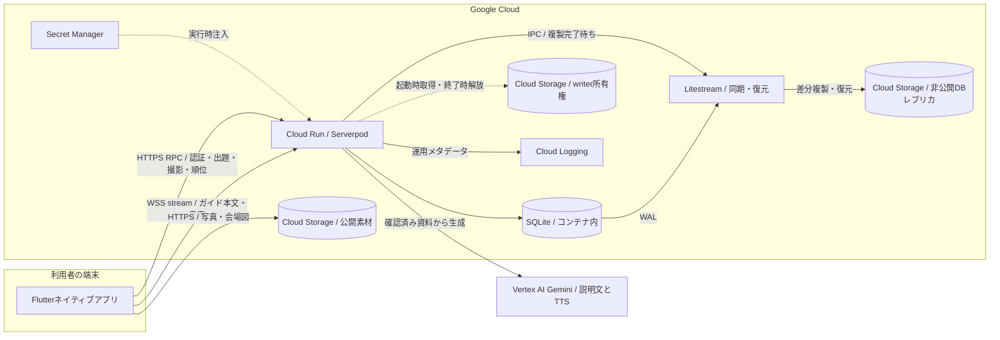
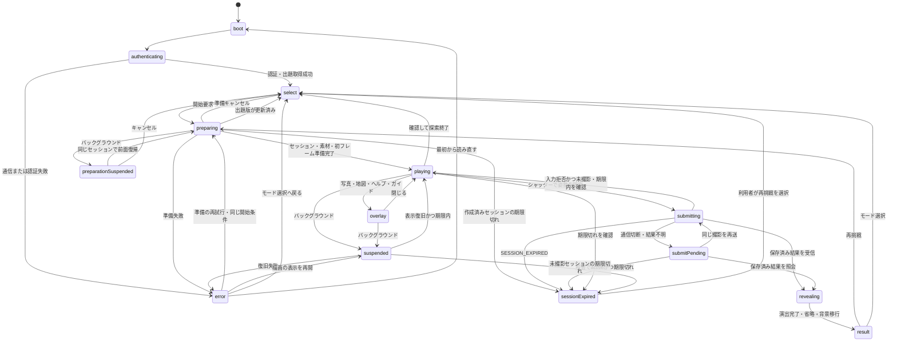
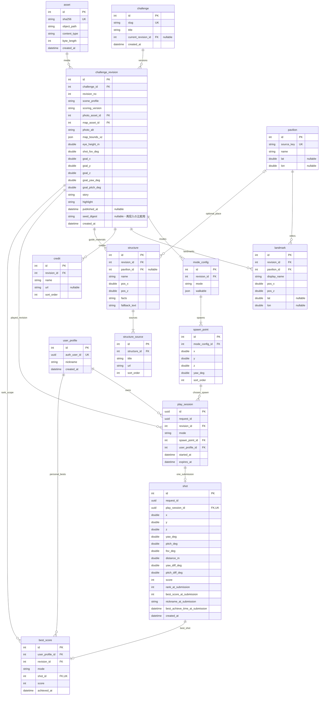

# かさね旅 設計書

DevFest GDGoC Japan Hackathon 2026／応募カテゴリ 観光

提出・コードフリーズ 2026年11月10日（火）19:00 JST

設計更新日 2026年11月8日

対象 Flutterネイティブアプリ、Serverpod API、出題・採点DB、3D素材、マップ、AI音声ガイド

## 概要

訪問者の写真を手がかりに、3D空間を探索して同じ撮影視点を探す観光体験をつくる。
アプリ名を「かさね旅」とし、最初の実証対象に大阪・関西万博を採用する。
名前には、写真と3D、撮影者と自分、過去と今の体験を重ねる意味を込める。
アイコンは青緑の背景に2つの写真枠と奥へ続く道を描いたものとし、原本は `design/branding/app-icon.png` で管理する。
柱の並び、屋根の形、建物の重なりを観察してシャッターを切ると、撮影位置・向きの近さが点数になり、お手本の視点から実写へ切り替わる。
撮影者のエピソードと建築の見どころを固定解説で伝える。

提出版は1区画・1写真・2モード。
探索中は写真と会場マップを参照でき、その場の位置・向きに応じた短いAI音声ガイドも利用できる。
匿名アカウントの自己ベストを出題版・モード別ランキングで比較する。
将来は別の観光地・文化施設への展開とVR端末での体験を検討するが、今回の提出対応端末はFlutterのAndroid／iOSネイティブアプリとする。

| モードID | 表示名 | 万博での対象と目的 | 開始条件 |
| --- | --- | --- | --- |
| `free` | 自由探索 | 万博に詳しい人が記憶を手がかりに巡る | 公開された入口を利用者が選び、サーバーが検証して保存する |
| `near` | ゴール周辺探索 | 未訪問者が建築の観察に集中する | 撮影地点近くの固定位置・向きから開始 |

本書は実装の正本。
提出用の説明資料はGoogleドキュメントで管理する。
以下の「採用」は設計判断を指し、実装完了・実機検証完了を意味しない。
性能、素材公開条件、SDK互換性、DB接続の未決事項は本書末尾で管理する。

## 目的・対象・用語

現地を訪れられない人や訪問経験者が、写真と3Dの比較を通して場所の特徴を観察できる体験を提供する。
提出範囲は1区画・1写真・2モードとし、未訪問者にはnear、訪問経験者にはfreeを推奨する。
モードの選択は利用者が行う。

「必須」は実装する機能・制約、「推奨」は理由を記録して変更できる方針、「既定値」は初期実装に使う値、「採用候補」は実証前の選択肢を表す。
性能値は設計目標とし、計測に基づいて変更した場合は端末・回線・版と変更理由を記録する。
設計の採用と実装の完了は分けて管理する。

## 社会課題・対象者・検証する価値

### 現地訪問に依存しない観光体験への入口

本企画が扱う課題は、観光地や文化施設に関心があっても現地を訪れられない人が、その場所の空間的な特徴や、訪れた人が見つけた魅力に触れる機会を持ちにくいことである。対象として、距離・時間・費用などの事情で訪問できない人や、イベントの閉幕・施設の公開終了後に関心を持った人を想定する。これらの事情がある人の規模や困難の程度は、現時点で本プロジェクトが調査・確認した事実ではない。

写真や説明の閲覧では伝わりにくい位置関係を、自分で視点を変えることで理解できるのではないか。また、自由に動けるだけの3D空間に観察の目的を与えることで、初めて見る人も建物の特徴へ注意を向けやすくなるのではないか。この二点を、本企画で検証する仮説とする。

訪問者の写真を手がかりに撮影視点を探すことで、柱の重なり、屋根の形、背景との位置関係を比較する理由をつくる。撮影後には、お手本の視点、実際の写真、撮影者のエピソードと固定解説を提示する。探索中のAI音声ガイドは、利用者が今いる位置・向きに対応する構造物の資料を短く説明し、観察を補助する。撮影の点数はお手本への位置・向きの近さであり、文化理解や学習成果そのものを評価する数値ではない。

目指すのは、現地へ行かなくても場所の魅力に気づき、関心を深める入口である。現地訪問のすべてを代替すること、旅行に伴う経済的・身体的な制約を解消すること、教育効果が得られることまでは今回の成果として主張しない。

### 万博を最初の実証対象に選ぶ理由

提出版では大阪・関西万博を最初の実証対象とする。閉幕後の会場を対象に、3D都市モデルと来場者の写真を組み合わせ、当時の視点と体験をたどる課題を具体化できるためである。国土交通省は万博会場の建築物をデジタルアーカイブとして公開し、再訪コンテンツや教育教材への活用を期待している。この資料はデータ活用の背景を示すものであり、本企画の仮説や学習効果を実証したものではない。[国土交通省の公開資料](https://www.mlit.go.jp/report/press/toshi03_hh_000205.html)

万博は本企画の適用事例であり、体験の規則そのものを万博専用にはしない。一方、提出版のモデル、会場図、写真、パビリオン資料は万博の内容に絞り、1区画・1写真で撮影から結果まで成立させる。他会場の選択画面や複数コンテンツの運用は今回の完成条件に加えない。

| 対象者 | 一般的に想定する状況 | 万博での検証対象 | 体験上の配慮 |
| --- | --- | --- | --- |
| 対象地を初めて見る人 | 位置関係や注目点を知らない | 万博に行けなかった人 | `near` で探索範囲を絞り、写真と建築の比較に集中できるようにする |
| 対象地に詳しい人・訪問経験者 | 記憶や知識を頼りに再訪したい | 万博に詳しい人・来場者 | `free` で公開された入口から探索し、記憶と現在の見え方を比較できるようにする |

対象者とモードは推奨の組み合わせであり、選択を強制しない。成績は出題版・モード別に比較し、探索条件の違う点数を同じランキングへ混ぜない。

### 仮説と試遊の記録

| 検証する仮説 | 記録する行動・発言 | 改善判断に使う情報 |
| --- | --- | --- |
| 写真を再現する目的が観察を促す | 撮影前後に、柱・屋根・背景など何を比較したかを本人の言葉で聞く | 手がかりを言えず当てずっぽうなら、写真・構図・開始範囲を見直す |
| 未訪問者も周辺探索を進められる | 開始から撮影までの到達、口頭補助、迷った操作や場所 | UIの迷いと、景色の比較の難しさを分けて修正する |
| 訪問経験者にも再発見がある | 記憶と一致した点、新しく気づいた特徴、探索を続けた理由 | 記憶だけで終わる場合も記録し、解説や出題の選び方を見直す |
| ガイドが観察を補助する | ガイドの利用、説明後に見た構造物、説明と視界が対応したか | 無関係な説明、誤った対象選択、長い待ち時間を区別して改善する |

各試遊では、訪問経験、選択モード、使用端末、口頭補助の有無、ガイド利用の有無、撮影までの到達、本人が挙げた観察の手がかりを記録する。操作できたこと、楽しめたこと、空間的な関係を説明できたことは別の観点として扱う。高得点やランキング順位だけを、理解が深まった証拠にしない。

可能であれば、同じ写真と固定説明だけを見た際の発言も記録し、3D探索後にどのような手がかりが加わったかを比較する。同じ問題を続けて体験すると学習や提示順序の影響があるため、少人数の観察から一般的な効果量や因果関係を主張しない。比較を実施できなかった場合はその事実を記載し、観察できた行動と次に検証する仮説を提出資料へ反映する。

### 他の場所へ展開するための設計条件

将来は観光地、歴史的景観、文化施設、期間限定展示などへの展開を検討する。次の条件を満たした別の1地点で体験を確認してから、適用範囲を広げる。

1. 3Dモデル・写真・解説の取得元と利用条件を確認し、同じ建物や構図を対応付けられること。
2. 歩行領域、開始候補、撮影目標、会場図、構造物と参照資料を、出題版に紐づくデータとして登録できること。
3. 地名・建物名・写真・ガイド資料の変更に、PlayControllerや採点規則の固有名詞による分岐を必要としないこと。
4. 出題条件と採点規則の違う問題を、同じランキングの成績として比較しないこと。
5. UIの配色や公式意匠をコンテンツの権利条件に合わせて変更できること。万博の素材・デザインに関する確認を他会場へ流用しないこと。

一般化のために現在の公開DTOを不用意に変更しない。施設seedの識別子と内部の構造物IDの対応を来歴に残し、他会場の識別子、複数問題の選択、運用画面は必要になった段階で契約を設計する。

## 採用方針と実装範囲

| 判断 | 方針 | 理由・負担 |
| --- | --- | --- |
| アプリ | Flutter Android／iOS、Riverpod | 既存UI作業とDart経験を使う。署名・描画・配布はOS別に確認 |
| 3D | Flutter Sceneを第一候補にSceneAdapterで接続 | 視点操作をFlutterから扱う。実モデル・SDKの組み合わせを固定する |
| モデル加工 | Unity等で切り出し・軽量化、原点・尺度を調整 | 軽量化だけで成功とはしない。カメラ・地図・歩行範囲の照合も必要 |
| API | Dart／Serverpod、Cloud Run | 型付きRPC・認証・ORM・マイグレーションを利用する |
| 出題 | DBに出題・不変の版・モード・開始点・解説を保存 | seedで公開版を追加でき、アプリやAPIの再ビルドなしに内容を更新 |
| DB | コンテナ内SQLite＋Litestream＋非公開GCS | 成功応答前にGCS複製完了を待つ。起動時復元と単一writer制御で最小0インスタンスに対応 |
| 素材 | 公開許諾済みGCSバケットから直接取得 | APIはURLとハッシュを返す。DB・秘密・許諾原本は別の非公開領域 |
| 採点 | 1プレイ1撮影、サーバーで位置・向きを採点 | 正解姿勢は撮影成立後だけ返す。撮影送信には通信が必要 |
| 認証・ランキング | Serverpodの匿名ログイン、出題版×モード別の自己ベスト | 登録フォームなしで遊べる。再インストール時の引継ぎと完全な不正防止は保証しない |
| 会場マップ | 加工モデルから作る真上の2D図 | ゲーム内の位置と当時の構造を一致させる。GPSは取得しない |
| Google Maps | 広域位置表示の追加候補 | 緯度経度を表示できるが、当時の会場図を置き換えない |
| AI音声ガイド | 利用者のボタン操作でGemini説明→Gemini TTS | 1つのstreamで本文を先に、WAVを32 KiB単位で送る。永続キャッシュは設けない |
| ツール管理 | miseのmonorepo tasks。ルートでFlutterの版を固定し、各ディレクトリにタスクを置く | 版のずれとセットアップ手順を減らす。monorepo tasksが使えるmiseの版をチームで揃える |
| ローカル実行 | docker composeで本番と同じapi imageとfake-gcs-serverを動かす | 起動順序・復元・同期を手元で確かめる。Geminiはfake実装で代替する |
| インフラ管理 | TerraDartを採用 | CLI・provider・OpenTofuを固定し、plan・適用・更新・復旧を提出前に確認 |
| 将来対応 | 他会場のコンテンツ、VR | データ・入力・表示の境界を用意する。VRランタイムと両眼描画は別途検証 |

匿名認証・採点・ランキング・探索中AIガイドは必須機能とする。
AIガイドは利用者のボタン操作で起動し、プレイ中の利用は強制しない。
ガイド障害時は固定文へ縮退し、撮影を継続できる。
写真投稿、ソーシャルログイン、ユーザー作成問題、複数会場の選択UI、VRビルドは提出範囲外。

## システム構成



Cloud Runは最小0・最大1インスタンスを既定値とする。
SQLiteとLitestreamは同じコンテナ内でsupervisorから起動し、ローカルのDBファイルとIPC socketを共有する。
業務の単一writerはGCSの所有権オブジェクトで制御し、最大インスタンス数だけに依存しない。
停止後もGCSへ複製済みのデータを保持し、次の起動では復元してから業務要求を受け付ける。

### リポジトリ内の責務

アプリは画面ごとの `screen.dart`、`view_model.dart`、`components/` を維持する。
歩行・進行、3D、地図は `usecase/play`、`scene`、`map` にまとめ、Riverpodで接続する。
[参照したhandson_pub_dev完成版](https://github.com/pochipochi-tsudoi/handson_pub_dev/tree/6e78ff796f0646eae43609095b7c8a71888e1e88/lib/complete)

```text
mise.toml                          # monorepo root。ツールの版（Flutter等）とタスク
app/
  mise.toml                       # config root。app用タスク（run:local等）
  lib/
    main.dart
    app.dart
    router/router.dart
    model/                       # 画面・プレイ専用状態。API DTOを再定義しない
    provider/
      api_client/                # 生成Clientと接続先のRiverpod注入
      auth/                      # 匿名認証・トークンの保管と復旧
      challenge/                 # 出題取得と版の保持
      play/                      # createPlaySession / submitShot / getPlaySession
      assets/                    # AssetStore・取得・SHA検証・キャッシュ
      ranking/                   # 順位取得
      profile/                   # 名前の取得・更新
      guide/                     # 文と音声chunkのstream購読・検証
    usecase/
      play/                      # PlayController・入力・移動・撮影送信状態
      scene/                     # SceneAdapter・描画資源の寿命
      map/                       # 共通座標変換を使う地図用処理
    ui/
      mode_selection/            # screen.dart / view_model.dart / components/
      exploration/               # 写真・地図・ヘルプ・ガイドもここへ
      result/
      ranking/
      settings/
  test/
shared/
  mise.toml                       # config root
  lib/src/
    models/                      # API DTO・enum・例外の.spy.yaml
    logic/                       # 純Dartの歩行領域・座標変換・角度計算
  test/
api/
  mise.toml                       # config root。生成・migrate・test等のタスク
  Dockerfile                      # 本番とローカルで共通のapi image
  client/                         # Serverpod生成クライアント（photohunt_client）
  scripts/start.sh               # 所有権→復元→Litestream→Serverpod、終了時は逆順
  scripts/seed.sh                # start.shと同じ所有権・復元の規則でseed CLIを実行する
  bin/main.dart
  bin/migrate.dart               # 所有権取得・復元・migration・複製完了まで行うJob用CLI
  bin/ops.dart                   # 運用CLI（writer所有権の取得・解放・DB照合・複製の確認。start.sh・seed.shが使う）
  bin/seed.dart                  # 出題seedの登録・公開CLI（seed.shが使う）
  docs/                          # API内部の設計資料（ガイド音声のバッファ上限など）
  config/
    litestream.yml               # DBパス・レプリカ・非公開IPC socket
    generator.yaml               # shared_packages
    development.yaml
    production.yaml
    passwords.yaml               # Git管理外。秘密の実値を入れない
  migrations/
  lib/
    server.dart                  # 起動・認証・SQLiteと同期境界の組み立て
    migrate.dart                 # bin/migrate.dartの本体。server.dartと同じく組み立ての起点
    ops.dart                     # bin/ops.dartの本体（コマンドと終了コード）
    seed.dart                    # bin/seed.dartの本体（使い方と終了コード）
    src/
      domain/
        models/                  # 手書きエンティティ
        repositories/            # DBのインターフェース
        ports/                   # Gemini・素材URL・永続化境界・ガイド送信路
        services/                # ShotScorer・NearbyStructureSelector
        exceptions.dart
      application/
        dto/                     # ユースケースの入力・結果
        usecase/                 # StartPlay・SubmitShot・GetRankingなど
        migration/               # migration Jobの手順とその抽象
        seed/                    # seed入力の検証・登録手順とその抽象
      infrastructure/
        database/
          tables/                # table / serverOnly: true の.spy.yaml
          mappers/               # ORM行とドメイン間の変換
          repositories/          # ORMによるインターフェース実装
          schema/                # スキーマ版ガード・migration用の検証
          replication/           # Litestream IPC・保存完了待ち・writer所有権
          migration/             # writer所有権の取得・作業領域・スキーマの照合
          seed/                  # seedのSQLiteへの書き込み
        audio/                   # WAVの検証・変換
        auth/                    # 認証フローのフック・匿名作成のレート制限
        config/                  # 環境変数の解釈・実行環境の判定
        gemini/                  # 説明生成・TTSの実装
        google/                  # Google Cloudの認証（メタデータサーバーのアクセストークン）
        guide/                   # ガイドの利用制限・送信キューの上限
        media/                   # 画像の寸法・形式の判定
        play/                    # 開始の頻度制限・開始点の選択
        seed/                    # seed入力の読み込み
          input/                 # seed入力の.spy.yaml（DBに保存しない）
        storage/                 # GCS・公開URLの実装
      presentation/
        endpoints/               # 認証→ユースケース→公開DTO
        mappers/                 # 結果・ドメイン例外から公開DTO・ApiExceptionへの変換
        middleware/              # 保守受付・スキーマ版ガード・ガイドstreamの送信路と全体期限
        request/                 # HTTPリクエスト由来の値（匿名作成のレート制限キー）
        di/                      # Sessionと実装を組み立てる
      generated/                 # 自動生成。手編集しない
  test/
    unit/
    integration/
content/
  seeds/                           # 出題・構造物・固定解説の登録入力
  provenance/                      # 出典・許諾状況・座標の照合記録
infrastructure/
  local/                           # docker compose、fake-gcs-server、.env.example、mise タスク
  terradart/                       # TerraDart。state・秘密はGit管理外
    mise.toml                      # Dart・gcloudの版とsetup/plan/apply/deployタスク
    bootstrap/                     # API有効化・state保管先・WIF・SA・予算（人が適用）
    stack/                         # Cloud Run・Job・GCS・Secret・AR（CIが適用）
docs/
  specs.md                       # 全体仕様・API・DB・インフラ
```

上記は実装時の配置契約であり、ディレクトリが作成済みという意味ではない。
UI担当の既存作業は対応画面へ統合する。
生成ファイルの置き場所は固定したServerpod generatorの出力に従い、生成結果を手で別フォルダへ移さない。

| 境界 | 守る依存方向と責務 |
| --- | --- |
| Screen／components | ViewModelの値を表示し操作を通知。座標補正・採点・RPCを直接実行しない |
| ViewModel | ロード・パネル・画面エラー。ProviderとPlayControllerを呼ぶ |
| アプリのProvider | 生成Clientの注入と通信・キャッシュ。SDK例外を画面で扱える失敗へ変換 |
| PlayController | 足元位置・向き・進行・撮影の固定値の正本。サーバー点数を受け取り、端末で正式採点しない |
| Scene／Map | PlayControllerの座標を表示。歩行位置を独自に変更しない |
| shared | 公開DTOと純Dartの幾何。Widget、Riverpod、Serverpod Session、DB行を参照しない |
| server domain | 永続化・外部サービスの抽象と採点規則。`package:serverpod` をimportしない |
| server application | コンストラクタで抽象を受け、`execute()` で認可・版固定・処理順序を実行 |
| server infrastructure | ORM行をmapperで変換。Session・HTTP・Gemini・Storageをここへ閉じ込める |
| server presentation | Sessionから認証主体を得てusecaseへ渡す。公開DTO・型付き例外に変換 |
| content | seedの入力。実行時の正本はDB。コードの再デプロイに公開内容更新を結び付けない |

依存はpresentation／infrastructureからapplication／domainへ向ける。
`presentation/di` はSessionと実装の組み立てだけを担当する。
ORMの直接操作・公開DTOや例外への変換・初期名などの業務規則をDIへ置かない。
DB行をendpointから直接返さず、秘密の正解・認証情報を公開DTOから除外する。
アプリとサーバーはsharedと生成clientを通して連携し、サーバー内部モデルをアプリへimportしない。
RiverpodのProviderは機能の接続と寿命管理を担当し、座標計算は純Dartの関数へ分ける。

### コード生成と互換性

1. `api/config/generator.yaml` で `shared_packages: [../shared]` を指定し、生成clientの出力先を `api/client` にする。
2. 公開モデル・enum・例外はshared、永続化テーブルはserverOnlyとして定義する。
3. `serverpod generate` でclient／protocolを生成し、DB変更時は `serverpod create-migration` の結果をレビューする。適用は本書「DBマイグレーション」のCloud Run Jobだけで行う。
4. Flutter・server・client・sharedのSDKと依存を同じ作業単位で固定する。`.spy.yaml` と生成差分を一緒にコミットする。
5. 生成後の型一致だけで、サイズ制限・座標の妥当性・認可が保証されたとはしない。入力制約と所有者検査はサーバーで実行する。
6. 提出後はnullableな項目追加を基本とし、意味を変える変更・enum追加・必須項目変更は既存配布版との互換性を確認する。

## 要件定義

| ID | 要件 |
| --- | --- |
| F01 | 配布アプリで匿名ログインし、公開出題・写真・モードを表示 |
| F02 | 自由探索は、公開された入口を利用者が選びサーバーが検証した開始点から歩く |
| F03 | 周辺探索は固定開始点から狭い範囲を歩く |
| F04 | 写真・会場マップ・ヘルプを開閉し、その場で再開 |
| F05 | 1プレイ1回撮影し、位置・向きの点数をサーバーから取得 |
| F06 | 撮影結果でお手本視点、実写、固定解説を表示 |
| F07 | 再挑戦・モード変更・終了 |
| F08 | 素材や描画の失敗から再試行・戻るを選択 |
| F09 | ニックネームを編集し、版・モード別順位と自己ベストを表示 |
| F10 | 探索中の位置・向きから利用者操作でAI説明を生成・再生 |
| F11 | 出題版とプレイ結果を永続化し、更新・再起動後も整合 |

### 非機能要件

性能値は設計目標とする。
変更時は端末・回線・版・計測値を記録する。

| ID | 項目 | 条件 |
| --- | --- | --- |
| N01 | 対応端末 | 対応済みと記載する各OSで署名ビルドを実機確認 |
| N02 | 初回ロード | 下り10 Mbps相当で操作可能まで15秒以内。コールドスタートを別計測 |
| N03 | モデル | アプリ同梱。制作予算10 MiB、テクスチャ最大辺2048 px。同梱成果物の実容量・実機性能を測定 |
| N04 | 描画 | 代表ルート30 fps以上。探索・再プレイを通じてクラッシュ・継続的な資源増加を抑える |
| N05 | 同時利用 | 10端末相当の開始・撮影で記録欠落・重複なし。制限時は再試行を案内 |
| N06 | 撮影待ち | warm環境でSQLite commitとGCS複製完了待ちを含む応答3秒以内を目標 |
| N07 | 回線断 | 取得済み素材で歩行・写真・地図を継続。確定・順位・新規ガイドは通信必須 |
| N08 | 中断・再開 | 背景時間を移動へ加算せず、送信待ちは固定要求で復旧 |
| N09 | 認可・データ保護 | 所有者を照合し、撮影前goal・認証秘密・DB・許諾原本を非公開とする |
| N10 | 記録の最小化 | 毎フレーム送信せず、撮影とガイド要求時の姿勢だけ送信 |
| N11 | 公開期間 | 2026/11/14 23:59 JSTまでAPI・素材・審査用配布導線を維持 |

VRは提出対象外とし、モバイルの性能目標をVRへ流用しない。

## 共通定義と状態の所有者

| 識別子 | 意味・保持規則 |
| --- | --- |
| `challengeId` / `revisionId` | DBの出題と不変の版。写真・地図・座標・固定解説・採点条件を同じ版で固定。3Dモデルは版と結び付けず、アプリ同梱のものを使う |
| `sceneProfile` | 描画アダプターの識別子。未知profileでは開始不可。同梱モデルと出題版の整合性を保証するものではない |
| `playSessionId` | `play.createPlaySession` が返すサーバーのUUID。再挑戦時は新規、通信再試行では保持 |
| `requestId` | 開始と撮影の操作ごとに生成するUUID。同じ操作の再送で再利用 |
| `attemptId` | 端末内の非同期試行世代。閉じる・再試行・別プレイで更新 |
| `guideId` | 1回のstreamのイベント識別。再取得用のIDとして使わない |
| 素材SHA-256 | 内容の識別子。バイトが変わればURLも変更 |

| 状態 | 正本・寿命 |
| --- | --- |
| 出題・正解・固定解説・開始候補 | DBの不変な版。未撮影クライアントには正解・固定解説・開始候補の座標を送らない。自由探索の入口は id と表示名だけを送る |
| 認証 | Serverpod認証モジュール。端末にはSDKの方式でトークンを保管 |
| ニックネーム・最高点・撮影結果 | DB。公開するのは名前・点数・順位などのDTOだけ |
| 出題スナップショット | アプリのChallenge Provider。開始時に固定した版をプレイ途中で差し替えない |
| 足元位置・yaw・pitch | PlayController。探索中は端末メモリ |
| 送信待ちのShotInput | シャッター時に固定。保存確認まで同じ値を再送する |
| 正式な点数・結果 | サーバー。結果DTOは端末の表示用コピー |
| パネル・GPU資源 | UI／SceneAdapter。閉じる・離脱・資源喪失で解放 |
| 素材キャッシュ | AssetStore。利用中の参照は削除から保護 |
| ガイド文・音声 | 1回のstreamと表示中の端末。DB/GCSに永続保存しない |

## 状態遷移・競合・中断



図の状態以外に、select／resultからランキング・設定へ遷移できる。
探索中のパネルは同時に一つ。
非同期のガイド取得はパネル内の状態として持ち、ゲームの採点状態と混ぜない。

| 場面 | 処理 |
| --- | --- |
| 初回起動 | 保存済みトークンを復旧。なければ匿名ログイン。プロフィール・出題を取得してモード選択へ |
| 認証の一時失敗 | 自動で匿名アカウントを作り直さず、通信再試行を表示 |
| 開始 | 同期的にpreparingにして連打遮断。requestId・出題版・モードを固定し `play.createPlaySession` |
| 開始応答が不明 | 同じrequestIdで再送。新しい乱数や開始点を端末で作らない |
| 出題が更新済み | 新版への更新を案内して選択へ戻る。旧写真と新版の座標・会場図を混在させない |
| 準備再試行 | 作成済みなら期限を確認して同じplaySessionIdと開始点で準備し直す。期限切れなら再挑戦を案内。開始応答不明なら同じrequestIdで結果を確認 |
| 準備キャンセル | 端末の試行を無効化し素材参照を解除。未撮影セッションは記録として残るが順位に入らない |
| パネル開閉 | 移動・見回しを解除。閉じた後は新しいタッチから入力を受ける |
| シャッター | 撮影用requestIdとShotInputを一度だけ固定。端末記録を保存してから送信、操作を停止 |
| 撮影応答が不明 | 同じ姿勢を保持し「結果を確認」「再送」を出す。別の姿勢で撮り直さない |
| 撮影が入力不正として確実に拒否 | エラー理由を表示。セッション未撮影・期限内を確認後、拒否された撮影の端末待機記録を消して探索へ復帰 |
| 保存済み結果 | 点数・誤差・お手本視点を受け取りrevealingへ。結果取得後に通信が切れても解説を表示 |
| 演出中の戻る・背景移行 | 演出を省略し結果へ進む。背景では描画・音声を停止 |
| 再挑戦 | 新しいrequestIdで別セッションを開始。自己ベスト以外の位置・姿勢・ガイドを初期化 |
| 結果から順位を開く | 最新順位を別途取得。撮影直後の順位と変わり得ることを区別 |
| 探索終了 | 確認後に描画資源を解放。撮影送信中は送信取消と扱わず、結果確認を優先 |

### アプリ終了・再開

歩行中の位置を毎フレーム保存する機能は設けない。
通常のプロセス終了後は新しいプレイとして開始する。
ただし撮影を送る直前に、所有アカウント、playSessionId、固定ShotInput、撮影requestId、revisionIdを端末のアプリ専用領域へ記録する。
これは中断した撮影の結果確認用であり、歩行状態の保存ではない。

次の起動で認証を復旧できた場合、`play.getPlaySession` で送信済み結果を照会する。
completedならshot・reveal・myRankingEntryを表示する。
activeかつ期限内なら同じ撮影の再送を案内し、期限切れなら新規撮影を止め、明示操作で待機記録を破棄して再挑戦へ進む。
端末の時刻による判定は案内用とし、サーバーの期限判定を正本とする。
保存済み結果を確認してから待機記録を消す。
他アカウントのトークンで古い撮影を送らない。
認証情報を失った場合は記録を引き継げない旨を案内し、明示操作で破棄して新規開始する。
アプリ内で結果を確認できなかったことを、サーバー側の撮影取消とは扱わない。

### 非同期処理と描画資源

1. 出題取得、素材取得、描画準備、採点応答、ガイド要求にプレイIDまたは取得世代とattemptIdを関連付ける。
2. キャンセル可能な処理は止める。不可能な処理は完了時に世代を比較し、古い結果を画面へ適用しない。
3. 旧試行のGPU資源は旧試行が解放する。素材ファイルと共有取得ジョブはAssetStoreが所有し、画面は利用参照だけを解除する。
4. 準備中の背景移行は描画準備を取り消す。前面復帰時に同じ出題・セッション・開始点で再開する。開始応答不明なら同じrequestIdで照会・再送し、セッション期限切れなら再挑戦を案内する。
5. 探索中は足元位置と視点をメモリへ保持し、パネルを閉じてsuspendedへ。復帰時にローカル素材から初フレームを確認する。
6. 入力ベクトル、ポインターID、前フレーム時刻を初期化し、背景にいた時間を歩行量へ加えない。
7. 復旧失敗は「表示を再開」「モード選択へ」を表示。勝手に開始点へ戻さない。
8. 撮影送信中に背景へ移った場合は姿勢固定を維持。復帰後に結果照会し、送信中の移動や二重撮影を許可しない。

## FlutterアプリとUI

### 画面と部品

| ID | 画面・部品 | 表示・操作・失敗時の動作 |
| --- | --- | --- |
| S01 | 起動・認証 | 匿名認証と取得状況、再試行。通常の認証失敗では名前や記録を消さない |
| S02 | モード選択 | 写真、2枚のモードカード、開始、遊び方、順位、設定、出典、出題更新 |
| S03 | 準備 | 写真、開始受付・素材取得・描画準備の段階、取得量、キャンセル |
| S04 | 探索 | SceneViewport、MovePad、LookArea、PhotoFrame、写真・マップ・ヘルプ、シャッター、「この辺りを解説」、モード、戻る |
| S05 | 写真パネル | 手がかり写真全体、代替説明、閉じる。中央切り抜きで手がかりを隠さない |
| S06 | 会場マップ | 図、現在地・向き、探索境界・障害物、施設、北、凡例、閉じる |
| S07 | ヘルプ | 歩行、見回し、写真・地図、1プレイ1撮影、通信が必要な場面 |
| S08 | 撮影送信・結果確認 | 固定した撮影の送信状態、結果照会、期限内の同じ撮影の再送。activeかつ期限切れは再挑戦を案内。再撮影ボタンは出さない |
| S09 | 結果 | 0〜1000点、距離・yaw・pitchのずれ、自分の撮影3D・お手本3D・実写の3列比較、固定エピソード・見どころ、自己ベスト、撮影時順位、再挑戦 |
| S10 | AIガイド | 右側パネルに選択対象名、説明生成中、説明・出典、音声準備、再生・停止・ガイド再生成、閉じる。見出し「この辺りの解説」・AI生成ラベル・重複する×は表示しない |
| S11 | ランキング | 版・モード、上位100件、自己順位と最高点、取得時刻、更新、戻る。未プレイは未記録 |
| S12 | 設定 | ニックネーム、保存、出典・利用案内。匿名記録の引継ぎ不可を説明 |

### 探索画面

```text
┌─────────────────────────────┐
│ 戻る      自由探索       操作方法 │
│      ┌────────────────┐      │
│      │ 写真と同じ比率の撮影枠 │      │
│      └────────────────┘      │
│                      写真    │
│ 移動パッド            マップ   │
│ この辺りを解説       シャッター │
└─────────────────────────────┘
```

- 左下パッドを長さ0〜1の前後左右入力へ、3D領域のドラッグをyaw／pitchの角度変化へ変換する。PlayControllerへ生のタッチ座標は渡さない。
- パッドと見回しは別ポインターで同時操作可能。UIで始めたタッチは3Dへ引き継がない。
- 写真と同じアスペクト比の撮影枠を示す。画面の縦横比が端末ごとに違っても、枠内の垂直画角は出題の固定値を使う。初期版はズーム操作を設けない。
- シャッターが回答であり、端末カメラや写真ライブラリは利用しない。サーバーへ送るのは姿勢であり、スクリーンショット画像ではない。
- システムの戻るはパネルを先に閉じる。撮影前の探索終了は確認を出す。送信結果が不明なときは結果確認へ誘導する。
- 画面の向きはアプリ全体で横画面に固定する（左右どちらの横向きも許可し、縦画面にはしない）。iOSは`Info.plist`、Androidは`screenOrientation`、Flutterは起動時の`SystemChrome.setPreferredOrientations`で指定し、画面ごとには切り替えない。iPadは全画面表示とし、Split View・Slide Overは対象外とする。全画面で必須ボタンをセーフエリアに収め、文字拡大時は説明・結果・設定・モード選択をスクロール可能にする。
- 操作領域は44論理px以上を目標とし、状態は色だけに依存させない。背景の上のボタンは不透明な面を持つ。
- ガイド生成とTTSは状態を分け、音声が遅くても本文を読める。ボタンを押す前に生成しない。
- 万博を題材にした配色・形状はテーマ設定に閉じ込める。公式素材は利用条件を確認して使用する。[公式デザインシステム](https://www.expo2025.or.jp/overview/design_system/)

### モジュールの接続口

| モジュール | 入力 | 出力・責務 |
| --- | --- | --- |
| Challenge Provider | 生成Client、取得世代 | ChallengeRevisionと取得エラー |
| Play Provider | 開始／撮影／結果照会の専用Request | 型付き応答。正式採点をローカルで代替しない |
| AssetStore | AssetRef | 検証済みローカルファイル、容量管理、参照保護 |
| PlayController | 出題、開始応答、意味付け済み入力、経過時間 | 足元位置・視点・撮影の固定値・ゲーム進行 |
| SceneAdapter | ローカルモデル、サイズ、CameraPose | 単眼描画、初フレーム通知、pause／resume／dispose |
| Map usecase | 現在位置・モード・VenueMap | 地図上の正規化位置・向き。共通の幾何関数を使用 |
| Guide Provider | セッション、固定した要求位置・向き | 説明と音声を別状態で返し、旧応答を無効化 |

SceneAdapterはアプリ内の抽象として `prepare(localFile, profile)`、`setCamera(pose)`、`resize(size)`、`pause()`、`resume(pose)`、`dispose()` を持つ。
資源が残っているときだけresumeし、喪失時はdispose完了後にprepareし直す。
初フレーム成功まで操作を許可しない。

Riverpod NotifierはセッションごとのPlayControllerを管理し、Screen／ViewModelは必要な値だけ監視する。
フレームごとのカメラ更新で全Widgetを再構築しない。
SceneAdapterはProvider経由で注入して探索離脱時に解放する。
Map usecaseは状態を持たない変換を基本とする。

## 歩行・カメラ・撮影演出

### ローカル座標

加工後モデルの単位はm。
＋Xを東、＋Yを上、＋Zを北とする（同梱モデルの実行時の向き。flutter_scene が glTF の Z を反転して読み込む。content/provenance/README.md「実行時の座標の向き」）。
足元XYZをプレイヤー位置の正本とし、通常カメラはそのYに出題の `eyeHeightMeters` を加える。
yawは北向き0°、東向き90°、pitchは上向きが正。
三角関数に渡すときだけradへ変換する。

| 設定 | 初期設計値 | 調整方法 |
| --- | --- | --- |
| 歩行速度 | 2.0 m/s | 端末実機で停止しやすさを確認 |
| 視点高さ | 1.6 m | 人の目線と写真に合わせる |
| yaw感度 | ドラッグ1論理pxにつき0.15° | タッチで1周でき、微調整できるか試遊 |
| pitch範囲 | −65°〜＋65° | 探索で上下反転を防ぐ |
| 最大フレーム経過 | 50 ms | 長い停止による瞬間移動を抑える |
| 結果演出 | カメラ600 ms、写真切り替え300 ms | 動きを減らす場合は補間を省略 |

数値は実装の初期値として固定し、試遊後に変更したら文書と実装を同時に更新する。

### 歩行可能領域

提出版の区画は平坦な屋外通路を選ぶ。
モードごとにXZ平面の外周ポリゴン `outer` と障害物の内周 `holes` を定義する。
移動可能な集合は外周内から内周を引いた範囲。
外周境界は許可、内周境界は進入禁止とする。

- 頂点は3点以上、閉じるための終点重複は持たせない。自己交差、穴同士の交差・接触・包含、穴と外周の接触を禁止する。すべての穴を外周の内側に厳密に収める。
- この領域はプレイヤー中心が動ける範囲として作る。実際の壁・柱から0.25 m以上内側に境界を設定し、プレイヤーの半径判定は重ねて実装しない。
- 前進ベクトルは `(sin(yaw), -cos(yaw))`、右は `(cos(yaw), sin(yaw))`。前後・左右の合成入力の長さを最大1に抑える。
- 1フレームの移動線分と境界を交差判定する。許可領域から出る最初の交差の1 mm手前で止め、残りの移動を捨てる。終点が内側でも、途中で穴や凹部を横切る移動を許可しない。外周境界上から内側へ動く場合と、許可領域内で境界に接するだけの場合は止めない。交点の前後で許可領域から禁止領域へ変わる交差だけを停止対象とし、時刻0の交点で内向き移動を止め続けない。
- 境界付近の数値誤差は1 mm以内として扱い、同じ許可領域判定を出題検証と実行時に使用する。外側へ計算された場合は直前の有効位置を維持する。
- 近くの障害物に引っかかる場合は、見えない補正で位置を飛ばさず、通路設定を修正する。

### 開始点と撮影枠

開始点は `play.createPlaySession` の返却値を使用する。
自由探索は、クライアントが選んだ `spawnPointId` をサーバーが検証して保存する。欠落・候補外は `INVALID_REQUEST`。nearは唯一の固定点を返し、クライアントの `spawnPointId` は受け取らない。
再送・素材再試行で開始点を引き直さない。同じ `requestId` で別の `spawnPointId` が来たら `REQUEST_ID_REUSED`。
写真と同じ比率の枠内に、版で固定した `shotVerticalFovDegrees` で描画する。
端末の画面比率によって採点用の画角が変わらないようにする。

撮影時は視点のXZ、yaw、pitchを固定して送信する。
YとFOVはサーバーが固定した出題版から補完する。
端末の描画にも同じ高さ・画角を使う。
端末上の移動範囲検査は操作を成立させるためのもので、正式採点や入力の正当性の最終判定はAPIが行う。
提出版は平坦な歩行面と固定視点高さに絞り、写真の目標姿勢も同じ高さ・画角・pitch範囲で到達できる構図を選ぶ。

### 撮影・お手本・実写の比較

保存済み結果を受け取ったら、自分の撮影姿勢とお手本姿勢、距離・向きの差を表示する。
横画面の結果画面は、通常の文字サイズで比較欄・点数・ずれ・順位・固定エピソード・見どころ・操作ボタンを1画面に収める。
文字を拡大した場合や解説が長い場合は、全文と全操作に到達できるよう縦スクロールを許す。
端末の3D描画が失敗しても、実写写真と、結果DTOの点数・固定解説は表示できる。

「自分の撮影（3D）」「お手本（3D）」「実写写真」を、見出しを付けて横に並べる。
各視点の周辺区画を順番に読み込み、1枚ずつ静止画に固定してから次の視点へ進む。
2視点の描画先や区画を競合させず、比較画像は結果画面を閉じたときに解放する。
撮影姿勢のXYZは絶対カメラ位置なので視点高さを二重に加えない。探索中の姿勢・入力は変更しない。

3つとも写真の幅／高さの比率を保ち、引き伸ばしや中央切り抜きは行わない。
画素単位の完全一致は求めず、輪郭・柱の並び・前後関係を実機で確認する。
VRではこの結果比較用カメラを流用しない。

## 会場マップ・施設・地理座標

### 会場マップ

マップはプレイ中のモーダルとして開き、移動を停止する。
北向き固定の会場図、現在地の矢印、モードの探索境界と障害物、パビリオン名を描く。
ゴール位置と撮影カメラは描かない。
マーカーを選ぶと名称を表示し、移動やテレポートは行わない。

画像全体に対応する `bounds` をデータに持つ。
画像は正射影で書き出し、幅／高さを `(maxX-minX)/(maxZ-minZ)` と一致させる。
ピクセル丸めの誤差は1 px以内とし、配信前に検証する。
画像の原点は左上で、Xが右、Zが下に増える。
画像内の正規化位置は次式とする。

```text
u = (x - minX) / (maxX - minX)
v = (z - minZ) / (maxZ - minZ)
```

画面では画像を縦横比維持で収め、余白オフセットを足してマーカーを置く。
ピンチ拡大・パンは画像と全オーバーレイへ同じ変換を適用する。
現在地は選択モードの範囲内にあることを前提にし、範囲外の値を無言で端に吸着させない。
矢印は北向きを0°としてyawで回す。
北、東、南、西と、離れた3地点で位置・方向を検証する。

会場図の画像が失敗した場合は `bounds` と歩行領域を用いた簡易図へ切り替える。
パビリオン、現在地、方位、境界を同じ位置に表示し、「簡易マップ」と明示する。
画像の代わりにゴールを手がかりとして表示しない。

### Google Mapsを使う範囲

会場図を必須とし、Google Mapsは夢洲周辺を示す追加画面の候補とする。
D05で次の条件を満たせる場合だけ採用する。

1. 現在の地図背景と2025年会場の違いを確認し、当時の施設を独自マーカーとして表示する。
2. 課金・利用枠とOS別キーを用意する。Androidはパッケージ名と署名証明書、iOSはBundle IDで制限する。
3. Googleの帰属表示を維持し、地図画像を会場図として抽出・同梱しない。
4. リリース署名と配布経路で動作し、取得失敗時は必須の会場図へ戻れるようにする。

GPS・Places・Routesは使用しない。
[設定](https://developers.google.com/maps/flutter-package/config)・[キー保護](https://developers.google.com/maps/api-security-best-practices)

### 施設seedと座標照合

施設の名称・緯度経度は `content/seeds/` からDBへ登録し、取得元・取得日・利用条件を `content/provenance/` と著作物利用シートへ残す。
別のAPIサーバーやTypeScript実装に依存しない。

地理座標を3Dローカル座標へ直接代入しない。
モデルの原点・軸・尺度が分かる場合は変換条件を記録し、不明な場合は対応が分かる複数の建物で照合して手動設定する。
代表点が建物内部でも地図マーカーには利用できるが、歩行開始点や撮影目標には使わない。
少なくとも離れた3地点で会場図・3D・地理座標の対応を確認する。
正解姿勢は写真と現地の記憶を照合して別途設定する。

## Serverpod APIとデータ契約

### 採用する設計指針

Serverpodの生成Clientとsharedのモデルを通信契約の正本とする。
Google AIPのリソース単位の分割、標準／独自メソッド、リクエスト識別、エラー分類を参考にする。
通信にはServerpodのRPC転送を使用する。
[AIP-121](https://google.aip.dev/121) · [標準メソッド](https://google.aip.dev/131) · [独自メソッド](https://google.aip.dev/136)

| 項目 | 本書の契約 |
| --- | --- |
| サービス分割 | challenge／play／ranking／profile／guideの5 Endpoint |
| 引数 | 生成Clientからは各メソッドへ専用の `XxxRequest request` 一つ。サーバーはSessionも受ける |
| 戻り値 | Get/Create/Updateはリソース、Listと独自メソッドは専用Response。ガイドだけStream |
| 識別子 | 文字列resource nameの代わりにint／UuidValue。AIPからの意図的な差分 |
| 作成の識別 | 開始と撮影はUUID v4のrequestIdを必須とする。任意指定とするAIPより厳しく再送を保証 |
| フィールド | `distanceMeters`、`yawDegrees`、`createTime`のように単位・時刻を明示。boolにis接頭辞を付けない |
| エラー | ApiExceptionにgRPC相当の分類とreasonを格納。実際のgoogle.rpc.Statusや数値wire codeとは同一ではない |
| 互換性 | nullable／既定値あり項目だけ追加。unknown enumは受け取れても未対応操作は停止 |

テーブルは `serverOnly: true`、公開DTO・enum・例外はsharedとする。
正解を含むORM行を直接返さない。
生成による型検査とは別に所有者・値の範囲・状態をサーバーで検証する。
[Serverpodモデル](https://docs.serverpod.dev/concepts/data-and-the-database/models) · [共有パッケージ](https://docs.serverpod.dev/concepts/data-and-the-database/models/shared-packages)

公開DTOの生成と型の往復変換はD08で確定し、ガイドイベントは本書「AI多文化音声ガイド」で定義する。

### エンドポイント

認証モジュールの匿名ログイン・トークン更新と、後述の運用用 `health.ping` を除き、全メソッドで `requireLogin => true`。
表の時間はアプリの1回の待ち上限で、再試行の総時間ではない。
ガイドは呼出しから終了までの60秒を絶対期限とし、イベント受信ごとに延長しない。

| Endpoint.method | 種類 | request → result | 再送の性質 | 待ち上限 |
| --- | --- | --- | --- | --- |
| `challenge.listChallenges` | List | ListChallengesRequest → ListChallengesResponse | 読み取り | 10秒 |
| `challenge.getChallenge` | Get | GetChallengeRequest → Challenge | 読み取り | 10秒 |
| `challenge.getChallengeRevision` | Get | GetChallengeRevisionRequest → ChallengeRevision | 不変な公開済み版 | 10秒 |
| `play.createPlaySession` | Create | CreatePlaySessionRequest → PlaySession | requestIdで重複排除 | 10秒 |
| `play.getPlaySession` | Get | GetPlaySessionRequest → PlaySession | 所有するプレイの現在状態 | 10秒 |
| `play.submitShot` | Custom | SubmitShotRequest → SubmitShotResponse | requestIdで同じ確定結果 | 15秒 |
| `ranking.listRankingEntries` | List | ListRankingEntriesRequest → ListRankingEntriesResponse | 読み取り。順位は変動 | 10秒 |
| `ranking.getMyRankingEntry` | Get | GetMyRankingEntryRequest → RankingEntry | 読み取り | 10秒 |
| `profile.getMyProfile` | Get | GetMyProfileRequest → Profile | 読み取り | 10秒 |
| `profile.updateNickname` | Update | UpdateNicknameRequest → Profile | 同じ値への再設定 | 10秒 |
| `guide.explainNearby` | Custom stream | ExplainNearbyRequest → Stream<NearbyGuideEvent> | 再生成。同一出力は保証しない | 60秒 |

`getMyRankingEntry` は記録がなければnotFound／RANKING_ENTRY_NOT_FOUND。
空ランキングはListの空配列として返す。
未所有プレイの操作はpermissionDenied／NOT_SESSION_OWNER。
存在しないプレイはnotFound／PLAY_SESSION_NOT_FOUNDとし、応答に相手の名前・版・結果を含めない。

業務の5 Endpointとは別に、疎通確認用の運用メソッド `health.ping` を置く（#20で採用）。
採用する場合は `requireLogin => false`、空のRequest、`HealthResponse(releaseId, time)` を返す。
認証・DB・外部サービスに触れず、`releaseId` は `RELEASE_ID` と同じ値とする。
これが「全メソッドで `requireLogin => true`」の唯一の例外である。

### RequestとResponseの全体

以下の型は各行で示す全項目を持つ。
空のRequestも専用モデルとして生成し、後から引数名を変えない。
DBのsnake_case列名と公開DTOのcamelCaseはmapperで変換する。

| Request | フィールド |
| --- | --- |
| ListChallengesRequest | 空 |
| GetChallengeRequest | `challengeId:int` |
| GetChallengeRevisionRequest | `revisionId:int` |
| CreatePlaySessionRequest | `revisionId:int`, `mode:PlayMode`, `requestId:UuidValue` |
| GetPlaySessionRequest | `playSessionId:UuidValue` |
| SubmitShotRequest | `playSessionId:UuidValue`, `camera:ShotInput`, `requestId:UuidValue` |
| ListRankingEntriesRequest | `revisionId:int`, `mode:PlayMode` |
| GetMyRankingEntryRequest | `revisionId:int`, `mode:PlayMode` |
| GetMyProfileRequest | 空 |
| UpdateNicknameRequest | `nickname:String` |
| ExplainNearbyRequest | `playSessionId:UuidValue`, `positionX:double`, `positionZ:double`, `yawDegrees:double`, `locale:String` |

| Resource／Response | フィールド・意味 |
| --- | --- |
| Challenge | `id:int`, `title:String`, `currentRevisionId:int?`。公開終了ならcurrentRevisionId=null |
| ListChallengesResponse | `challenges:List<Challenge>`。公開中の最大1件を返す |
| ChallengeRevision | 下記YAML。正解、解説、開始候補の座標は含めない。自由探索の入口（id と表示名）は含める |
| PlaySession | 下記YAML。activeではshot／reveal／myRankingEntryすべてnull |
| SubmitShotResponse | `shot:Shot`, `reveal:Reveal`, `myRankingEntry:RankingEntry`。撮影確定時の値 |
| Shot | `id:int`, `camera:CameraPose`, `score:int`, `distanceMeters:double`, `yawDiffDegrees:double`, `pitchDiffDegrees:double`, `createTime:DateTime` |
| Reveal | `goalCamera:CameraPose`, `story:String`, `highlight:String` |
| RankingEntry | `rank:int`, `nickname:String`, `score:int`, `achieveTime:DateTime`, `mine:bool` |
| ListRankingEntriesResponse | `entries:List<RankingEntry>`。上位100件 |
| Profile | `nickname:String`, `anonymous:bool`。anonymousは出力専用 |
| AssetRef | `url:String`, `sha256:String`, `byteLength:int`, `contentType:String` |
| VenueMap | `image:AssetRef`, `bounds:MapBounds`, `landmarks:List<Landmark>` |
| MapBounds | `minX/minZ/maxX/maxZ:double`。モデルローカルのm |
| Landmark | `id:int`, `name:String`, `positionX/positionZ:double`, `latitude/longitude:double?`。緯度経度は対で設定 |
| ModeConfig | `mode:PlayMode`, `walkable:WalkableArea`, `entrances:List<SpawnEntrance>`。入口は id と表示名だけで、自由探索以外は空 |
| WalkableArea | `outer:List<PointXZ>`, `holes:List<List<PointXZ>>` |
| PointXZ | `x/z:double`。モデルローカルのm |
| Spawn | `positionX/positionY/positionZ:double`, `yawDegrees:double`。位置は足元、pitch初期値0 |
| ShotInput | `positionX/positionZ:double`, `yawDegrees/pitchDegrees:double`。冪等性判定の4値 |
| CameraPose | `positionX/positionY/positionZ:double`, `yawDegrees/pitchDegrees/verticalFovDegrees:double`。位置は視点 |
| Credit | `name:String`, `url:String?` |
| GuideSource | `title:String`, `url:String` |
| FieldViolation | `field:String`, `reason:String`。項目名と固定理由のみ |

```yaml
enum: PlayMode
serialized: byName
default: unknown
values:
  - unknown
  - free
  - near
```

```yaml
enum: PlaySessionState
serialized: byName
default: unknown
values:
  - unknown
  - active
  - completed
```

```yaml
class: ChallengeRevision
fields:
  id: int
  challengeId: int
  sceneProfile: String
  photo: AssetRef
  photoAlt: String
  map: VenueMap
  modes: List<ModeConfig>
  eyeHeightMeters: double
  shotVerticalFovDegrees: double
  credits: List<Credit>
```

```yaml
class: CreatePlaySessionRequest
fields:
  revisionId: int
  mode: PlayMode
  requestId: UuidValue
  spawnPointId: int?
```

```yaml
class: PlaySession
fields:
  id: UuidValue
  revisionId: int
  mode: PlayMode
  spawnPointId: int
  spawn: Spawn
  state: PlaySessionState
  createTime: DateTime
  expireTime: DateTime
  shot: Shot?
  reveal: Reveal?
  myRankingEntry: RankingEntry?
```

```yaml
class: ShotInput
fields:
  positionX: double
  positionZ: double
  yawDegrees: double
  pitchDegrees: double
```

```yaml
class: SubmitShotRequest
fields:
  playSessionId: UuidValue
  camera: ShotInput
  requestId: UuidValue
```

```yaml
class: ListRankingEntriesRequest
fields:
  revisionId: int
  mode: PlayMode
```

```yaml
class: UpdateNicknameRequest
fields:
  nickname: String
```

受信したunknownをfreeやactiveへ置き換えない。
unknown modeは開始を止め、unknown stateは撮影を無効にして対応アプリへの更新を案内する。
要求中のunknownはinvalidArgument。
sealedイベントに未知の型を追加する場合はenumと同じfallbackが働くと仮定せず、別メソッドまたは対応版の配布で移行する。

### 一覧の上限と整列

提出版の出題一覧は公開中の最大1件をid昇順で返し、公開処理で同時公開数を検証する。
0件なら「公開中の出題なし」を表示し、開始を無効にする。
ランキングは版・モード別の上位100件を返し、空なら空配列を返す。
101位以下の本人順位はgetMyRankingEntryで取得する。
両Listにページングは設けない。
順位はscore降順→achieveTime昇順→内部プロフィールID昇順で連番を付け、Listと本人Getで同じ規則を使う。
公開済みの版なら、公開終了後もランキングを参照できる。下書きの版は、存在を公開しないためnotFound／REVISION_NOT_FOUNDにする。出題の素材・正解情報はこの読み取りに含めない。
名前はプロフィールの現在値を返し、保存済みの撮影時スナップショットは更新しない。
SQLiteの達成時刻は固定SDKの保存精度（ミリ秒）で比較し、UTCで返す。
画面の更新操作で一覧を取り直す。

### 匿名認証とプロフィール

保存済みの認証を復旧し、初回だけ匿名作成する。
ネットワーク障害で勝手にアカウントを作り直さない。
Serverpodの匿名providerはexperimentalで、他認証との連携・再インストール後の継承は提供しない。
トークンはSDKの保管・更新機能を使う。
[匿名認証](https://docs.serverpod.dev/concepts/authentication/providers/anonymous/setup)

プロフィールは匿名作成フローで一意に登録する。
途中失敗からの復旧処理は認証フロー内で行い、`getMyProfile` は読取専用にする。
`auth_user_id` の一意制約で重複を防ぐ。
認証・初期プロフィールのSQLite commitとGCS複製確認が終わる前に、新しいトークンを成功として渡さない。

初期名は「旅人」＋4桁数字、重複可。
更新は前後の空白を除き、書記素で1〜20文字、改行・制御文字なし。
不可視名・表示順序の偽装を防ぐため、Unicode書式文字（Cf）はZWJ（U+200D）を除き拒否する。
タグ文字（U+E0020–E007F）を使うサブディビジョン旗は対象外とする。
Hangul filler（U+115F/U+1160/U+3164/U+FFA0）と点のない点字（U+2800）も不可視文字として扱う。
異体字セレクタ（U+FE0E/FE0F）と結合文字は保持するが、それらとZWJ・空白だけの名前は拒否する。
対になっていないサロゲートも拒否する。大量の結合文字を抑える補助上限は、trim後512 UTF-16 code unitsとする
（20個のZWJ家族絵文字も収まる）。主たる文字数の判定は書記素のまま維持する。
`FieldViolation.reason` は `EMPTY`・`TOO_LONG`・`CONTROL_CHARACTER`・`FORMAT_CHARACTER`・
`INVALID_UNICODE`・`TOO_LONG_CODE_UNITS` を返す。
updateNicknameはnicknameだけを受け付ける。
anonymousは出力専用とする。
クライアントは保存要求を一つずつ送り、古い更新の再送で新しい名前を上書きしない。

名前はランキングへ公開することを設定画面で伝える。
本人識別に名前を使わず、内部IDはDTOへ出さない。
匿名作成のIP制限は100件／時を初期設定とする。
代理ヘッダーを無条件に信用せず、配布先から同一回線を使った動作も確認する。
この制限はローカル設定でだけ緩め、提出構成では変えない。
#25では、SQLiteの入れ子transactionを避けるため、認証モジュールの
`DatabaseRateLimiter` を匿名作成transactionの前に呼ぶ。記録はモジュールの既存テーブルを使う。
記録は作成transactionと独立してcommitし、作成失敗でも試行の枠を消費する。
ローカルではソケットのremote addressを使い、代理ヘッダーを無視する。
`K_SERVICE` があるCloud Run直結ingressでは、proxyが追加する想定の
`X-Forwarded-For` 右端だけを使う。左側の任意値は使わず、欠落・不正時は作成を拒否する。
IPv4-mapped IPv6はIPv4へ統一し、IPv6は/64単位で制限する。
このproxy契約はHTTP統合テストで模擬しているが、実環境では未実証。
[Issue #65](https://github.com/penguins-osaka/gdg_hack/issues/65) で追跡し、
別回線の分離・同一回線の共有・偽装ヘッダーによる回避不可を実際の配布経路で確認する。
実環境の確認前に、配布先でのIP制限を検証済みと扱わない。
外付けLB・proxyを追加する場合は信頼境界を再検証する。
`ANON_SIGNUP_LIMIT_PER_HOUR` の既定値は100。上限の緩和はローカルemulator環境のみ許す。

初期プロフィールは匿名作成と同じtransactionに登録する。欠落時の復旧は
JWT更新と同じtransactionで行い、復旧失敗ではローテーションもrollbackする。
認証モジュールの期限切れ・不正secretによる失効処理はcommitし、標準の例外を維持する。
JWT更新adapterはcommitまで所有し、外部transaction指定は認証処理前に拒否する。
`getMyProfile` と `updateNickname` でプロフィールが欠落した場合は、
`failedPrecondition / PROFILE_NOT_INITIALIZED` を返し、`retryAfterSeconds` は付けない。
アプリのProviderはSDKで認証更新を一度だけ強制し、同じ要求を一度だけ再実行する。
再び同じエラーなら再送を止めて画面へ案内し、匿名アカウントを作り直さない。
[匿名認証の制限](https://docs.serverpod.dev/concepts/authentication/providers/anonymous/customizations)

### 出題版・開始・結果の再取得

1. 起動時に`listChallenges`で公開中のchallengeIdを取得し、`getChallenge`でcurrentRevisionIdを取得し、`getChallengeRevision` でその不変版をロードする。公開済み旧版も取得できるが、開始できるかは別に判定する。未公開の下書き版は、存在を公開しないよう、版がない場合と同じ `notFound／REVISION_NOT_FOUND` にする。0以下のIDは `invalidArgument／INVALID_REQUEST`。
2. 開始は読み込んだrevisionIdをそのまま指定する。サーバーが勝手に最新へ差し替えない。初期版はcurrentRevisionIdに一致する版だけ新規開始を許可し、終了版はfailedPrecondition／REVISION_NOT_PLAYABLE。
3. 同じ利用者・requestIdの作成済みセッションがあれば、版の公開状態を再評価する前に同じ対象を返す。入力が違えばinvalidArgument／REQUEST_ID_REUSED。
4. 新規の場合、自由探索は指定された入口を検証して保存する。nearは唯一の点を選ぶ。本人・版・モード・開始点・requestIdを保存する。
5. 同じrequestIdで再送しても別のプレイは作らない。既に撮影済みなら現在のcompletedセッションを返し、端末は結果へ進む。初回active応答を永久保存する必要はない。[AIP-155](https://google.aip.dev/155)
6. 未提出の有効期限はcreateTimeから2時間を初期値とし、expireTimeで伝える。期限後は新規撮影不可。completedの取得・同一撮影の再送は期限後も可能。

`getPlaySession` はactiveならshot／reveal／myRankingEntryをnull、completedなら3つとも返す。
存在する未提出セッションをnullで返さない。
開始済みの版は公開切替後も撮影・結果照会へ使う。
結果照会のrankは撮影時の保存値、最新順位はrankingで取得する。

### 撮影・採点・再送

シャッターを押した瞬間、requestIdとShotInputを一度だけ固定する。
通信再試行でIDや姿勢を変えない。
提出版は写真と同じ比率の枠と固定画角を使い、ズームや画像アップロードは設けない。

```text
dx = camera.positionX - goal.positionX
dz = camera.positionZ - goal.positionZ
d = sqrt(dx * dx + dz * dz)
yawDiff = abs(((camera.yawDegrees-goal.yawDegrees+540) % 360)-180)
pitchDiff = abs(camera.pitchDegrees-goal.pitchDegrees)
positionScore = exp(-d / 10.0)
angleScore = exp(-(yawDiff * yawDiff + pitchDiff * pitchDiff) / (2 * 30.0 * 30.0))
score = clamp(floor(1000 * positionScore * (0.5 + 0.5 * angleScore) + 0.5), 0, 1000)
```

距離はm、角度差は度、四捨五入の整数を保存する。
式・係数の変更はscoring_versionと出題版を上げる。
#153 の初期調整に限り、公開済み v1 の係数をこの式へそのまま改めた。保存済み点数は再計算しない。
位置を主に評価し、角度による配点は位置点の50〜100%とする。
距離の特性長は10 m、角度の標準偏差は30°とする。
目標位置で真後ろを向いた場合は500点、距離2 m・角度差0なら819点、距離5 m・角度差0なら607点になる。
提出版の開始点はXZ距離5 m以上離す。
nearの固定位置は観察可能な経路を確認して選ぶ。
YとFOVは入力から除き、セッションのspawn.positionY＋版のeyeHeightMetersとshotVerticalFovDegreesから補完する。

| 検証対象 | 条件 |
| --- | --- |
| 所有者 | 認証主体とplay_sessionの所有者が一致 |
| 値 | 全座標・角度が有限。暗黙の文字列変換なし |
| XZ | 指定セッションの版・モードの歩行領域内 |
| 補完Y | 版の平坦な歩行面＋eyeHeightMeters。要求からは受け取らない |
| yaw | 0以上360未満 |
| pitch | −65°以上＋65°以下 |
| 補完FOV | 版のshotVerticalFovDegrees。要求からは受け取らない |
| seedの目標 | 同じ高さ・画角・操作範囲で満点姿勢を再現可能 |

撮影行、自己ベスト、撮影時順位の計算・保存を同一のSQLiteトランザクションで行う。
全業務DB処理をプロセス内の共通ゲートで直列化し、撮影はBEGIN IMMEDIATE相当で更新用トランザクションを開始する。
既存shotを確認してから自己ベストと順位を計算し、commit後にLitestreamのGCS複製完了を待つ。
ゲートは複製確認まで保持し、未複製の変更を後続要求へ読ませない。
複製完了を確認した場合だけ成功を返す。
保存の成否が不明なら結果不明として扱い、同じrequestIdで照会・再送する。

同じプレイに撮影済みデータがあれば、以下を適用する。

| 再送 | 応答 |
| --- | --- |
| 同じrequestId・同じ4値（XZ・yaw・pitch） | 保存済みSubmitShotResponseを返す。期限や最新順位で結果を変更しない |
| 同じrequestId・異なる4値（XZ・yaw・pitch） | invalidArgument／REQUEST_ID_REUSED |
| 別requestId | alreadyExists／SHOT_ALREADY_SUBMITTED。getPlaySessionで結果を取得 |

数値比較は検証後の−0を0へ正規化した値の一致。
requestIdは開始と撮影で別々に発行する。
重複識別情報は審査期間中、対象のプレイ・撮影とともに保持する。
保存済みshotの再送は期限・現在の公開状態の検査より先に判定し、正規化した4値を保存値と照合する。
新規撮影にだけ未撮影・期限内の条件を適用する。
異なる撮影が同時に届いても、play_session_idの一意制約とトランザクションで一つだけ保存する。

応答が失われたらgetPlaySessionで確認する。
activeかつ期限内なら固定要求を再送し、completedなら保存済み結果を表示する。
activeかつ期限切れなら再挑戦を案内する。
GCSへ未複製の変更は確定結果として返さない。
復元後に保存済みshotがあれば同じ結果を返し、なければ固定要求を再処理する。

サーバー採点でも位置偽装や過去の正解の再利用を完全には防げない。
報酬を伴わない比較機能とし、正解を撮影前DTO・アプリ同梱データ・AI入力へ含めないことを実施範囲とする。

### 順位と結果の不変性

本人×revisionId×modeごとに最高点を1行保持する。
同点は最初の達成を残す。
score DESC、achieveTime ASC、内部プロフィールID ASCで1から連番の順位にし、同点同順位にはしない。
順位の取得はListと自分のGetで同じ規則を使う。

SubmitShotResponseのmyRankingEntryは撮影当時の自己ベスト順位・名前・得点・達成時刻のスナップショット。
shotの保存列へ含め、同じrequestIdでは名前変更後も同じ値を返す。
rankingのGet/Listは現在名・最新順位を返す。
結果UIは「撮影時」、順位UIは「最新」と区別する。

### 共通エラーと再試行

```yaml
exception: ApiException
fields:
  code: ApiErrorCode
  reason: String
  message: String
  retryAfterSeconds: int?
  fieldViolations: List<FieldViolation>?
```

```yaml
enum: ApiErrorCode
serialized: byName
default: unknown
values:
  - unknown
  - invalidArgument
  - notFound
  - alreadyExists
  - permissionDenied
  - failedPrecondition
  - resourceExhausted
  - unavailable
  - internal
```

分類の意味をgRPCに合わせるが、Serverpod認証の未認証例外やtransportの切断をすべて業務ApiExceptionへ変換できるとは仮定しない。
Providerはそれらを独立に扱う。
messageは開発者向けの固定説明にし、画面はcode／reasonを日本語へ対応付ける。
SQL・秘密・生の例外を格納しない。
[AIP-193](https://google.aip.dev/193)

| 状況 | code / reason | UI |
| --- | --- | --- |
| 名前・姿勢・要求値が不正 | invalidArgument / INVALID_NICKNAME、INVALID_CAMERA、INVALID_REQUEST | 対象欄または不整合を案内 |
| ガイドのlocaleがja-JP以外 | invalidArgument / UNSUPPORTED_LOCALE | 日本語ガイドのみ対応と案内 |
| 認証主体のプロフィールがない（認証フローが作る） | failedPrecondition / PROFILE_NOT_INITIALIZED | 認証を更新してから再取得する |
| 撮影済みセッションでガイド要求 | failedPrecondition / SESSION_COMPLETED | 結果画面へ |
| ガイド停止中 | failedPrecondition / GUIDE_DISABLED | 探索を継続 |
| 認証主体のプロフィール欠落 | failedPrecondition / PROFILE_NOT_INITIALIZED | SDKで認証更新→同じ要求を一度だけ再実行。再度欠落なら停止して案内 |
| ガイド対象なし | failedPrecondition / NO_GUIDE_TARGET | この出題には解説できる対象がないと案内 |
| 開始頻度の制限 | resourceExhausted / SESSION_RATE_LIMITED | retryAfterSeconds後に手動再試行 |
| 同一IDを異なる入力へ再利用 | invalidArgument / REQUEST_ID_REUSED | 自動再送せず、不整合を案内 |
| 未存在 | notFound / CHALLENGE_NOT_FOUND、REVISION_NOT_FOUND、PLAY_SESSION_NOT_FOUND | 一覧または開始画面へ |
| 自己記録なし | notFound / RANKING_ENTRY_NOT_FOUND | 未記録と表示。サービス障害と扱わない |
| 他人のプレイ | permissionDenied / NOT_SESSION_OWNER | 結果や資料を返さず一覧へ |
| 別IDで二重撮影 | alreadyExists / SHOT_ALREADY_SUBMITTED | getPlaySessionで確定結果を表示 |
| 公開終了版 | failedPrecondition / REVISION_NOT_PLAYABLE | 最新版を再取得 |
| 撮影前の期限切れ | failedPrecondition / SESSION_EXPIRED | 再挑戦を案内 |
| ガイド等の制限 | resourceExhausted / GUIDE_RATE_LIMITED | retryAfterSecondsの残り秒数を表示し、その間は再生成を押せない。経過後に手動で再試行 |
| 保存失敗・一時不可 | unavailable / TEMPORARILY_UNAVAILABLE | 固定要求で再試行 |
| migration中・スキーマ版の不一致 | unavailable / MAINTENANCE、SCHEMA_TOO_NEW | メンテナンス中と案内。自動再試行しない |
| 未分類の内部失敗 | internal / INTERNAL | 汎用エラー。自動再送しない |

自動再試行はunavailable（MAINTENANCE・SCHEMA_TOO_NEWを除く）だけ、初回に加えて最大3回、待機1秒・2秒・4秒に小さい乱数を加える。
要求内容とrequestIdを保持し、画面離脱で止める。
認証失効はSDKの更新を一度試し、ネットワーク切断・待ち上限超過は利用者へ案内して結果照会または手動再送する。
ガイドのstream再生成はこの自動再試行の対象外。

互換性を壊す変更ではメソッド名・request引数名・既存フィールドを流用せず、新メソッドかV2 Endpointを設ける。
unknown enumやnullable追加でも、新しい振る舞いを既存クライアントで使えるとは限らないため、配布版との互換性を確認する。

## データベース設計

### 保存対象とER図

出題の正本をDBに置き、`content/` はseedの入力と出典記録にする。
写真・会場図はGCS、DBにはハッシュ・サイズ・MIME・オブジェクト名だけを持つ。
3Dモデルはビルド時の変換成果物をアプリに同梱し、seed・DB・配信素材の対象にしない。
出題版はモデルの素材参照を持たない。
生成されたAI文章・音声は永続化しない。
APIモデルのPlaySessionとDBのplay_sessionはmapperで変換し、型名や列名をそのまま公開しない。
認証モジュールの管理テーブルは以下の図から省略し、独自の認証テーブルを作らない。



`challenge.current_revision_id` は自分自身の `challenge_revision` を参照することを公開処理で検証する。
図のassetの線は写真・会場図の2外部キーをまとめたもの。
`pavilion` は万博seedの参照用マスターであり、出題・採点はパビリオン種別に依存しない。
公開後にマスター名が変わっても版が変質しないよう、表示名と地理座標は `landmark`、説明資料は `structure` に版単位で固定する。

### 制約・索引・更新

| 対象 | 制約 |
| --- | --- |
| `challenge` | slug一意。未公開はcurrent_revision_id=null。current_revision_idは自分の公開済みの版だけを指す（トリガー） |
| `challenge_revision` | `(challenge_id, revision_no)` 一意。`published_at` 設定後は内容更新・削除禁止（子データも含めトリガーで拒否） |
| `mode_config` | `(revision_id, mode)` 一意。提出版はfree/nearの2行 |
| `spawn_point` | `(mode_config_id, sort_order)` 一意。freeは2〜32行、nearは1行 |
| `asset` | sha256一意。小文字16進64桁、byte_length>0、内容アドレスは上書き禁止 |
| `landmark` | `(revision_id, pavilion_id)` 一意。表示座標と地理座標を混同しない |
| `user_profile` | auth_user_id一意・NOT NULL。nickname重複可 |
| `play_session` | `(user_profile_id, request_id)` 一意。spawnがその版・モードに属することを開始トランザクションで検証 |
| `shot` | play_session_id一意。撮影request_idと撮影時順位・名前・最高点・達成時刻を保存。scoreは0〜1000、書換え禁止 |
| `best_score` | `(user_profile_id, revision_id, mode)` 一意。shotが同じ本人・版・モードに属することを更新時に検証 |
| ランキング索引 | `(revision_id, mode, score DESC, achieved_at ASC, user_profile_id ASC)` |

全テーブル定義はサーバー内で `serverOnly: true`。
ORMが生成するIDと外部キーに加え、上表の複合条件をmigrationとユースケースの両方で担保する。
列挙値は `serialized: byName`、日時はUTC。
JSONの歩行ポリゴンも型付きモデルとして読み、登録検証を省略しない。

`play_session.id` はサーバーでUUIDを生成する。
UUIDは認証の代わりではなく、必ず所有者を照合する。
ほかの主キーは整数。
SQLiteは全接続でPRAGMA foreign_keys=ONとし、一意制約違反を汎用500へ落とさず同一再送や競合として処理する。

公開版、プレイ、撮影、自己ベストは審査期間中削除しない。
未公開の版とその子データは管理用処理で削除でき、版の子にはCascadeを設定する。
play_sessionから参照する版・開始点、共有asset、pavilionはRestrictとする。
公開済み版そのものの削除は管理用処理が拒否する。
認証アカウントの削除運用を追加するときは、関連する個人記録の保持・削除を先に決める。

### seedと公開処理

seedは管理者が実行する処理とし、クライアントの公開エンドポイントに汎用DB更新を用意しない。
同じslugと版番号を再投入する場合、同じ内容なら無変更、内容が違えば失敗させる。
公開後の修正は新しい版と子データを追加する。

1. GCSへ許諾済み素材を内容ハッシュ付きパスで配置し、実ファイルからメタデータを得る。
2. 下書き版、モード、開始点、マップ、出典、構造物資料をDBへ登録する。
3. 型・サイズ・幾何・素材到達性・撮影構図の検証を実行する。
4. 公開処理を管理用ロックで直列化し、一つのトランザクションで版を公開済みにして`challenge.current_revision_id`を切り替える。提出版ではcurrent_revision_idが非nullのchallengeは最大1件とする。旧版のpublished_atは維持する。
5. 永続化の確定後、実機で新規開始と旧版プレイの撮影を確認する。

実装（#26）は管理用CLI `api/bin/seed.dart`（`verify`・`load`・`publish`・`unpublish`・`delete-draft`）で、コンテナでは `api/scripts/seed.sh` がwriter所有権の取得→復元・検証→Litestream→書き込み→複製確認→解放の順に実行する。
入力は `content/seeds/<slug>/r<n>/revision.yaml` と `content/seeds/pavilions.yaml` で、YAMLはserverOnlyの生成モデル（`api/lib/src/infrastructure/seed/input/`）で読み、application層の不変クラス（`api/lib/src/application/seed/seed_input.dart`）へ変換する。applicationは生成コードを参照できない（依存方向の検査）ため、読み取り形式はinfrastructureに置く。手書きのJSON変換は持たず、生成モデルが捨てる知らないキーは入力エラーにする。
CLIはServerpodを起動せず、DBファイルをsqlite3で直接開いて1操作を1トランザクション（`BEGIN IMMEDIATE`）で書く。ServerpodのORMは `pod.start()` で接続プールを開くまで使えないためである。

- 同じ版番号の別内容や、公開済みの出題の題名変更は、素材を置く前に読み取りだけで確かめる（失敗する登録で素材を公開しない）。題名は出題に1つなので、版が1つでもある出題では、違う題名の版を登録できない（どの版の入力も出題の題名と同じにし、別の版の題名で公開されたり、同じ入力の再投入が衝突したりしないようにする）。題名を変えるには、未公開の版を `delete-draft` で全て消すか、別のslugにする。
- 素材は検証の後、DBより先に `media/{sha256}/{photo|map}.{拡張子}` へ `ifGenerationMatch=0` で置く。既にあれば内容を読んで一致だけを確かめ、上書きしない。同じsha256の素材が登録済みならそのオブジェクト名を使う。
- 置くときは、内容ハッシュ付きの不変パスなので `Cache-Control: public, max-age=31536000, immutable` をメタデータに付ける。既にある素材のメタデータは更新しない（seed Jobは作成の権限だけを持つ）。
- 再投入の比較は、入力を正規化したSHA-256を `challenge_revision.seed_digest` に保存して行う。正規形は生成モデルのJSONではなく項目を明示した版付きの形（`kSeedDigestVersion`。現在は 2 で、開始点の表示名を常に含める）で、素材はファイル名ではなく内容のSHA-256に置き換える。正規形を変えたら版を上げる（登録済みの版は同じ内容でも衝突になる）。pavilionマスターは版に固定しない参照データなので比較に含めず、名前・座標が変わっていれば更新する。
- 「管理用ロック」はwriter所有権とSQLiteの書き込みトランザクションで兼ねる。公開中の出題が別にあるときは `publish` を拒否し、`unpublish` してから切り替える。切り戻しは公開済みの旧版を `publish` する。
- 会場図の幅／高さの検証は、幅から高さ・高さから幅の両方を求め、どちらも1 px以内で一致することを求める（比率が1でないとき、片方の向きは誤差が比率の分だけ大きく出るため）。素材は読み込む前にファイルの大きさを確かめ、上限（5 MiB）を超えるものは中身を読まずに違反にする。既にある素材はサイズ・MD5・Content-Typeで照合する。
- 写真・会場図のEXIF・XMPは、CLIで除去せず違反として拒否する。画素を再エンコードすると内容が変わるため、除去は素材の準備（#3）で行う。
- 3Dモデルとの照合（共通の輪郭・柱、満点姿勢の再現）はCLIで自動判定できないため、公開前に実機で確認する（手順5）。

### 登録時の相互検証

- 全数値は有限。地図は幅・高さが正、緯度は−90〜90、経度は−180〜180。
- 各ポリゴンの頂点は3〜512点、穴は0〜64個。自己交差・穴の交差・境界接触を禁止し、nearの領域はfreeの領域内。
- モードごとの開始点は該当歩行領域内、ゴールの足元位置は両モードで到達可能。開始点とゴールは同じ接続領域にあり、初期版はXZ距離5 m以上離す。
- 全モード・開始点の足元Yは同じ平面とし、撮影目標のYはその値＋eyeHeightMetersに一致させる。画角はshot_fov_degだけに保存し、ShotとRevealのCameraPoseもこの値から組み立てる。
- 全マーカー・歩行領域・開始点・撮影地点は会場図の範囲内。モデルの原点・縮尺・回転を変えたら全座標を再検証する。
- マップの登録地点は最大100件、出典は最大30件、構造物は最大100件。出題詳細のシリアライズ結果は1 MiB以下を初期上限にする。
- 実写とモデルで共通して観察できる輪郭・柱・建物の重なりがあり、採点上の満点姿勢を通常の操作で再現できる。
- 素材参照のMIME・サイズ・SHAが実ファイルと一致する。公開中版の出題取得と生成クライアントにgoalや解説の内容が漏れない。

## 端末の素材取得と通信断

### 素材URLと取得上限

`AssetRef.url` はHTTPSで、環境設定された素材バケットのoriginと `media/{sha256}/{file}` 形式だけを許可する。
サーバーは起動時に `ASSET_BASE_URL` を検証し、本番（production）でhttpsでない・未設定・認証情報やクエリ・フラグメントを含む値なら起動しない。httpを許すのは、ローカルのGCSエミュレーター（`STORAGE_EMULATOR_HOST`）を使うときだけで、エミュレーターの設定はCloud Runで起動時に拒否する（#24）ので、Cloud Runでは必ずhttpsになる。development・testで未設定なら、ローカルのfake-gcs-serverの値を使う。migration Job（`--role=maintenance`）は素材URLを配信しないので検証しない。
URLは `ASSET_BASE_URL` と `asset.object_path` をつなぎ、オブジェクト名が `media/{sha256}/{file}` の形でsha256と一致しなければ壊れたデータとして `internal` を返す。
URL内の認証情報・クエリ・フラグメントは受け付けず、別originへのリダイレクトに追従しない。
実行時に任意のURLを代理取得しない。
同じハッシュを含むURLは上書きせず、`sha256`、`byteLength`、`contentType`を実ファイルと照合する。

画像はJPEG／PNG／WebP、各5 MiB以下・最大辺4096 px。
同梱モデルは採用profileに対応した形式にビルド時変換する。
モデルはAssetStoreの取得・SHA検証・キャッシュ対象に含めない。
外部URLのテクスチャ・シェーダー・スクリプトを参照するモデルは同梱しない。
許可されない拡張子・MIME・サイズはダウンロード前に拒否し、取得中もバイト上限を適用する。

### AssetStoreの保存規則

アプリ専用のサポートディレクトリに `assets/{sha256}/{file}` を保存する。
外部アプリと共有するフォルダへ置かず、OSのバックアップ対象から外す。
正本はStorageで、端末保存は再取得できるキャッシュとして扱う。

1. ダウンロードを始める前に同じハッシュの検証済みファイルがあるか確認する。再利用前にサイズとSHA-256を検証する。
2. 同時取得は最大2本。同じハッシュ・パス・サイズ・型の要求はAssetStore内の単一ジョブへまとめ、完了を共有する。同じハッシュでもサイズや型が矛盾する要求はコンテンツエラーとする。
3. 取得ジョブごとに固有の `.part` ファイルへ逐次書き込む。Content-Lengthと実際の取得量に安全上限を適用する。
4. 全体を取得後、`byteLength` とSHA-256を比較する。不一致・中断ではpartを削除する。
5. 成功したファイルだけを同一ファイルシステム内のrenameで確定する。別試行が先に完成させた場合は既存を検証して再利用する。
6. 写真はデコードまで確認する。会場図画像が失敗したら、同じ出題の境界・地点データから簡易図を準備する。簡易図もboundsの縦横比で描き、画像表示時と同じ座標変換を使用する。
7. 固定した出題DTOと開始応答、写真、同梱モデルの読込、実画像または簡易図が揃った時点で探索を許可する。

ジョブは待機者の参照数を持つ。
画面のキャンセルは自分の参照だけを解除し、参照が0になったときに取得を停止してpartを削除する。
新しい試行が待っているジョブを古い試行のキャンセルで停止しない。
完成済みファイルの削除はキャッシュ整理だけが行い、準備中・プレイ中の参照が残るファイルを保護する。

取得済みファイルがあっても、新規起動では公開出題をAPIから確認する。
オフラインでの新規開始は提供しない。
探索に入った後は固定した出題とローカル素材で歩行・写真・地図を使える。
撮影の確定と結果取得、順位、新しいガイドには通信が必要。
結果取得後はその結果とローカル素材で解説を表示できる。

### タイムアウトと再試行

| 対象 | 初期設計値 | 失敗後の処理 |
| --- | --- | --- |
| 通常RPC | API一覧の10秒／撮影15秒 | 出題は再試行、開始・撮影は同じrequestIdで復旧 |
| 写真・会場図 | 接続10秒、無受信15秒、全体120秒 | 該当partを捨てる。写真は再試行、会場図は簡易図 |
| モデルの準備 | 30秒 | 旧試行を無効化し、解放完了後に再試行可能にする |

デコード処理を中断できないライブラリでは、旧処理の完了・解放前に同じシーンを追加生成しない。
同梱モデルの描画だけ失敗する場合は、通信の再試行にしない。

キャッシュ上限は100 MiB。
準備とプレイで参照中のファイルを保護し、上限を超える前に未使用の古いファイルから削除する。
容量不足は開始前に案内する。
プロセス終了時に残ったpartは次の起動で破棄する。
探索中の描画再生成にも、保護したファイルを使う。

## AI多文化音声ガイド

### 固定解説と探索中ガイド

撮影後のstory／highlightは、人が確認して出題版へ登録した固定解説とし、AIを呼ばず結果へ返す。
AIガイドは探索中の「この辺りを解説」を押したとき、その位置・向きに応じた構造物の資料から文と音声を生成する。
今回の必須機能で、日本語・単一話者に絞る。
会場のどこで押しても説明できるようにする。近くに登録対象がなければ、出題版に登録した構造物のうち最寄りのものを、方向と距離の帯を添えて説明する（#226）。

万博では建築や展示から国・地域の文化や食文化へ話をつなぐ。
多文化は扱う文化の多様性を意味し、多言語選択は今回提供しない。
将来の別会場でも資料に応じた説明を行えるよう、国名やパビリオン名で処理を分岐しない。

### 1回の要求で文章から音声へ

1. ボタン操作時の足元positionX／positionZ／yawDegreesを固定し、歩行を止めてパネルを開く。
2. `guide.explainNearby(ExplainNearbyRequest request)` を開始する。localeはja-JPだけを許可する。
3. 認証・本人の未撮影セッション・期限・歩行範囲・回数制限を確認し、その出題版の資料を選ぶ。
4. Geminiで説明文を生成し、`GuideText` を最初に返す。端末は本文と出典をすぐ表示する。
5. サーバーが同じ確定本文をTTSへ渡す。音声取得後、WAVを32 KiB以下の `GuideAudioChunk` に分け、順に送る。
6. 端末は全体の完了・WAV形式を確認して再生ボタンを有効にする。再生は利用者操作で行う。
7. パネルを閉じると購読を取消し、同じ場所で探索を再開する。サーバーは可能な上流処理を止める。

到着判定や自動テレポートは要求しない。
ボタンを押す前には生成しない。
撮影済みのセッションでは新規説明を開始せず、結果画面は固定解説を使う。

Serverpodのstreamは共有WebSocketを使う。
Cloud RunへのHTTPS RPCとは別にWSS接続が必要で、gRPC streamではない。
切断時に同じ接続や生成処理へ復帰できると仮定しない。
[Serverpod Streaming](https://docs.serverpod.dev/concepts/endpoints-and-apis/streaming)

### 構造物の選定

出題版のstructureに名称・代表位置・確認済みの事実・固定の代替文、structure_sourceに出典を登録する。
外部Webの実行時検索やGeminiによる位置の推測は行わない。

```text
dx = structure.x - player.x
dz = structure.z - player.z
distanceMeters = sqrt(dx*dx + dz*dz)
bearingDegrees = normalize360(atan2(dx, dz) * 180 / pi)
relativeDegrees = normalizeToMinus180Plus180(bearingDegrees - yawDegrees)
```

| 条件 | 初期規則 |
| --- | --- |
| 対象 | 同じrevisionId、資料あり |
| 近くの候補（第1段） | 対象のうち、距離30 m以内、相対角度±60°以内 |
| 選択 | 距離昇順→角度の絶対値昇順→構造物ID昇順。第1段があれば最大3件、なければ対象から最寄りの1件（距離の上限・角度の制限なし） |
| 方向 | −15°〜＋15°は正面、絶対値135°超は後ろ、それ以外の負は左手、正は右手 |
| 代表点と重なる | 距離がほぼ0で方向が決まらなければ方向表現を省く |
| 対象なし | 版に資料ありの構造物が1件もないときだけ、failedPrecondition／NO_GUIDE_TARGET。生成しない |

選定時の「資料あり」は、空白以外のfacts・fallbackTextと1件以上の登録出典が揃うことを指す。
代表点から0.5 m未満は方向なしとし、角度の候補制限を適用せず、並び順の角度を0とする。
第2段は、会場の広い範囲を歩けるようになり、提出区画の外では近くの候補がなくなるために設けた（#226）。第1段の候補は、より近い背後の構造物より優先する。
このしきい値は試遊で調整する初期値で、0.5 mちょうどから通常の方向判定を適用する。
距離・角度だけでは壁の遮蔽や画面内の可視性は保証できない。
「左手の近くにある」「後ろの遠くにある」等、方向と距離の帯で表し、視界に見えると断定しない。
採用区画で手作業の見え方確認を行い、代表点・候補範囲を調整する。
厳密な可視判定は将来の拡張とする。

写真・正解カメラ・点数・撮影後の固定解説をGeminiの入力に含めない。
一般的な建築説明が間接的な手がかりになることは許容するが、撮影位置を直接答える記述は資料から除く。

### モデル・本文・音声の検証

domainの `GuideTextGenerator`／`GuideSpeechGenerator` をinfrastructure/geminiで実装する。
Vertex AI（Gemini Enterprise Agent Platform）のGeminiへ、サーバーからHTTPSで接続する。
認証はCloud Runの実行SAのアクセストークン（ADC。メタデータサーバーから取得）とし、APIキーは使わない。
端末から任意のプロンプト・URL・モデル・音声IDを受け付けない。
[Interactions API](https://docs.cloud.google.com/gemini-enterprise-agent-platform/models/capabilities/interactions) · [APIキーとADC](https://docs.cloud.google.com/gemini-enterprise-agent-platform/models/start/api-keys)

ロケーションは `global` とする。InteractionsとTTSモデルが使えるのは `global`・`us`・`eu` だけで、東京などの単一リージョンは使えない。
送るのは構造物の公開資料と、その読み上げ用の本文だけのため、処理する地域を日本に限らない。

文生成は `gemini-3.5-flash-lite`（思考 `minimal`）、TTSの音声IDは `Kore` とする（D07、11/10・#134で確定）。
文生成は費用を優先する。`gemini-3.8-flash`（思考 `low`）は資料の事実をすべて使ったが、`flash-lite` は同じ資料で事実の一部（設計者）を2回とも落とした（資料にない事実は足していない）。事実の欠落が問題になれば `gemini-3.8-flash`＋`low` に戻す。
Vertexの `gemini-3.8-flash` は思考 `minimal` を受け付けないため、思考の量はモデルと組み合わせて設定値で指定する。
日本語150〜250字程度、最大400字、選定資料内の事実のみを使う。
文化を国全体の一律な特徴として語らず、資料の地域差や対象範囲を保つ。
資料は生成指示と分離し、資料内の命令を実行させない。

空本文・拒否・不正形式・文字数超過・文生成のタイムアウトは、選定対象の先頭の固定文へ切り替える。
sourcesはモデルに作らせず、登録資料から付ける。
文字数検査だけで事実性が保証されるとはしない。
公開前に対象・位置・向きを変えた複数の生成結果を資料と照合する。

TTSにはGuideTextとして確定した本文だけを渡す。
採用モデルの出力MIME・サンプル条件を確認し、WAVならそのまま、ヘッダーなしPCMなら正しいWAVヘッダーを付ける。
ヘッダーを二重にしない。
全体は10 MiB以下、形式と実機再生を確認する。
TTSモデルは `gemini-3.8-flash-lite-tts` とする。VertexのTTSモデルはInteractionsに対応しないため、generateContentを使う。
[Gemini TTS（Vertex AI）](https://docs.cloud.google.com/gemini-enterprise-agent-platform/models/text-to-speech/overview) · [Gemini 3.8 TTSへの移行](https://docs.cloud.google.com/gemini-enterprise-agent-platform/models/text-to-speech/migration-guide)

D07の実API確認（11/10・#134）の結果は次のとおり。API の実装（`GeminiGuideTextGenerator`・`GeminiGuideSpeechGenerator`・`HttpGeminiTransport`）をそのまま使い、トークンだけ利用者認証にして `global` へ送った。
- 文生成（Interactions）：`gemini-3.8-flash`＋`low` は2回とも `completed`、2.7秒・6.3秒、123〜141字で資料の事実をすべて使った。`gemini-3.5-flash-lite`＋`minimal` は2回とも `completed`、約1.1秒、123〜124字で、設計者を落とした。
- TTS（generateContent）：`gemini-3.8-flash-lite-tts` は音声 `Kore`・`Aoede`・`Charon` で `audio/wav`（24 kHz・モノラル・16 bit）、`finishReason=STOP`、約5.2秒、約1.1 MBを返し、実装のWAV検証を通った。
- 本番の実行SAでの実行と、署名実機での字幕・音声の再生は、配備後に確認する。

実装（#31・#78）の判断は次のとおり。
- 送り先は `https://{ホスト}/v1/projects/{VERTEX_PROJECT_ID}/locations/{VERTEX_LOCATION}/…`。ホストは `global` が `aiplatform.googleapis.com`、`us`・`eu` が `aiplatform.{us,eu}.rep.googleapis.com`。トークンは `Authorization: Bearer` で送り、URL・ログ・例外に載せない。期限の60秒前まで使い回す。
- 文生成はInteractions（`POST …/interactions`）を使い、`store=false` で本文をVertex側に保存させない。`generation_config.thinking_level` は `GEMINI_TEXT_THINKING_LEVEL` の値を送る。
- 文生成は、指示を `system_instruction`、資料を入力の区切ったJSON（名称・事実・方向・距離帯だけ）として渡す。正確な位置・写真・正解・点数・story・highlightは入力の型に持たせない（`GuideTextInput`）。距離は「すぐ近く（5 m未満）」「近く（5〜15 m）」「少し離れた所（15〜30 m）」「離れた所（30〜100 m）」「遠く（100 m以上）」の帯で伝える。方向は「正面」「左手」「右手」「後ろ」「方向なし」で伝える。
- 応答が `completed` でない（途中まで・失敗）、本文が空、`errors` に安全性の拒否がある、400字（コードポイント）を超える、15秒を超える、の場合は先頭の構造物の固定文にし `aiGenerated=false`。取消は失敗ではないので固定文にしない。想定外の例外（不具合）は固定文で隠さない。
- TTSはgenerateContent（`POST …/publishers/google/models/{GEMINI_TTS_MODEL}:generateContent`）を使い、確定した本文だけを `contents` で渡す。`generationConfig` は `responseModalities: [AUDIO]` と `speechConfig`（`voiceConfig.voice` に音声ID、`languageCode: ja-JP`）だけとし、受け付けない `systemInstruction`・`temperature`・`topP`・`topK`・`candidateCount` は送らない。音声は最初の候補の最後の `inlineData` から取り出す。`promptFeedback.blockReason` があれば音声の失敗にする。1回の要求の出力は完成したWAV（`audio/wav`、24 kHz・モノラル・16 bit）。`audio/l16`・`audio/pcm`（ヘッダーなし）なら `rate=` の標本化周波数でWAVヘッダーを付ける。WAVを二重にしない。10 MiB超・読めないWAV・そのほかの形式は音声の失敗にし、呼び直さない。
- 取消（`GuideCancellation`）を受けたら、送信中のHTTP要求を中断する。トークンの取得中・接続中に届いた取消・タイムアウトでも、要求を送らない。トークンを取得できなければ、文は固定文、音声はなしにする。
- `GUIDE_BACKEND=fake` は、名称と方向から決まる固定文（先頭に【fake】）と、約1秒の440 Hzの正弦波のWAV（48,044バイト。32 KiBを超えるので複数chunkの経路を試せる）を返す。`GUIDE_FAKE_BEHAVIOR`（normal・empty・refused・timeout・unavailable）と `GUIDE_FAKE_DELAY_MS` で失敗・遅延を注入できる。
- 起動時に設定を検証する。`GUIDES_ENABLED` が未設定なら止めた状態（false）で、`GUIDE_BACKEND` の既定はfake。配備された環境（development・test以外）でガイドを有効にするなら、`GUIDE_BACKEND` の明示を必須にし、fakeはローカルのGCSエミュレーター（`STORAGE_EMULATOR_HOST`）を使うときだけ許す（本番で書き忘れてfakeの文と電子音を返さないため）。`GUIDES_ENABLED=true` かつgeminiで、プロジェクト・モデル・思考の量・音声ID・指示の版のどれかがなければ起動しない（エラーには設定名だけを出す）。`VERTEX_LOCATION`（未設定ならglobal）と `GEMINI_TEXT_THINKING_LEVEL` が対応しない値なら、ガイドを止めていても起動しない。migration Job（`--role=maintenance`）は検証しない。

初期版は完成した1つのWAVを分割して送る方式とする。
Geminiの生成音を逐次再生する方式や、各chunkが独立したWAVであることは約束しない。
文を先に表示できることと、音声の生成待ち自体が短くなることは区別する。

### ストリームの型と順序

```yaml
class: ExplainNearbyRequest
fields:
  playSessionId: UuidValue
  positionX: double
  positionZ: double
  yawDegrees: double
  locale: String
```

```yaml
class: NearbyGuideEvent
sealed: true
fields:
  guideId: UuidValue
```

```yaml
class: GuideText
extends: NearbyGuideEvent
fields:
  text: String
  structures: List<String>
  sources: List<GuideSource>
  aiGenerated: bool
```

```yaml
class: GuideAudioChunk
extends: NearbyGuideEvent
fields:
  sequence: int
  data: ByteData
  contentType: String
  last: bool
```

```yaml
class: GuideAudioUnavailable
extends: NearbyGuideEvent
fields:
  reason: GuideAudioUnavailableReason
```

```yaml
enum: GuideAudioUnavailableReason
serialized: byName
default: UNKNOWN
values:
  - UNKNOWN
  - TTS_FAILED
  - AUDIO_TIMEOUT
  - TEXT_FALLBACK
```

未知のreasonは汎用の音声利用不可として表示し、受信済み本文を保持する。

sealedはServerpodのコード生成に合わせて利用する。
以下のイベント順序をアプリとサーバーの契約とする。
[Serverpod model reference](https://docs.serverpod.dev/concepts/lookups/model-reference)

| 規則 | 契約 |
| --- | --- |
| guideId | 呼出し単位のUUID。全イベントで同じ値。再開用APIのIDではない |
| 文 | GuideTextを必ず先頭に1回。生成成功はaiGenerated=true、固定文はfalse |
| 音声 | GuideText後にsequence=0から連番。各dataは1〜32768 bytes、contentType=audio/wav |
| 完了 | 最後のchunkだけlast=true、その後正常終了。最後まで連結したファイルが1つのWAV |
| 音声なし | GuideText後にGuideAudioUnavailableを1回送り正常終了。以後chunkを送らない |
| 固定文 | 今回は本文のみ。GuideAudioUnavailable(reason=TEXT_FALLBACK)で終了 |
| 中断 | last前の終了・欠番・重複・別guideId・サイズ超過は音声失敗。部分ファイルを破棄し本文を残す |
| 再生 | lastと正常終了とWAV検証が揃ってから許可。chunk単位の再生はしない |

TTS失敗時はTTS_FAILED、予算時間超過はAUDIO_TIMEOUT、固定文はTEXT_FALLBACKとする。
本文送信後にGUIDES_ENABLED=falseが反映された場合は、上流を取り消し、UNKNOWNのGuideAudioUnavailableを送って正常終了する。本文送信前ならGUIDE_DISABLEDとする。
利用者は理由に応じた短い案内を見る。
本文送信後のtransport切断はGuideAudioUnavailableが届く保証がないため、クライアントでも同じ本文保持の処理を行う。

### 期限・取消・再生成

上流文生成15秒、TTS30秒、サーバー全体55秒、端末全体60秒を初期上限にする。
個別上限と全体の残り時間の短い方を適用する。
TTSを再帰的に呼び直さない。
DB照会・認証に時間を使った場合も全体期限を伸ばさない。
正常時に数秒で終わるとは実測前に断定しない。

生成本文・音声はDB/GCSへ永続化せず、この呼出しのメモリと端末の表示中一時領域だけに持つ。
ストリーム完了・取消でサーバーのバッファを解放する。
1要求のWAV上限10 MiB、文/TTS合計で同時2要求、バッファ合計24 MiBを初期値とする。
各バッファの内訳と上限の根拠は [`api/docs/guide-buffer-budget.md`](../api/docs/guide-buffer-budget.md) に置く。
遅い受信者へ無制限に蓄積せず、送信の待ちを反映し期限で止める。

APIの再実行は新たな生成であり、同じ入力でも本文・音声や利用料金が同一になる保証はない。
ガイドに「冪等」とは記載しない。
文が既に表示されている場合は音声失敗でも本文を残し、操作名は「音声だけ再試行」ではなく「ガイドを再生成」とする。
再生成時は新しいguideId・本文・音声をひと組で置き換え、旧本文と新音声を混ぜない。

閉じる・別プレイ・背景移行で購読と上流処理を可能な限り取消し、入力を解除する。
再生も停止し、復帰時に自動再生しない。
録音・マイク権限は要求しない。
停止直前に生成済みの上流料金を取消せるとはしない。

### 認可・失敗・費用制御

イベントを出す前に、所有者・active状態・expireTime・有限な位置とyaw・歩行領域・ja-JP・資料を検査する。
locale不正はinvalidArgument／UNSUPPORTED_LOCALE。
その他の違反も共通エラー表に従う。
撮影済みはfailedPrecondition／SESSION_COMPLETED、停止中はfailedPrecondition／GUIDE_DISABLED、資料ありの構造物が版にないときはfailedPrecondition／NO_GUIDE_TARGET、制限はresourceExhausted／GUIDE_RATE_LIMITED。
所有者と認証は通常RPCと同じ規則にする。

10秒クールダウン、UTC日付ごと（日本時間の毎朝09:00にリセット）30回を利用者ごとのメモリ上の補助制限とする。
再起動・別プロセスで消えるため「1人1日30回」の保証としては表示しない。
回数と待ち時間は、所有者・active状態・expireTime・有限な位置とyaw・歩行領域・資料の検査を通った時点で消費する（#223）。検査で終わった要求（INVALID_CAMERA・NO_GUIDE_TARGET・SESSION_COMPLETED・SESSION_EXPIRED・UNSUPPORTED_LOCALE・GUIDE_DISABLED など）は、Geminiを呼ばないので消費しない。検査を通った後の失敗・取消・再生成は対象。
匿名アカウントを複数作れるため、上流の費用は予算通知と停止フラグで抑える。
Vertex AIの従量課金（Standard PayGo）には支出の上限がない。Cloud Billingの予算通知（金額は#33で決める）を受けて、人が `GUIDES_ENABLED=false` にする。自動停止の仕組みは設けない。
429は上限到達ではなく一時的な混雑を表す。呼び直さず、文は固定文、音声はなしにする。
[Standard PayGo](https://docs.cloud.google.com/gemini-enterprise-agent-platform/models/standard-paygo)

`GUIDES_ENABLED=false` は新規ストリームを拒否する。
送信中に停止が反映された場合は上流を可能な限り止め、本文送信済みなら音声なしで終了する。
取得済み本文・音声の遠隔回収は保証しない。
キー未設定でもfalseなら基本APIは起動できるが、AIガイドは必須実装であり、本文生成・音声再生を提供する。

ログは要求ID・版・対象構造物・モデル/指示版・時間・利用量・結果分類とし、キー・トークン・本文・音声・正確な位置を通常ログへ残さない。
生成品質の確認用サンプルは、担当者が出典と照合した検証記録に分ける。

### WebSocketと保存層の接続条件

Cloud RunはWebSocketを扱えるが要求時間制限が適用され、接続が開いている間は課金・資源利用が続く。
ガイドの購読終了後、他にstreamがない場合は専用のstream接続を閉じ、探索中ずっとソケットを保ち続けない。
[Cloud Run WebSocket](https://cloud.google.com/run/docs/triggering/websockets)

各streamメソッドの認証・資料取得は短いDB処理区間で完了し、資料を値として取り出してから文生成とTTSを行う。
上流APIの待ち・音声送信中は業務DBの共通ゲートやトランザクションを保持しない。
WSSの認証・資料取得区間で生じたDB更新も、最初のイベントを返す前にGCS複製完了を確認する。
WebSocket接続全体をゲートで囲まず、長いTTS中でも撮影・認証更新のDB処理を進められるようにする。

本文と音声を同じ呼出し内で対応付けるため、提出版はstreamを維持する。
ByteDataはJSON内のBase64となり、転送量は元データより約33%増えるため、10 MiBの上限はデコード後のWAVサイズとして適用する。
RPCを分けてもByteDataの転送量は同じで、一時本文の保存・所有者確認・別インスタンス到達時の失効処理が増える。
[Serverpodの型](https://docs.serverpod.dev/concepts/data-and-the-database/models)

## 3D描画方式と素材制作

### 第一候補と採用の条件

Flutter Sceneを第一候補とし、Flutter GPUを利用するネイティブのSceneAdapterを試作する。
Flutter公式FAQでも3Dの選択肢として案内されている。
ただしAPIと素材処理の変更があるため、SDK、パッケージ、必要なGPU設定、素材形式を同じ検証結果に記録して固定する。
[Flutter FAQ](https://docs.flutter.dev/resources/faq) · [Flutter Scene](https://github.com/bdero/flutter_scene) · [Flutter GPU](https://github.com/flutter/flutter/blob/master/docs/engine/impeller/Flutter-GPU.md)

最初は外部参照を含まないGLBを入力にする。
パッケージのビルド時変換を経由した成果物をアプリへ同梱する。
ネットワークからモデルを取得する構成は採用しない。
同梱した提出用モデルで、署名実機の読込・破棄・再生成を確認する。

SceneAdapterはローカルモデルの読込、固定カメラ、HUDとの入力分離、描画資源の破棄と再生成、背景復帰を扱う。
描画方式とモデル形式は、モデルの本加工より先にD01で確定する。
成立しない場合はSceneAdapterの契約を満たす代替描画方式を比較する。

### 素材一式の納品条件

| 素材 | 必要な内容 |
| --- | --- |
| 実写 | 原本と公開用画像、縦横比、撮影場所・向きの目安、掲載と動画収録の了承 |
| 3D | 加工済みモデル、単位・原点・軸、加工前後の容量・面数・テクスチャ、再生成手順 |
| 会場図 | 正射影の真上画像、北向き、bounds。画像の余白もboundsに対応させる |
| 通路 | 両モードの外周と穴、開始候補、ゴール、障害物との余白 |
| 写真カメラ | XYZ、yaw、pitch、FOV、異なる画面比率での切り替え確認画像 |
| パビリオン | seedの識別子と地理座標、照合済みローカル位置、出典 |
| 出典・説明 | 撮影者の語り、建築の見どころ、公開するクレジット |

対象区画は写真に見える建物と探索ルートを先に決め、不要な遠景、裏面、材質から削減する。
軽量化で柱の本数、屋根の輪郭、建物の重なりを失う場合は削減を戻すか、出題写真と場所を選び直す。

採用する万博3Dモデルの利用条件は、加工・アプリへの同梱配布・提出動画という具体的な用途で確認する。
利用条件の適用が不明な場合は提供元へ確認する。
回答と採用範囲をチームで保存し、未確認の素材は公開用バケットへ入れない。
[公開案内](https://www.mlit.go.jp/report/press/toshi03_hh_000205.html) · [配布先](https://www.geospatial.jp/ckan/dataset/plateau-27999-osaka-shi-2025) · [利用規約](https://gic-plateau.s3.ap-northeast-1.amazonaws.com/2025/expo-doc/3d-license/license.pdf)

## 将来の拡張（提出対象外）

VR・他会場対応は提出版の完成後に別計画で設計する。
入力・描画とゲーム進行を分離し、コンテンツは不変の出題版へ紐付ける。
現行のSceneAdapterはモバイル単眼描画用とし、未使用のXR依存は追加しない。
VRの追跡・両眼描画・移動・快適性・配布は対象端末で検証する。
撮影姿勢と入力方式に応じた競技区分をサーバーで固定するまでは、VR試作から既存ランキングを更新しない。
別会場でも地名・構造物名による採点ロジックの分岐を設けず、素材・位置・資料を版データとして差し替える。

## クラウド・永続化・運用

### 保存方式とスケールゼロ

DBは全run modeでSQLiteを使用し、認証・プレイ・撮影・自己ベストを保存する。
ローカルDBをSQLiteで開き、LitestreamがWALの変更を非公開GCSへ差分複製する。
GCS FUSE上のファイルをSQLiteで直接開かない。
復元元はGCSのLitestreamレプリカとし、ローカルcommitとGCS複製完了を別の段階として扱う。

Cloud Runが0インスタンスになるとローカルファイルは失われるが、複製済みデータは次の起動時に復元する。
成功応答はリクエスト処理中にGCS複製完了を待ってから返す。
終了時の同期や、応答後のバックグラウンド複製だけを成功済み記録の永続化根拠にしない。
[Litestreamの仕組み](https://litestream.io/how-it-works/)・[Cloud Runの実行契約](https://docs.cloud.google.com/run/docs/container-contract)

### リソースと実行構成

| リソース | 設定・役割 | 権限・境界 |
| --- | --- | --- |
| Cloud Run API | 東京、gen2、1 vCPU、1 GiB、同時要求10、最小0・最大1、要求上限120秒を既定値 | 専用実行SA。非公開DB領域と必要なsecretだけを参照。Vertex AIの呼び出しに `roles/aiplatform.user` を付ける |
| SQLite | /data/db.sqliteを既定値とし、WALモード・foreign_keys=ON・busy_timeout=5000を接続ごとに設定 | コンテナのローカル領域。全業務DBアクセスを共通ゲートで制御 |
| Litestream | Serverpodと同じコンテナでsupervisorから起動。バイナリ版とimage digestをD09で固定 | 同じローカルDBを読み、非公開IPC socketとGCSレプリカを使用 |
| DBレプリカバケット | 公開素材と分離した非公開GCS。固定した環境別prefixへLitestreamが複製 | Public Access Prevention。API/JobのSAに必要な読取・一覧・作成・削除を付与し、他領域への権限は付けない |
| writer所有権オブジェクト | 環境ごとに1つ。API・migration・seedが同じ名前を使う | ifGenerationMatch=0で取得し、所有するgenerationを指定して解放 |
| Cloud Run Job photohunt-migrate | APIと同じimage digest、タスク1・並列1・再試行0・期限15分 | 専用migrator SA。同じ所有権を取得してから復元・変更・複製を行う |
| 公開素材バケット | 許諾済み写真・会場図、不変の内容ハッシュURL | 公開読取。API・アプリに書込権限を与えない。seed Job は内容ハッシュ付きパスへの作成だけ |
| seed入力バケット | `content/seeds` の写し。seed Job が読み取り専用でマウントする。出題の更新に API の再ビルド・再デプロイを要さない | 非公開。seed Job の SA は読取だけ。上げるのは素材担当 |
| IaC stateバケット | TerraDart/OpenTofuの環境別state | 非公開。インフラ担当だけが読み書きし、API実行SAに権限を与えない |
| Secret Manager | Serverpod認証署名鍵 | 必要なsecretの固定版だけを参照。GCSとVertex AIは実行SAの認証を使う |
| Artifact Registry | imageをコミットSHAとdigestで識別 | ビルド担当が書込、実行基盤が取得 |
| Logging / Monitoring | API・同期のエラー、応答時間、復元時間、複製位置、メモリ、生成利用量 | 秘密・認証トークン・正解姿勢・本文・音声を通常ログへ出さない |

Cloud Runではserverless roleを使い、APIは0.0.0.0とPORTで待ち受ける。
SQLite構成ではsessionLogs.persistentEnabled=false、consoleEnabled=trueとし、ログは標準出力へ出す。
業務DBへのfuture calls・終了時フックによる追加更新は設けない。
Litestreamのバックグラウンド処理用にインスタンスベース課金でリクエスト外もCPUを割り当て、最小インスタンス数は0を維持する。
CPU割当を永続化の保証とはせず、成功応答前の同期確認を必須にする。
DB・WAL・Litestream作業領域・音声バッファはメモリ予算に含める。
[Serverpod設定](https://docs.serverpod.dev/concepts/server-fundamentals/configuration)・[GCS認証](https://litestream.io/guides/gcs/)・[CPU割当とスケーリング](https://docs.cloud.google.com/run/docs/configuring/billing-settings)

### writer所有権と起動順序

最大1インスタンスでも置換・デプロイ時に複数プロセスが重なるため、GCSへ複製するプロセスを別途1つに制御する。
supervisorはランダムなownerId・RELEASE_ID・起動時刻を含む所有権オブジェクトをifGenerationMatch=0で作成し、返されたgenerationを保持する。
既に所有権があれば、業務DBを開かず、復元・複製・APIの受付も開始しない。
同じレプリカprefixへ2つのLitestreamを起動しない。
[Cloud Run最大数](https://docs.cloud.google.com/run/docs/configuring/max-instances)・[GCS条件付き操作](https://docs.cloud.google.com/storage/docs/request-preconditions)

所有権はTTLで自動奪取しない。
正常終了ではServerpodとLitestreamの停止完了後にだけ解放し、異常終了で残留した場合は運用者が旧プロセス・Job・未完了アップロードの停止を確認してから、対象generationを指定して解除する。
時刻やヘルス失敗だけで所有権を奪うと古いプロセスのアップロードを防げないため、自動復旧より単一writerを優先する。
この場合は一時的に起動・受付を停止し、空DBで営業を再開しない。

起動は次の順序とする。

1. 設定を検証し、writer所有権を取得する。
2. GCSから新しいローカル領域へ復元する。認証・権限・通信・レプリカ破損のエラーでは起動を止め、同梱DBや空DBへ置き換えない。
3. SQLiteの整合性・外部キー・スキーマ版を照合する。初回DBの作成は専用Jobから明示的に行う。
4. Litestreamを起動し、IPC socketと対象DBの同期機能が利用可能になるまで待つ。
5. Serverpodを起動し、業務要求の受付を有効にする。

復元・同期準備中はstartup probeを成功させず、初回リクエストの待ち時間に復元時間を含める。
起動失敗時は子プロセスを止めてから所有権を解放する。
スキーマ不一致では書き込み・複製を始めず、所有権を解放して保守扱いにする。

### commitから成功応答まで

Serverpodの業務・認証DB処理を共通ゲートへ接続し、SQLite更新からGCS複製確認までを1つの処理区間にする。
読取要求もゲートを通し、前の要求の未複製データを応答へ含めない。
POST /syncを利用できるv0.5.9以降の修正版をD09で固定する。
IPC socketへPOST /syncを送り、wait=trueを指定してリモート複製完了を待つ。

```json
{"path":"/data/db.sqlite","wait":true,"timeout":8}
```

HTTP成功だけでなく応答のstatus・txid・replicated_txidを確認し、対象commitを含むローカル同期位置までGCS複製済みであることを確定する。
status=synced_localは成功応答の根拠にせず、syncedまたは位置を照合できるno_changeだけを扱う。
同じゲート内で業務更新を止めたまま同期することで、要求のcommitと確認した複製位置を対応付ける。
LitestreamのTXIDはSQLiteの行IDやrequestIdと混同しない。
[Litestream IPC](https://litestream.io/reference/ipc/#post-sync)

同期待ちは最大8秒とRPC全体の残り時間の短い方を指定し、アプリ側にも全体期限を設ける。
Litestreamのtimeoutはbest-effortであるため、呼出し中断をアップロード取消・変更取消として扱わない。
同期失敗・タイムアウト・応答不正ではTEMPORARILY_UNAVAILABLEとし、ゲートを閉じたまま当該変更の同期結果を確認する。
再同期で保存を確認できれば受付を再開する。
確認できなければServerpodとLitestreamを停止し、未複製のローカル状態を別要求へ返さず、GCSのレプリカから復旧する。
Litestreamを動かしたままDBファイルを置き換えない。
復旧後は同じrequestIdによる照会・再送で二重登録を防ぐ。

### 停止と再起動

SIGTERMを受けたsupervisorは、新規の認証・業務要求・stream開始を止める。
進行中のDB処理と同期を完了させ、Serverpodの全DB接続を閉じてからLitestreamを停止する。
Litestreamとそのアップロードの終了を待ち、最後に所有権オブジェクトをgeneration条件付きで削除する。
この順序はスケールゼロ・デプロイ・migrationへの引渡しで共通とする。

Cloud Runの通常終了猶予は10秒であるため、終了時の同期は補助とし、成功済み変更は各要求内で既にGCSへ複製済みとする。
猶予内に停止できなかった場合は所有権を自動解放せず、運用者が旧writerの停止を確認して復旧する。
通常のスケールゼロ後は、次のインスタンスが所有権取得・復元を行って再開する。

### 認証と開始要求の制限

匿名作成、プロフィール初期化、トークンの発行・更新・失効もSQLite更新とLitestream同期の境界に含める。
トークンを含む成功応答はGCS複製確認後に返す。
通常endpointだけでなく、認証モジュール内部とWSSメソッドの更新も同じゲートへ接続する。
業務エラー前に認証情報が更新された場合も、その同期成否を確定してから応答する。
途中失敗は同じ認証主体で復旧し、ネットワーク障害を別アカウントの作成で隠さない。

新規createPlaySessionはアカウントごと10回/分をメモリ内の補助制限とする。
既存requestIdの再送は重複排除を先に行い、回数を消費しない。
超過時はresourceExhausted / SESSION_RATE_LIMITEDとretryAfterSecondsを返す。
未撮影セッションは審査期間中保持し、期限後の新規撮影だけを拒否する。
準備キャンセルを繰り返した利用者が遊べなくなるのを避けるため、同時active件数による開始拒否は設けない。

実装（#28）の判断は次のとおり。
- 制限は新規の開始だけで、直近60秒に10回まで（`InMemoryStartRateLimiter`）。超過した開始は回数を消費せず、`retryAfterSeconds` は最も古い消費が窓から出るまでの秒数（1秒以上）を返す。本番のAPIは1インスタンスで、要求を共通ゲートで1件ずつ処理するので、排他は設けない。回数は、セッションを保存できた開始だけが使う（版の確認などで失敗した開始は数えない）。時刻は単調に増える時計（Stopwatch）から取る。
- 処理順は、入力の検証→プロフィールの確認→再送の判定→レート制限→現在の公開版の確認→開始点の決定→保存。再送の判定は、版の公開状態の再評価とレート制限より前に行うので、公開が旧版に切り替わった後や制限中でも、作成済みのセッションは同じ内容で返る。
- 開始点は、その版・モードの `mode_config` に属する候補だけから選ぶので、選んだ点は必ずその版・モードに属する。候補の取得と保存の間に版の内容は変わらない（公開済みの版と子データはトリガーで変更できない。#26）。DBに「開始点が版・モードに属する」ことのトリガーは設けていない。nearの開始点が1件でなければ、黙って抽選せず壊れたデータとして扱う。

実装（#162）の判断は次のとおり。
- 自由探索は `spawnPointId` 必須で、その ID の開始点を保存する。欠落・候補外は `INVALID_REQUEST`。再送で ID を省くか別 ID を送ると `REQUEST_ID_REUSED`。nearは `spawnPointId` を受け取らず、再送に ID が付いていても `REQUEST_ID_REUSED`。入口の表示名は公開DTOに含め、座標はセッションの `spawn` だけが持つ。公開済みの版は書き換えず、入口を足すときは新しい版を作る。
- 同じ `(利用者, requestId)` の並行要求で一意制約に負けた側は、保存済みのセッションを読み直し、再送と同じ判定（入力が違えば `REQUEST_ID_REUSED`）で返す。共通ゲートはproductionでだけ有効で、開発・テストでは要求が並行し得るため、この扱いが要る。
- 認証主体のプロフィールがなければ `failedPrecondition / PROFILE_NOT_INITIALIZED`（プロフィールの作成・復旧は認証フローが担当する）。

### DBマイグレーション

スキーマ変更は専用Jobだけで行い、API起動には--apply-migrationsを付けない。
APIとJobは同じimage digest、SQLite設定、モジュール別migrationの適用順序・期待版manifestを使う。
復元したDBの適用版を照合し、必要な版が未適用ならunavailable / MAINTENANCE、新しい版・未知の版ならunavailable / SCHEMA_TOO_NEWとして業務処理を拒否する。
認証前の拒否やWSSハンドシェイクの失敗も、Providerで同じ保守表示へ対応付ける。

1. 生成SQLと対象imageをレビューし、保守用リビジョンへ全トラフィックを向ける。保守用リビジョンはwriter所有権を取得せず、認証・業務要求を処理前に拒否する。
2. 旧リビジョンのタグURLを外し、進行中のRPC・WSSを排出する。旧writerの正常な停止と所有権解放を確認する。新リビジョンの準備完了を旧writerの停止条件にする循環を避け、引渡し中は保守応答とする。
3. JobはAPIと同じwriter所有権を取得し、GCSレプリカをローカルへ復元する。所有権を取得できなければ変更を始めない。
4. 適用済みなら無変更終了する。未適用なら同じimageのServerpodを--mode=production --role=maintenance --apply-migrationsで子プロセスとして起動し、非0終了をJobの失敗として伝える。
5. 子プロセスを終了して整合性・外部キー・適用版を確認した後、Litestreamで変更済みDBを複製し、IPCのwait=trueでGCS複製完了を確認する。失敗・部分適用のローカルDBは公開しない。
6. Jobの全DB処理とLitestreamを停止して所有権を解放する。新APIは所有権取得・GCS復元・版照合を経て通常受付を開始する。

初回作成も専用Jobの明示操作に限定し、レプリカが存在する場合は再初期化を拒否する。
seedなどの管理更新も同じ所有権・同期境界を使い、稼働APIと並行で書き込まない。
Jobの同期結果が不明な場合は保守を維持し、全writerを停止してGCSへ保存された版を確認する。
コードの切り戻しは復元DBの版が一致するimageに限り、通常は現行スキーマに対応した修正版をデプロイする。
審査期間中のスキーマ変更は表追加とnullable列追加を基本とする。
新旧のリビジョンは同時に所有権を持てないため、スキーマ変更がないデプロイも同じ保守経由の手順で行い、ローリング更新はしない（[`docs/infrastructure.md`](infrastructure.md)「デプロイ手順（保守経由）」）。
[Serverpod migration](https://docs.serverpod.dev/concepts/data-and-the-database/database/migrations)

### TerraDartによる構成管理

TerraDartを提出版のインフラ管理に採用する。
infrastructure/terradart/ でCLI・core・Google provider・OpenTofuを固定し、`pubspec.lock` をコミットする。
TerraDart CLIは各パッケージの `dev_dependencies`、OpenTofuは `pubspec.yaml` の `terradart.opentofu_version`、Dartとgcloudは `infrastructure/terradart/mise.toml` で固定する。
パッケージ構成・IAM・CI/CD・デプロイ手順の詳細は [`docs/infrastructure.md`](infrastructure.md) を正とする。
候補0.36.0と必要resourceの表現はD10で確定する。
Cloud Runサービス/Job、公開素材・非公開DBレプリカ・所有権のGCS領域、IAM、Secret参照、Artifact Registryを同じ環境別stateで管理する。
必要APIとstate保管先のbootstrapを分け、その後の構成変更は同じstateからplan/applyする。
alpha版の自動更新は行わず、不足するresource表現はTerraDart/OpenTofu管理へ取り込む方法を検討する。

imageは不変digest、secret参照は版を固定する。
addDartDefineOutput()はAPI URLなど公開値だけに使い、認証鍵をアプリや公開outputへ入れない。
Job実行とトラフィック切替は構成applyから分離する。
環境はprodだけを作り、配備前の検証はローカル環境（infrastructure/local）で行う。
所有権オブジェクトは実行時の排他状態であり、TerraDartのapplyで作成・削除・初期化しない。
DBレプリカprefixの変更は新規の空DBへの切替ではなくデータ移行として明示的に扱う。
構築・URL出力・同じ構成の再plan・image更新が成立しない場合は、問題のresourceと期限への影響を記録し、TerraDartの採用を維持して定義を修正する。
[TerraDart](https://terradart.dev/)・[実行方式](https://terradart.dev/docs/how-it-works/)・[client outputs](https://terradart.dev/docs/client-outputs/)

## ローカル開発環境

前提ツールはmiseとDockerで、`mise trust` → `mise install` → `mise setup` の順で準備する。
シェルの設定では、`eval "$(mise activate zsh)"` をPATHを変更する行すべてより後ろに置く。
FlutterやfvmのbinがmiseのDartより前にあると、タスクが別の版で動くためである。
`mise //:doctor` がDartの版とPATH上の `dart`・`flutter` を検査し、ずれていれば直し方を表示して失敗する。
ツールの版は各config rootの `mise.toml` で固定し（api・sharedはDart、appはFlutter）、ルートは `mise.lock` とタスクの集約を持つ。各config rootのタスクはルートから `mise //<dir>:<task>` で呼ぶ。

docker composeは `api` と `gcs` を常駐させる。
`api` は本番と同じ `api/Dockerfile` のimage、`gcs` はfake-gcs-serverである。
tools profileの `migrate` と `seed` はapiと同じimageのワンショットで、必要なときだけ実行する。

バケット名は公開素材が `photohunt-media-local`、Litestreamレプリカとwriter所有権が `photohunt-db-local` とする。
所有権オブジェクトはレプリカとは別prefixに置く。

fake-gcs-server（1.56.1）での確認結果は次のとおり。
- バケットは `infrastructure/local/gcs/init/<バケット名>/.keep` を `-data` で読み込ませて作る。
- 書き込みは `-backend filesystem -filesystem-root /storage` でvolumeに残し、コンテナを作り直しても消えない。`reset` はvolumeごと消す。
- 匿名で取得できる素材URLは `http://<host>:4443/<バケット>/<オブジェクト>` で、`ASSET_BASE_URL` はこの形式にする。
- 端末から届くホストはサーバーが作る `AssetRef.url` に入るため、実行先を変えるときは `.env.local` の `ASSET_BASE_URL` と `GCS_PUBLIC_HOST` を変える。
- ホスト側のポートは `.env.local` の `API_HOST_PORT` と `GCS_HOST_PORT` で変える。

主要タスクは次のとおり。

| タスク | 内容 |
| --- | --- |
| `mise //infrastructure/local:up` / `down` / `reset` | ローカル環境の起動・停止・初期化 |
| `mise //infrastructure/local:seed` / `migrate` | seed登録・migrationの実行 |
| `mise //infrastructure/local:logs` | composeのログ表示 |
| `mise //app:run:local` | ローカルAPIへ接続してアプリを起動 |
| `mise check` | 全config rootの検査 |

設定値は `infrastructure/local/.env.example` を `.env.local` にコピーして使う。
`.env.local` はGit管理外とする。
ローカルでは `STORAGE_EMULATOR_HOST` を設定し、`GUIDE_BACKEND` は既定の `fake` とする。

端末からの接続先は、Androidエミュレーターが `10.0.2.2`、iOSシミュレーターが `localhost`、実機がLANのIPとする。
`API_BASE_URL` と `ASSET_BASE_URL` はdart-defineで渡す。
HTTPの素材URLを許すのは、ローカル設定のときだけとする。

本番との差分は、Geminiのfake実装と、Litestreamの複製先である。
Litestream（v0.5.18）は、複製（replicate）とPOST /syncはfake-gcs-serverで動くが、復元（restore）は、fake-gcs-serverがHostの一致しない要求の `/<バケット>/<名前>` 形式の読み取りに404を返すため失敗する。
そのためローカルの複製先だけDocker volume（`type: file`）にし、writer所有権はfake-gcs-serverを使う。fake-gcs-serverは削除の `ifGenerationMatch` を無視するので、所有権の解放は `generation` も併記する。
GCSの認証・権限・複製の確認は、本番相当の環境で行う。

## 公開・設定・セキュリティ

### 設定値

| 設定 | 内容 |
| --- | --- |
| `API_BASE_URL` | アプリの生成Clientへ渡すCloud RunのHTTPS URL |
| `PORT` | Cloud Runが指定するAPIの待受ポート。外部公開URLは443を使う |
| `RELEASE_ID` | コミットSHA。APIログ・疎通記録へ付与 |
| DB設定 | 全run modeでSQLiteのdatabase.filePathを指定。productionは/data/db.sqlite |
| `DB_REPLICA_BUCKET` / `DB_REPLICA_PREFIX` | Litestreamの非公開GCSレプリカ。API・Jobで同じ環境の保存先を指定 |
| `DB_WRITER_OWNER_OBJECT` | 共通writer所有権のGCSオブジェクト名。レプリカとは別prefix |
| `LITESTREAM_SOCKET_PATH` | 非公開IPC socket。/var/run/litestream.sockを既定値とし、外部HTTPへ公開しない |
| `MAINTENANCE_MODE` | trueなら所有権取得・DB復元・複製を行わず、認証・業務要求を処理前に拒否 |
| `ASSET_BUCKET` / `ASSET_BASE_URL` | 公開素材と許可URL。API の実行アカウント（sa-api）に素材書込権限を与えない。seed Job（sa-migrate）は内容ハッシュ付きパスへの作成だけを許す（`objectCreator`、上書き・削除なし）。`ASSET_BASE_URL` は本番で必須・https（「素材URLと取得上限」）。保守用リビジョンにも同じ値を設定する |
| Serverpod認証設定 | 固定版の認証モジュールが求める秘密をSecret Managerから注入 |
| `STORAGE_EMULATOR_HOST` | ローカルだけで設定するGCS emulator（fake-gcs-server）の接続先。productionでは未設定でなければならない |
| `GUIDE_BACKEND` | `gemini` または `fake`。ローカルの既定値は `fake`、提出構成は `gemini` |
| `GUIDES_ENABLED` | 停止用フラグ。開発初期false、提出構成ではtrue |
| `VERTEX_PROJECT_ID` / `VERTEX_LOCATION` | Vertex AIのプロジェクトとロケーション。ロケーションは `global`（既定）・`us`・`eu` だけ。キーは使わず、実行SAの認証で接続する |
| `GEMINI_TEXT_MODEL` / `GEMINI_TTS_MODEL` | 実APIで確認したモデルIDとAPI形式の対応を固定。文はInteractions、TTSはgenerateContent |
| `GEMINI_TEXT_THINKING_LEVEL` | 文生成の思考の量（`minimal`・`low`・`medium`・`high`）。モデルが受け付ける値と組み合わせる |
| `GUIDE_PROMPT_VERSION` / `GUIDE_VOICE_ID` | 指示の版と音声ID。ログで利用版を追跡 |

上記独自設定名は実装契約であり、Serverpodの既存環境変数名とは限らない。
起動処理で公式設定へ明示的に対応付ける。
APIの既定値は1 vCPU、1 GiB、同時要求10、最小0・最大1、Cloud Run要求上限120秒とする。
メモリと保存待ちを測って調整し、30 fpsなど端末側の目標とは分けて記録する。

### 公開と切り戻し

1. 素材の用途・配信条件を確認し、写真の不要なEXIF位置・端末情報を除く。
2. 内容ハッシュ付きの新規URLへ素材を配置し、公開アクセスとメタデータを照合する。
3. 下書きseedから出題版・構造物・固定解説を登録し、座標・資料・描画を検証する。
4. クラウドの環境はprodだけとし、新リビジョンの開発・検証はローカル環境のDB・バケットで行う。GCSの権限・復元・所有権の引渡しは、prodの初回構築時（利用者がいない段階）に確認する。新リビジョンはトラフィックを移す前にタグURLで疎通を確認する。
5. schema変更の必要があれば本書「DBマイグレーション」に従って、Cloud Run Jobで適用を完了する。
6. 公開版を切り替え、署名済みアプリで匿名認証→開始→撮影→順位→ガイドを確認する。
7. コミット、SDK、migration、出題版、素材SHA、DBの適用版、端末、モデル設定、結果をリリース記録へ残す。

出題の切り戻しは `current_revision_id` を検証済み旧版へ向け、公開済み全版の素材・採点式を審査期間中保持する。
コードの切り戻しは現行DBスキーマとの互換性を確認して行う。
DBの過去への巻き戻しは成功済み記録も失うため、通常のAPI切り戻しとは分けて扱う。

素材を取り下げる場合は対象URLを停止し、その素材を使う新規プレイを停止する。
取得済み端末データを遠隔回収できるとはしない。
取り下げ素材へ戻す切り戻しは禁止する。
公開停止後も既存プレイの撮影・結果照会をどう提供するかは、取り下げ理由と許諾範囲に沿って運用担当が決める。

### データ公開と保管

- 公開ランキングはニックネーム・点数・順位・達成時刻を返し、認証ID・トークン・内部プロフィールIDを含めない。
- 出題取得には正解カメラと撮影後の解説を含めない。公開素材のファイル名や追加メタデータにも正解姿勢を埋め込まない。
- 写真・地図だけを公開バケットに置く。モデルはアプリ同梱とし、SQLiteレプリカの認証情報・撮影記録を含むデータは非公開で管理する。
- ログは処理名・状態・時間・RELEASE_ID・エラー分類を基本とし、キー・トークン・ユーザー入力全文・正解姿勢を出さない。
- Vertex AIへは構造物の公開資料と、その読み上げ用の本文だけを送る。文生成（Interactions）は `store=false` で保存させない。TTS（generateContent）のVertex側のキャッシュ（メモリ上で最長24時間と、永続のキャッシュ）は既定のまま使う。不正利用の監視のためにプロンプトが記録されることがある。Googleは事前の許可なく学習に使わない。[データの保持](https://docs.cloud.google.com/gemini-enterprise-agent-platform/resources/zero-data-retention)
- 名前・資料・本文をHTMLやコードとして実行しない。出典リンクは明示操作でHTTPSのみを開く。
- 審査期間は認証・撮影・自己ベストを保持する。運用終了時は公開停止と保存データの整理担当を決め、継続運用する場合は保持期間・削除受付を別途定める。
- App Check等のアプリ証明、本人確認、厳密な不正撮影防止は提出版で未対応。審査期間を超える公開前に見直す。

## ネイティブ配布と提出

Androidは署名付きAPK、iOSはTestFlightを第一候補とする。
TestFlightの外部テスター向けの最初のビルドには審査が必要なため、署名・配布準備と審査の所要時間を見込む。
第三者端末への導入とAPI接続を確認したOSだけを対応済みと記載する。
外部配布が成立しないOSは提出対象から外し、Androidのみの提出は運営が認めた場合に限る。
[Appleの外部テスター配布](https://developer.apple.com/help/app-store-connect/test-a-beta-version/invite-external-testers)

ネイティブ配布URLとAPI URLを提出する形式の可否は運営へ確認する。
提出するアプリの版・対象OS・API URL・公開出題版を説明資料へ記載する。
提出締切は2026/11/10 19:00 JST、API・素材・配布導線は11/14まで維持する。
ハッカソンの提出物・共有権限・著作物利用条件はキックオフ資料に従う。

## 実装順序と未決事項

日時はすべて2026年・JST。
担当は全項目「未定」とする。
未決事項の確定結果を本書へ反映し、決定前に各担当がAPIや保存方式を別々に変更しない。

| 順序 | 作業 | 成果物 |
| --- | --- | --- |
| 0 | D08/D09/D10を最初に確定し、D01を並行確認 | 固定SDK、生成client、SQLiteの同期・復元・writer制御、TerraDart定義、描画profile |
| 1 | UI・API・素材を統合 | 匿名認証、開始、撮影、結果、順位、利用可能な素材 |
| 2 | ガイドと配布を接続 | 本文生成・音声再生、取消・縮退、署名と第三者端末の導入経路 |
| 3 | 提出物と公開構成を固定 | 対応OS、ビルド、API、説明資料、動画、権利確認 |

| ID | 未決事項・確認項目 | 期限 | 確定条件 | 未成立時の対応 | 担当 |
| --- | --- | --- | --- | --- | --- |
| D01 | Flutter Scene・素材形式 | 11/8 23:59 | 取得素材を署名実機でロード・破棄・再生成 | 素材削減または実証済みの代替renderer。代替も未実証なら成立リスクを記録しスコープ再判断 | 未定 |
| D02 | 提出OS・最低OS・配布方式 | 配布前 | 運営回答、署名と審査条件、第三者端末への導入 | 導入未成立OSを対象外にする。Androidのみは運営が認めた場合。経路なしなら運営調整 | 未定 |
| D03 | 写真と探索区画 | 11/8 23:59 | 了承、構図、到達可能性、開始距離5 m以上 | 条件を満たす写真・区画へ縮小・交換 | 未定 |
| D04 | 素材配信・動画用途 | 11/9 12:00、公開前 | 配信・加工・動画の許諾証跡 | 利用可能な代替素材へ交換。未確認素材を公開しない | 未定 |
| D05 | Google Maps追加 | 11/8 23:59 | 本書「Google Mapsを使う範囲」の条件を確認 | 広域地図は追加せず、会場図だけを実装 | 未定 |
| D06 | 性能予算 | 初測11/9 12:00、最終11/10 17:00 | 端末、ロード、fps、メモリ、DB応答を計測 | 素材・描画・接続数を調整し再測定。未達の条件と影響を記録して設計を更新 | 未定 |
| D07 | Gemini・音声・料金 | 11/9 12:00 | Vertex AI（global）で文（Interactions）とTTS（generateContent）を実行SAの認証で実行し、モデル・思考の量・音声ID、字幕・音声の実機再生と課金経路を確認 | 同じ契約で動作実証済みモデルへ固定。正常生成・音声が未成立なら必須機能未完了と記録 | 未定 |
| D08 | Serverpod・Flutter・Dart版 | 11/8 23:59 | 依存解決、exception/extends/sealed/enum defaultの生成・解析・往復、匿名認証、リリース描画。`mise install` と `mise //infrastructure/local:up` でapiが起動し、生成clientから疎通できる | 動作確認できる組合せに固定。生成不成立は契約を更新して再実証 | 未定 |
| D09 | SQLite・Litestream・スケールゼロ構成 | 11/8 23:59 | SQLite/Litestreamの固定版、WAL、IPC同期完了、起動時復元、認証更新の捕捉、所有権引渡しと異常停止時の復旧を実証。ローカルのfake-gcs-serverでも復元と同期を確認（emulatorが未対応の項目は代替方法を記録） | 保存・排他が未成立なら受付を止め、同じ構成の接続境界・supervisorを修正。別のDBサービスへの自動切替は設けない | 未定 |
| D10 | TerraDart固定版・resource表現 | 11/8 23:59 | plan/apply、URL出力、Litestreamを含むサービスとJob、再plan、image更新・復旧。`infrastructure/terradart` のmiseタスクからplan/apply | TerraDartを維持し同じstateで表現を修正。不成立箇所と期限影響を記録 | 未定 |
| D11 | VR対象・競技区分 | 提出範囲外。着手前に期限設定 | 1機種で別計画の実証 | 現行ランキングから隔離した試作に留める | 未定 |
| D12 | 他会場の成立 | 提出範囲外。着手前に期限設定 | 別の1地点で固有名詞のコード分岐なしに体験 | 万博の1区画だけを公開 | 未定 |

SDK候補はServerpod 4.1.1、flutter_scene 0.24.3、Flutter 3.47系以上とする。

#20で確認した固定版は次のとおり。

| 項目 | 版 |
| --- | --- |
| Flutter | 3.47.9（Dart 3.13.7同梱） |
| Dart | 3.13.7（`api/mise.toml`・`api/Dockerfile` の `DART_VERSION`） |
| serverpod・serverpod_client・serverpod_auth_idp_server・serverpod_auth_idp_client・serverpod_test | 4.1.1（`^` なし） |
| serverpod_cli | 4.1.1（`dart pub global activate`） |

pub workspaceは採用しない。
`app` がFlutter SDKに依存するため、Dartだけの `dart pub get`（api image・CI）が解決に失敗する。
`api` は `../shared`、`api/client` は `../../shared` を `path:` 依存で参照し、`app` は `../api/client` と `../shared` を参照する。

SQLite構成で確認した制約は次のとおり。

- 設定キーは `database.filePath`。`sessionLogs.persistentEnabled: false` を指定する。
- 4.1.1の匿名providerの `perIpAddressRateLimit` は、SQLiteでネストしたトランザクションを開いて `LockError` になる。`AnonymousIdpConfig(perIpAddressRateLimit: null)` で無効にし、IP別制限は #25 で `onBeforeAnonymousAccountCreated` に実装する。
- 接続ごとのPRAGMAは `foreign_keys=ON` のみ4.1.1が設定する。WALは既定で有効（sqlite_async）。`busy_timeout=5000` を設定する公式フックは見つからなかった（#24で再確認）。書き込み接続は `sqlite_async` の1本で、プロセス内の待ちはロックのキュー（既定30秒）が処理し、共通ゲートが要求を1件ずつに直列化する。プロセス外から触るのはLitestream（WALの読み取り側）だけなので、接続のPRAGMAは設定しない。
- 待受ポートはyamlの `apiServer.port` か `SERVERPOD_API_SERVER_PORT`。Cloud Runの `PORT` は起動スクリプトで後者へ渡す。
- Serverpod本体にも `HealthResponse` があるため、server側のendpointは `package:serverpod/serverpod.dart` を `hide HealthResponse` でimportする。
- `dart compile exe` はnative assets（sqlite3）に対応しない。api imageは `dart build cli` で作る。

DBテーブル定義（#22）で確認した制約は次のとおり。

- `.spy.yaml` で表現できたのは、複合UNIQUE・通常の索引・外部キーの `onDelete`（Cascade・Restrict）・`column=` による列名・UUIDの主キー。循環外部キー（`challenge` ⇄ `challenge_revision`）もSQLiteでは `CREATE TABLE` 内で宣言でき、そのまま外部キーにした。
- 表現できなかった次の制約は、生成された `api/migrations/<版>/migration.sql`・`definition.sql` に手書きで追記した。`create-migration` は既存のmigrationを作り直さず、差分がなければ何も作らない。テーブルを作り直すmigrationを足すときは同じ制約を引き継ぐ。
  - assetのsha256形式（小文字16進64桁）・byte_length>0、shotのscore範囲（0〜1000）、JSON列の `json_valid`（CHECK）
  - ランキング索引の `score DESC, achieved_at ASC, user_profile_id ASC`
  - shotの更新禁止（`BEFORE UPDATE` トリガー）
  - 公開済みの版と子データ（mode_config・spawn_point・landmark・credit・structure・structure_source）の追加・更新・削除の禁止、`current_revision_id` が自分の公開済みの版だけを指すこと（#26、`BEFORE INSERT/UPDATE/DELETE` トリガー）。`definition.sql` では参照する全テーブルの作成後に置く
- 新しいmigrationの `definition.sql` は `create-migration` が手書きの制約を含めずに作り直す。前の版の `definition.sql` から手書き部分を引き継ぐ（#26で確認）。引き継ぐとき、`serverpod_migrations` に書く photohunt の版はコピー元の番号のままにせず、その migration ディレクトリの番号にする。新規 DB は `definition.sql` だけから作られ、`migration.sql` は走らない。
  - `api/test/unit/published_revision_migration_test.dart` が、最新の `definition.sql` と、基準のmigration以降を順に適用したDBに、手書きのトリガーが残っているか検査する。テーブルを作り直すmigrationを足してトリガーが消えると、このテストが失敗する（`check:migration` はスキーマ定義しか比べない）。
- Serverpodの型付きJSON列は壊れた値の例外を制御できないため、JSON列は `String` で持ち、mapperで `WalkableArea`・`MapBounds` へdecodeして `CorruptedDataException` に変換する。
- DateTimeはSQLiteにミリ秒の整数で保存される（マイクロ秒は失われる）。UUIDは16バイトのBLOB。
- 一意制約違反のうち、主キー（SQLITE_CONSTRAINT_PRIMARYKEY）は `DatabaseUniqueViolationException` ではなく親の `DatabaseQueryException` で届く。メッセージ `UNIQUE constraint failed: table.col` から制約名を引いて `DuplicateEntityException` に変換する。
- `withServerpod` は設定のポートでサーバーを起動するため、統合テストのファイルは並列に実行できない（`api/dart_test.yaml` で `concurrency: 1`）。
依存下限だけで採用を確定せず、D08の固定版で生成と実機動作を確認する。
[Serverpod](https://pub.dev/packages/serverpod/versions/4.1.1)・[Flutter Scene](https://pub.dev/packages/flutter_scene)

期限内に必須機能が成立しない場合は、未成立の要件と影響を記録し、本仕様・提出説明を同時に更新する。
描画や配布の都合でWebへ変更する判断は別途行う。

## 参照資料

章立て・責務・状態・再試行の記述粒度は[参照仕様](https://github.com/pochipochi-tsudoi/order_2026/blob/dev/docs/spec.md)を参考とする。
開催条件と提出物はチーム共有の「[DF Hack26] Kickoff Slide.pdf」を正本とする。
技術の根拠は各節の公式資料を参照する。
